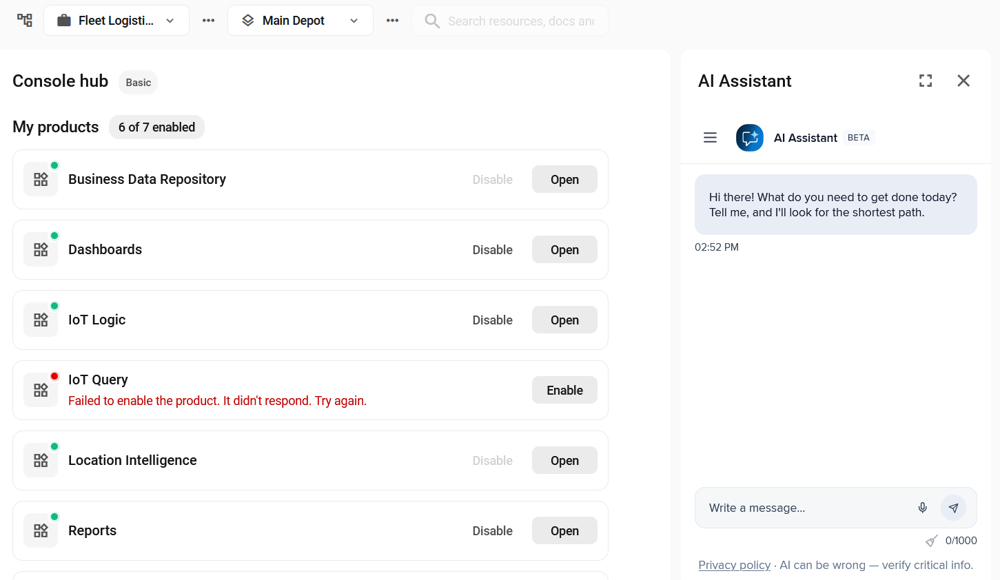

# Navixy AI Assistant

Ask about your fleet in plain language while you work, and the assistant answers from your live data. Navixy AI Assistant is a chat built into the Navixy platform. It needs no setup, no API key, and no AI client of your own.

<figure><figcaption>
The AI Assistant in Console
</figcaption></figure>


Navixy AI assistant is tailored to the product it accompanies. Certain supported features may be unavailable depending on where you ask the question.


Open the assistant and enter your question, or click the microphone icon and say it out loud. The assistant answers in the language of your question.

## What you can ask

The assistant answers from the live data of your workspace. In [Console](https://app.gitbook.com/s/9BfYVQ80Aby5RbZ9vQVj/) and [Business Data Repository](https://app.gitbook.com/s/6RLA9o0EecKpLxHiaeR4/products/bdr), you can ask about assets, devices, positions, trips, sensor readings, and geo objects. The assistant can also make calculations based on your data and show you the result as a table or a chart.

Here are some of the questions you may ask:

* "Where are my assets right now?"
* "Show me the trips of Volvo FH 4521 yesterday."
* "How did the fuel level of Volvo FH 4521 change this week?"
* "Which assets are inside the Main depot geo object?"

You can also ask the assistant to create an asset or an asset type. The assistant prepares the change, and nothing is created until you confirm it.

When you aren't sure what to ask, ask the assistant what it can do.

## What the assistant can see

The assistant's answers depend on your access and on the product where you open it. Keep these points in mind when you work with it:

* The assistant works in your own account. It sees only what your roles allow. To learn more about roles and access rights, see [Users and roles](https://app.gitbook.com/s/9BfYVQ80Aby5RbZ9vQVj/users-and-roles) in the Console documentation.
* The assistant depends on product context. Some product-specific features are only available if you open the assistant on the product's page.
* The assistant supports resuming conversations. You can start a new conversation or go back to an earlier one.


The assistant runs on a language model, and a language model can make mistakes. Check important answers in Navixy before you act on them.


## AI Assistant in the legacy Navixy 3 platform

The [legacy Navixy 3 platform](https://app.gitbook.com/s/446mKak1zDrGv70ahuYZ/) and its [Admin Panel](https://app.gitbook.com/s/KdgeXg71LpaDrwexQYwp/) have an AI Assistant of their own. It answers questions about Navixy features, GPS devices, and the Navixy APIs from the Navixy documentation. It also answers from the live data of your account: your trackers and their routes in the platform, and your users, trackers, tariff plans, and billing in its Admin Panel.

To open it in the platform, click the assistant in the lower-right corner of the screen. In its Admin Panel, select it on the sidebar. To learn more, see [Navixy AI Assistant](https://navixy.com/docs/navixy-mcp/navixy-ai-assistant).

## Ask a question from your own AI client

To ask about your fleet from Claude, Cursor, or another AI client that you already use, you'll connect the client with Navixy MCP Server. Navixy MCP Server is coming soon.

## See also

* [Navixy Documentation MCP Server](../use-navixy-documentation-with-ai.md): Give your AI client access to the Navixy documentation.
