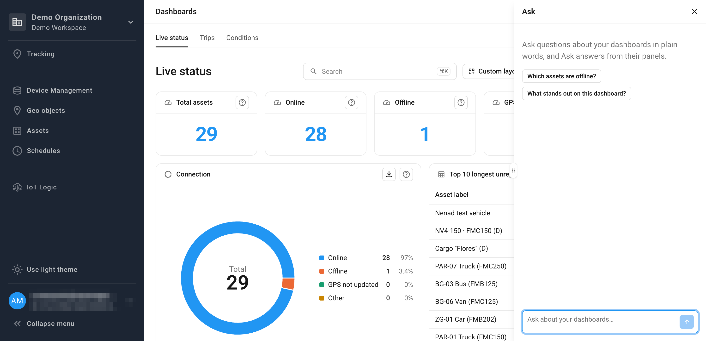

# Ask AI in Dashboards

**Ask AI**, or Ask, answers questions about your dashboards in plain language. For example, ask which assets are offline, which asset drove the most, or what changed since the previous period. Ask replies with the figures and their units. It's Navixy AI Assistant in [Dashboards](https://app.gitbook.com/s/6RLA9o0EecKpLxHiaeR4/products/dashboards), and it works on every dashboard.


**Access**

Anyone who can open Dashboards can use **Ask AI**. Ask has no access settings of its own. It reads only the dashboards that your roles let you open, and only the assets and GPS devices that your roles let you see. To learn who can open Dashboards, see [Access to Dashboards](https://app.gitbook.com/s/6RLA9o0EecKpLxHiaeR4/products/dashboards#access-to-dashboards).


<figure><figcaption>
The Ask panel next to the Live status dashboard, with its example questions
</figcaption></figure>

Here's what you can do:

* Ask about the dashboard on screen or another dashboard, in [Questions that Ask answers](#questions-that-ask-answers).
* See the panels, figures, and maps that a reply shows, and open a proposed report, in [What a reply shows](#what-a-reply-shows).
* Compare a period with the period before it, in [Comparison with the previous period](#comparison-with-the-previous-period).
* Learn which data Ask doesn't read, in [What Ask doesn't read](#what-ask-doesnt-read).
* Continue or start a conversation, in [Conversations](#conversations).
* Check how many questions you can ask, in [Limits](#limits).
* Dictate a question instead of typing it, in [Dictation](#dictation).
* Find what to do when Ask shows a message, in [Messages in the Ask panel](#messages-in-the-ask-panel).

To open Ask, click **Ask AI** on any dashboard. The **Ask** panel opens next to the dashboard on a screen 1,664 pixels wide or more. On a narrower screen, the panel covers part of the dashboard, and on a phone it fills the screen. To close it, click **Ask AI** again or press Esc. You can drag the edge of the panel to make it wider or narrower, and your browser keeps that width.

The first time that you open the panel, it shows the notice **Ask AI and your data**. The notice says that Ask AI sends your questions and the account data that it needs to answer them. The notice links to the Privacy Policy. Click **I understand** to start asking. **Decline** closes the panel, and the notice shows again the next time that you open it. After you click **I understand**, the notice doesn't show again in Dashboards or Reports, in any workspace, until Navixy changes the notice.

## Questions that Ask answers

Ask answers from your dashboard panels, with the same figures that the panels show you. It reads only the dashboards that your roles let you open, and only the assets and GPS devices that your roles let you see.

Ask knows which dashboard is on screen and which period it shows. A question that names no dashboard or period is about the dashboard and the period on screen. You can also name another dashboard or another period, for example, "Which assets drove the most on Trips over the last 7 days?"

For example, you can ask:

* How many assets are online right now?
* Which assets haven't reported for the longest time?
* Which asset drove the most in the last 14 days?
* How long does a trip take on average?
* Which assets have weak batteries?

A new conversation offers example questions for the dashboard on screen. Click an example to put it in the question box, then edit it or send it.

Above the reply's text, the panel names who answered, for example **Fleet manager** or **Analyst**.

In the reply's text, each figure has its unit: km, km/h, V, or %. Ask gives an altitude in m, and a latitude, longitude, or heading in °. A count or a number, such as engine RPM, has no unit. Ask gives a duration in hours as a decimal number, such as 134.37 h. On the dashboard, the same duration shows as 134 h 22 min.

Ask names assets as the dashboards do. For the [panels without data](https://app.gitbook.com/s/6RLA9o0EecKpLxHiaeR4/products/dashboards/conditions#panels-without-data) on the Conditions dashboard, such as **SOS events**, Ask says that the panel has no data, rather than giving 0.

Ask says what changed, where, and by how much. It doesn't say why a value changed, because the dashboards record no causes.

From a table with one row for each asset, such as **Fleet details**, Ask reads the first 50 rows and counts the remaining rows. For one question, Ask reads up to 5 dashboards or periods. For more dashboards or periods, ask several questions.

## What a reply shows

Under its text, a reply can show up to 4 of the following:

* A dashboard panel, as it looks on the dashboard. Under the panel, the reply shows the dashboard's name. On Trips and Conditions, it also shows the dates that the panel covers.
* Figures that no dashboard panel shows, such as a comparison of two periods. Ask shows them as a tile, a chart, or a table. As on a dashboard panel, you can download the rows as a file.
* A map of the assets that the reply names, with their latest positions.

To open the dashboard for a panel's period, click **Open**. When the dashboard is on screen with another period, the button is **Apply**, and it switches the dashboard to the panel's period. A panel from the dashboard and period on screen has no button, and neither does the panel of the earlier period in a comparison.

A dashboard panel in a reply shows current data, read with your access. After a reload or on a later day, it can show other figures than the reply's text.

A reply can also propose a report in [Reports](https://app.gitbook.com/s/6RLA9o0EecKpLxHiaeR4/products/reports), with the report type, the period, and the assets. Click **Open report** to open the report in Reports, in a new browser tab. To learn how Ask works in Reports, see [Ask AI in Reports](reports.md).

## Comparison with the previous period

Ask compares a period with the period of the same length just before it. For example, it compares the last 7 days with the 7 days before them. For a comparison, Ask reads the dashboard twice: once for the period and once for the period before it.

Every period on a dashboard ends now, so the last 24 hours are part of the last 7 days. For this reason, Ask compares a period with the period before it, and not with a longer period that contains it.

The Live status dashboard shows the current moment and has no periods. Ask gives the current Live status figures and doesn't compare them with an earlier time.

## What Ask doesn't read

Ask reads the **Latitude** and **Longitude** columns of **Fleet details**, so it can give an asset's latest position. It leaves out this data:

* The **Geofences** panel of Live status
* The **Address** and **Current geofence** columns of **Fleet details**
* **Asset trip details** on the Trips dashboard, the list of single trips with their start and end positions

To see an asset on the map, use [Tracking](https://app.gitbook.com/s/6RLA9o0EecKpLxHiaeR4/products/tracking). To look up single trips, use [Asset trip details](https://app.gitbook.com/s/6RLA9o0EecKpLxHiaeR4/products/dashboards/trips#asset-trip-details) or [Reports](https://app.gitbook.com/s/6RLA9o0EecKpLxHiaeR4/products/reports).

## Conversations

Ask keeps your conversation while you work in the same browser tab. You can switch dashboards, close the panel, or reload the page, and the conversation stays. A new browser tab, another browser, or another workspace starts a new conversation. A conversation belongs to you and to one workspace, and no one else can read it.

To start over, click <picture><source srcset="../.gitbook/assets/icons/dashboards-add-dark.svg" media="(prefers-color-scheme: dark)"></picture> at the top of the panel. Ask keeps a conversation for 30 days after its last question.

## Limits

By default, Ask answers up to 50 of your questions in a workspace in 24 hours. A workspace can have a different limit, which applies to each person in it. Dashboards counts your questions separately from [Ask AI in Reports](reports.md). The count includes every question that you sent in the last 24 hours. When you reach the limit, Ask tells you to try again later. You can ask again when the earliest of those questions is more than 24 hours old.

Ask answers one question at a time, and a question can be up to 2,000 characters long. One question can take up to 3 minutes. If Ask doesn't reply in that time, the panel says that Ask couldn't answer.

## Dictation

You can dictate a question instead of typing it. Click <picture><source srcset="../.gitbook/assets/icons/dashboards-mic-dark.svg" media="(prefers-color-scheme: dark)"></picture>, speak for up to 30 seconds, and click <picture><source srcset="../.gitbook/assets/icons/dashboards-stop-dark.svg" media="(prefers-color-scheme: dark)"></picture>. Ask adds the text to the question box, and you can edit it before you send it. Press Esc to cancel a recording.

You can dictate in English, Russian, or Spanish. Choose the language in the menu next to <picture><source srcset="../.gitbook/assets/icons/dashboards-mic-dark.svg" media="(prefers-color-scheme: dark)"></picture>, and your browser keeps your choice.

A phrase is one recording. Ask transcribes up to 100 of your phrases in a workspace in 24 hours. Navixy keeps only each phrase's length, in seconds, not the recording or its text.

## Messages in the Ask panel

When Ask can't reply, or can't show or save its notice, the **Ask** panel shows one of the following messages:

| Message | What to do |
| --- | --- |
| "Ask could not answer this." | Click **Ask again**. If the message appears again, name the dashboard and the period in the question. |
| "Ask is busy. Try again in a minute." | Wait a minute and send the question again. |
| "Ask is still answering your last question." | Wait for the reply to your last question, then send the next question. |
| "You have asked N questions in the last 24 hours, as many as Ask takes. Try again later." | N is your workspace's limit, which is 50 questions in 24 hours by default. Wait until the earliest of those questions is more than 24 hours old. |
| "Ask could not read this question." | Change the question and send it again. A question can be up to 2,000 characters long. |
| "This conversation is gone. Start a new one." | Click <picture><source srcset="../.gitbook/assets/icons/dashboards-add-dark.svg" media="(prefers-color-scheme: dark)"></picture> to start a new conversation. |
| "This conversation is gone. Ask keeps a conversation for 30 days after its last question." | Click **New conversation**. |
| "This conversation could not be read." | Click **Try again**. If the message appears again, start a new conversation with <picture><source srcset="../.gitbook/assets/icons/dashboards-add-dark.svg" media="(prefers-color-scheme: dark)"></picture>. |
| "Your answer was not saved. Try again in a minute." | Navixy didn't save your click on **I understand**. Wait a minute and click **I understand** again. |
| "Ask could not check whether you have read its notice." | Click **Try again**. If the message appears again, contact Navixy support. |

When dictation doesn't fill in the question, the panel shows one of the following messages under the question box:

| Message | What to do |
| --- | --- |
| "The browser does not let this page use the microphone. Allow it in the site settings, then try again." | Allow the microphone for Dashboards in your browser's site settings, then click <picture><source srcset="../.gitbook/assets/icons/dashboards-mic-dark.svg" media="(prefers-color-scheme: dark)"></picture> again. |
| "No microphone is available. Connect one, or close the app using it, then try again." | Connect a microphone. If a microphone is connected, close the other app that uses it. |
| "Nothing was heard. Speak closer to the microphone, then try again." | Speak closer to the microphone, and check that the microphone isn't muted. |
| "The text does not fit in the question, which takes 2000 characters. Shorten the question, then dictate again." | Delete part of the text in the question box, then dictate again. |
| "You have dictated N phrases in the last 24 hours, as many as Ask takes. Type the question instead." | You can dictate up to 100 phrases in a workspace in 24 hours. Type the question instead. |
| "Voice input is unavailable right now. Try again later, or type the question." | Try again later, or type the question. |

## See also

* [Live status](https://app.gitbook.com/s/6RLA9o0EecKpLxHiaeR4/products/dashboards/live-status): Learn what the panels of the Live status dashboard show.
* [Trips](https://app.gitbook.com/s/6RLA9o0EecKpLxHiaeR4/products/dashboards/trips): Learn how Navixy detects trips and what the Trips dashboard shows.
* [Conditions](https://app.gitbook.com/s/6RLA9o0EecKpLxHiaeR4/products/dashboards/conditions): Learn what the panels of the Conditions dashboard show.
* [Ask AI in Reports](reports.md): Learn how to ask for a report in plain language.
* [Navixy AI Assistant](README.md): Learn what the assistant answers in each Navixy product.
