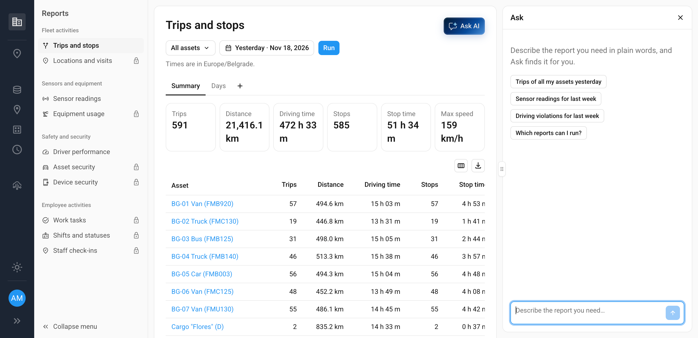
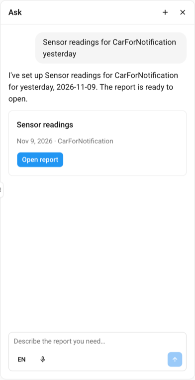

# Ask AI in Reports

**Ask AI**, or Ask, builds a report from a request in plain language. Describe the report that you need, for example the trips of all your assets yesterday, and Ask proposes the report type, the period, and the assets. One click opens and runs the report. It's Navixy AI Assistant in [Reports](https://app.gitbook.com/s/6RLA9o0EecKpLxHiaeR4/products/reports).


**Access**

Anyone who can open Reports can use **Ask AI**. Ask has no access settings of its own. It proposes only the report types that you can run, and it uses only the assets that your roles let you see. To learn who can open Reports, see [Access to Reports](https://app.gitbook.com/s/6RLA9o0EecKpLxHiaeR4/products/reports#access-to-reports).


<figure><figcaption>
The Ask panel next to Trips and stops, with its example questions
</figcaption></figure>

Here's what you can do:

* Ask for a report and open it, in [Report proposals](#report-proposals).
* Dictate a question instead of typing it, in [Dictation](#dictation).
* Continue or start a conversation, in [Conversations](#conversations).
* Have Ask remember a fact, or forget it, in [Memory](#memory).
* Check how many questions you can ask, in [Limits](#limits).
* Find what to do when Ask shows a message, in [Messages in the Ask panel](#messages-in-the-ask-panel).

To open Ask, click **Ask AI** on any page in Reports. The **Ask** panel opens next to the report. To close it, click **Ask AI** again or press Esc. To make the panel wider or narrower, drag the edge of the panel that is next to the report. The browser remembers the width.

The first time that you open the panel, it shows the notice **Ask AI and your data**. The notice says that Ask AI sends your questions and the account data that it needs to answer them. The notice links to the Privacy Policy. Click **I understand** to start asking. **Decline** closes the panel, and the notice shows again the next time that you open it. After you click **I understand**, the notice doesn't show again in Reports or Dashboards, in any workspace, until Navixy changes the notice.

## Report proposals

Ask proposes a report: the report type, the period, and the assets. It works with the report types that you can run.

To ask for a report, follow these steps:

1. In the question box at the bottom of the **Ask** panel, describe the report that you need, for example "Trips of all my assets yesterday". In a new conversation, you can also click one of the examples in the panel. The example appears in the box, where you can change it.
2. Press Enter to send the question. To start a new line instead, press Shift+Enter.
3. Wait while the panel shows **Thinking…**. The reply appears under your question. Above its text, the panel names who answered, for example **Report builder**.
4. If the reply proposes a report, check the report type, the period, and the assets in the proposal, then click **Open report**. If the proposal is for the report that the page shows, the button is **Apply**.

The report opens and runs for the proposal's period and assets. **Apply** changes the report on the page in the same way. On a narrow screen, the panel closes so that the report shows.

<figure><figcaption>
A proposal in the Ask panel: the report type, the period, and the assets, with Open report
</figcaption></figure>

Ask starts from the report that the page shows. You can ask for a change to that report, such as "Add Truck 7" or "The same for last week". The proposal keeps everything that you don't name.

You can name assets by their names. Ask finds an asset by its name only when your roles let you see 200 assets or fewer. With more assets, Ask proposes the report for all assets, and you choose the assets in the report. Replies and proposals name your assets as the report does: by name, or by ID when an asset has no name.

You can name periods in everyday words. "Last week" and the other periods of the period menu cover the same days as in the menu. A proposal follows the rules of the report: at most 31 days and at most 200 assets chosen one by one. Ask can also tell you which reports you can run.

Ask can answer with figures from **Trips and stops** and **Sensor readings**, such as the distance that each asset drove. The figures are totals for the period: for all the assets, for each asset, or for each sensor. Ask doesn't list single trips, stops, or sensor readings. To see them, open the report.

For **Driver performance**, Ask can describe the report and propose it, but answers no figures from it. Its proposal opens the report for all violation types.

## Dictation

You can speak your question instead of typing it. To dictate, you need a microphone, and your browser needs permission to use it.

To dictate, click <picture><source srcset="../.gitbook/assets/icons/reports-mic-dark.svg" media="(prefers-color-scheme: dark)"></picture>, speak, and click <picture><source srcset="../.gitbook/assets/icons/reports-stop-dark.svg" media="(prefers-color-scheme: dark)"></picture>. A clock shows how long you have spoken. After 30 seconds, the recording stops by itself. To cancel the recording, press Esc. The panel shows **Transcribing…**, and the text appears in the question box, after anything that you typed. Check the text, change it if needed, and send the question.

You can dictate in English, Russian, or Spanish. The language mark in the question box, for example **EN**, shows the language to speak. To change the language, click the mark and choose a language. The browser remembers your choice. Speech in another language becomes wrong text. If the text doesn't appear, see the dictation messages in [Messages in the Ask panel](#messages-in-the-ask-panel).

## Conversations

Ask keeps your conversation while you work in the same browser tab. You can move between reports, close the panel, or reload the page, and the conversation stays. A new browser tab, another browser, or another workspace starts a new conversation. A conversation belongs to you and to one workspace, and no one else can read it.

To start a new conversation, click <picture><source srcset="../.gitbook/assets/icons/reports-add-dark.svg" media="(prefers-color-scheme: dark)"></picture> at the top of the panel. Ask keeps a conversation for 30 days after its last question.

## Memory

Ask can remember facts that you tell it and uses them in later conversations. To make Ask remember a fact, say so in your question, for example "Remember that Van 7 is our spare vehicle." Ask keeps your 20 latest facts in a workspace, even after the conversation ends. A new fact replaces the oldest fact. Your facts belong to you and to one workspace, and no one else gets them.

When Ask offers to forget a fact, the panel shows the fact under the reply, under **Ask remembers**. To forget the fact, check it and click **Forget**. The fact then shows **Forgotten.** You can't undo **Forget**. Typing "yes" in the conversation doesn't forget the fact: only **Forget** does.

## Limits

By default, Ask answers up to 50 of your questions in a workspace in 24 hours. A workspace can have a different limit, which applies to each person in it. Reports counts your questions separately from [Ask AI in Dashboards](dashboards.md). The count includes every question that you sent in the last 24 hours. When you reach the limit, Ask tells you to try again later.

Ask answers one question at a time, and a question can be up to 2,000 characters long. One question can take up to 3 minutes. If Ask doesn't reply in that time, the panel says that Ask couldn't answer.

A phrase is one recording. You can dictate up to 100 phrases in a workspace in 24 hours.

## Messages in the Ask panel

When Ask can't reply, or can't show or save its notice, the **Ask** panel shows one of the following messages:

| Message | What to do |
| --- | --- |
| "Ask could not answer this." | Click **Ask again**. If the message appears again, change the question, for example name the report type, the period, and the assets. |
| "Ask is busy. Try again in a minute." | Wait a minute and send the question again. |
| "Ask is still answering your last question." | Wait for the reply to your last question, then send the next question. |
| "You have asked N questions in the last 24 hours, as many as Ask takes. Try again later." | N is your workspace's limit, which is 50 questions in 24 hours by default. Wait until the earliest of those questions is more than 24 hours old. |
| "Ask could not read this question." | Reload the page and send the question again. If the message appears again, contact Navixy support. |
| "This conversation is gone. Start a new one." | Click <picture><source srcset="../.gitbook/assets/icons/reports-add-dark.svg" media="(prefers-color-scheme: dark)"></picture> to start a new conversation. |
| "This conversation is gone. Ask keeps a conversation for 30 days after its last question." | Click **New conversation**. |
| "This conversation could not be read." | Click **Try again**. If the message appears again, start a new conversation with <picture><source srcset="../.gitbook/assets/icons/reports-add-dark.svg" media="(prefers-color-scheme: dark)"></picture>. |
| "Your answer was not saved. Try again in a minute." | Navixy didn't save your click on **I understand**. Wait a minute and click **I understand** again. |
| "Ask could not check whether you have read its notice." | Click **Try again**. If the message appears again, contact Navixy support. |

When a fact under a reply, under **Ask remembers**, can't be shown or forgotten, it shows one of the following messages:

| Message | What to do |
| --- | --- |
| "This could not be loaded." | If the message shows **Try again**, click it. If the message appears again, contact Navixy support. |
| "Ask could not forget this. Try again." | Click **Forget** again. |
| "Ask could not forget this." | Ask can't forget this fact for you. Contact Navixy support. |
| "Ask no longer remembers this." | Ask has already forgotten this fact: you clicked **Forget** on another copy of it, or 20 newer facts replaced it. You don't need to do anything. |

When dictation doesn't fill in the question, the panel shows one of the following messages under the question box:

| Message | What to do |
| --- | --- |
| "The browser does not let this page use the microphone. Allow it in the site settings, then try again." | Allow the microphone for Reports in your browser's site settings, then click <picture><source srcset="../.gitbook/assets/icons/reports-mic-dark.svg" media="(prefers-color-scheme: dark)"></picture> again. |
| "No microphone is available. Connect one, or close the app using it, then try again." | Connect a microphone. If a microphone is connected, close the other app that uses it. |
| "Nothing was heard. Speak closer to the microphone, then try again." | Speak closer to the microphone, and check that the microphone isn't muted. |
| "The text does not fit in the question, which takes 2000 characters. Shorten the question, then dictate again." | Delete part of the text in the question box, then dictate again. |
| "You have dictated N phrases in the last 24 hours, as many as Ask takes. Type the question instead." | You can dictate up to 100 phrases in a workspace in 24 hours. Type the question instead. |
| "Voice input is unavailable right now. Try again later, or type the question." | Try again later, or type the question. |

## See also

* [Manage reports](https://app.gitbook.com/s/6RLA9o0EecKpLxHiaeR4/products/reports/manage-reports): Run a report, choose its period, and download its tables.
* [Ask AI in Dashboards](dashboards.md): Learn which questions the assistant answers about your dashboards.
* [Navixy AI Assistant](README.md): Learn what the assistant answers in each Navixy product.
