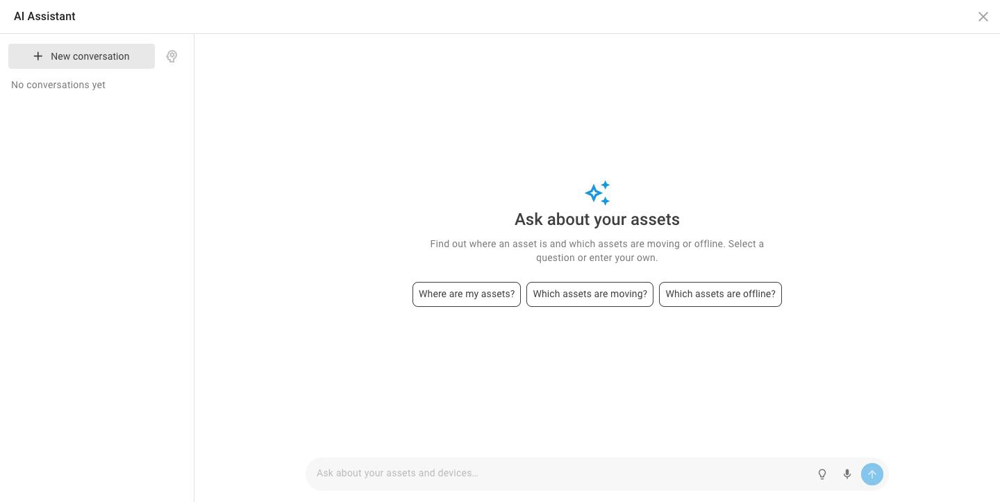

# AI Assistant in Tracking and Business Data Repository

Ask where your assets are, which of them are moving or offline, or how a truck's fuel level changed yesterday. The answer comes with a map, a trip timeline, or a chart. Navixy AI Assistant in [Tracking](https://app.gitbook.com/s/6RLA9o0EecKpLxHiaeR4/products/tracking) and [Business Data Repository](https://app.gitbook.com/s/6RLA9o0EecKpLxHiaeR4/products/bdr) answers from the live data of your workspace. It can also prepare a new asset or a new asset type, which you then create with one click.

The assistant is the same in both products. It answers the same questions, and your conversations and the facts that it remembers are the same in Tracking and in Business Data Repository.


**Access**

Anyone who can open Tracking or Business Data Repository can use the assistant. The assistant shows only the assets, devices, and data that your roles let you see.


<figure><figcaption>
AI Assistant in Business Data Repository, before the first question
</figcaption></figure>

Here's what you can do:

* Learn which questions the assistant answers, in [Questions that the assistant answers](#questions-that-the-assistant-answers).
* Pick a question that the assistant answers for sure, in [Suggested questions](#suggested-questions).
* Have the assistant prepare a new asset or type, in [New assets and types](#new-assets-and-types).
* Learn which data the assistant reads, in [What the assistant can see](#what-the-assistant-can-see).
* Continue or delete a conversation, in [Conversations](#conversations).
* Make the assistant remember your units or your names for assets, in [Memory](#memory).
* Check how much you can ask, in [Limits](#limits).
* Dictate a question instead of typing it, in [Dictation](#dictation).
* Find what to do when the assistant doesn't answer, in [Messages in the assistant window](#messages-in-the-assistant-window).

To open the assistant, click **AI Assistant** on the right edge of the window in Tracking or in Business Data Repository. The button has an icon and shows its name when you point to it. The assistant opens over the whole window. To close it, click <picture><source srcset="../.gitbook/assets/icons/close-dark.svg" media="(prefers-color-scheme: dark)"></picture> at the top of the window.

## Questions that the assistant answers

The assistant answers questions about the assets of your workspace, from their live data. Enter a question in the box at the bottom of the window and press Enter. To start a new line instead, press Shift+Enter.

The assistant answers in a few sentences and shows the details next to the answer:

| You ask about | The assistant shows |
| --- | --- |
| Where an asset is, or where all your assets are | A card for each asset with a map, its connection status, and its motion status |
| Which assets are moving, parked, or offline right now | A card for each matching asset, with its position |
| Which assets have been offline since a time, such as yesterday, or which asset has been offline the longest | Up to five assets by name, and how many assets match |
| Which assets haven't moved for a time, such as three days | Up to five assets by name, and how many assets match |
| The trips and stops of one asset, or of up to 20 assets | A trip timeline with the routes on a map, grouped by asset |
| The current fuel level, temperature, ignition, voltage, or odometer of an asset | A card with the current readings, which updates every few seconds |
| How fuel, temperature, or tire readings changed over a period | The readings in text, or a chart |
| Which assets are in a geo object, such as a depot | Up to five assets by name, and how many assets are inside |
| The assets of an asset group | The same answer as for other assets, for the assets of that group only |
| Harsh acceleration, harsh braking, harsh turns, and SOS events of one asset | How many events of each kind were recorded, and when |
| A chart, such as the mileage per day or the assets by motion status | A bar, line, or pie chart, with a table of its values |

For example, you can ask:

* Which assets have been offline since yesterday?
* Show the trips of Truck 7 yesterday.
* How did the fuel level of Truck 7 change this week?
* Which assets are at the Main depot?
* Show a chart of the mileage per day of Truck 7 for the last week.

You can get the data as a table instead of a card or a chart. Ask for it in the question, for example "Show the current readings of all trucks as a table".

When you name an asset, the assistant finds it by a part of its name or its license plate. If several assets match, the assistant shows them in a list and asks which asset you mean. Click the asset in the list to continue.

The assistant answers in the language of your last question, and gives times in your time zone. A period such as "yesterday" runs from 00:00 to 24:00 in your time zone. A question about trips that names no period covers the last two days.

The assistant answers only about your fleet and Navixy. When you ask about something else, such as the weather, the assistant says that it can't help with it and suggests what it can do. When you ask for something that it can't do, such as sending a command to a GPS device, the assistant says so.

## Suggested questions

The assistant keeps a list of questions that it answers for sure. To see it, click <picture><source srcset="../.gitbook/assets/icons/lightbulb-dark.svg" media="(prefers-color-scheme: dark)"></picture> in the question box.

The list groups the questions by topic: location, status, trips, sensor readings, charts, new assets, and memory. To choose a question, use the Up and Down arrow keys, then press Tab to put it in the box. Some questions have a placeholder, such as "asset name or license plate". Replace it with your text. Press Esc to close the list.

A new conversation also offers three questions under **Ask about your assets**. Click one of them to send it.

## New assets and types

The assistant can prepare a new asset, an asset type, or a geo object type. It never creates anything by itself: you check the draft and click **Create**.

When you ask for a new asset, the assistant shows a form under its answer. For example, ask "Add a new asset Truck 12 with the license plate AB 1234". The assistant picks the asset type, and asks which type you mean when your question doesn't make it clear. You can fill in or correct the fields in the form. After you click **Create**, the form says that you created the asset and offers **Show asset**.

If the assistant fills in a field that the form doesn't show, the form lists that field. Such fields aren't saved with the asset: set them in Business Data Repository after you create the asset. If the asset type has a required field that the form can't fill in, the form asks you to create the asset in Business Data Repository instead.

To get an asset type or a geo object type, ask for it and name its fields. For example: "Create an asset type Trailers with the fields Axle count and Last inspection date". The assistant shows a draft of the type under its answer. You can't edit the draft itself. To change it, ask the assistant, for example "Add the field Owner", and the assistant shows a new draft.

A type draft has only the fields that you named. It can't include a field that refers to another record, such as an asset, or a field that stores a shape on the map. Add those fields in Business Data Repository after you create the type.

## What the assistant can see

The assistant works with your own access. It reads only the assets, devices, and data that your roles let you see. Navixy checks your access every time the assistant reads data. When your roles show only some of the workspace's assets, the cards, lists, and timelines say so. To learn more about roles, see [Users and roles](https://app.gitbook.com/s/9BfYVQ80Aby5RbZ9vQVj/users-and-roles) in the Console documentation.

The assistant works in the workspace that you have open. When the data belongs to a product that isn't turned on for your workspace, such as Tracking, the assistant says so.

The assistant reads a limited amount of data for one question:

* For a question about which assets are offline, aren't moving, or are in a geo object, the assistant reads up to 1,000 assets. If your workspace has more, the answer says how many assets the assistant checked, for example 1,000 of 1,240.
* Readings over a period are fuel, temperature, and tire readings only, and only while the asset moves.
* The assistant reads harsh driving events for one asset at a time. It can't rank all your assets by them. Speeding isn't one of these events.
* A trip timeline shows up to 20 assets.
* A chart of trips shows up to 50 assets and a period of up to 400 days.
* A chart of speed over time shows up to 5 assets and a period of up to 7 days.
* A chart of sensor readings shows up to 5 assets and a period of up to 31 days.
* A chart of the current speed or the motion status of your assets shows up to 1,000 assets.

## Conversations

The assistant keeps your conversations, and you can continue any of them later. A conversation belongs to you and to one workspace, and no one else can read it.

The list under **New conversation** shows your 50 latest conversations in the workspace. Click a conversation to open it.

You can also do the following:

* To start a new conversation, click **New conversation**.
* To delete a conversation, point to it and click <picture><source srcset="../.gitbook/assets/icons/delete-dark.svg" media="(prefers-color-scheme: dark)"></picture>, then confirm. You can't undo it.
* To stop an answer, click <picture><source srcset="../.gitbook/assets/icons/stop-dark.svg" media="(prefers-color-scheme: dark)"></picture> in the question box.
* To rate an answer, click <picture><source srcset="../.gitbook/assets/icons/thumb_up-dark.svg" media="(prefers-color-scheme: dark)"></picture> or <picture><source srcset="../.gitbook/assets/icons/thumb_down-dark.svg" media="(prefers-color-scheme: dark)"></picture> under it. After you click <picture><source srcset="../.gitbook/assets/icons/thumb_down-dark.svg" media="(prefers-color-scheme: dark)"></picture>, you can also add a comment of up to 2,000 characters and click **Send**.

Navixy deletes the messages of a conversation 90 days after they were sent. Navixy deletes a conversation that has no new messages for 90 days.

## Memory

The assistant can remember facts that you give it and use them in all your conversations in the workspace. For example, it can remember the units that you use, your favorite assets, other names for your assets, and short notes. To make the assistant remember a fact, say so, for example "Remember that I measure distances in miles". The assistant saves only what you ask it to remember.

To see what the assistant remembers, click <picture><source srcset="../.gitbook/assets/icons/psychology-dark.svg" media="(prefers-color-scheme: dark)"></picture> next to **New conversation**. To delete a fact, click <picture><source srcset="../.gitbook/assets/icons/delete-dark.svg" media="(prefers-color-scheme: dark)"></picture> next to it, then confirm. You can't undo it. You can also ask the assistant to forget a fact.

The assistant remembers up to 50 facts for you in a workspace. When you ask it to remember more, the assistant asks which facts to forget first.

Navixy deletes a fact that hasn't changed for 90 days, unless you have a conversation in the workspace that changed in the last 90 days.

## Limits

A question can be up to 4,000 characters long. The assistant answers one question at a time. To ask the next question, wait for the answer or stop it.

The assistant has a daily limit for each person in a workspace, and a limit for the whole workspace. The limit counts the work that the assistant does to answer, not the number of questions. A question about many assets uses more of the limit than a short question. When you're close to the limit, the window says so. When you reach it, the window says when you can ask again. The limit resets at 00:00 UTC.

One answer can take up to 3 minutes. If the assistant doesn't answer in that time, the window says that it failed to get a response.

## Dictation

You can dictate a question instead of typing it. Click <picture><source srcset="../.gitbook/assets/icons/mic-dark.svg" media="(prefers-color-scheme: dark)"></picture> in the question box and speak. To finish, click <picture><source srcset="../.gitbook/assets/icons/stop_circle-dark.svg" media="(prefers-color-scheme: dark)"></picture>. A recording stops by itself after 60 seconds. The text appears in the box, where you can change it before you send it.

Speak in the language of your browser. The assistant uses that language to turn speech into text. You can dictate up to 30 minutes in a day in a workspace. The limit resets at 00:00 UTC.

When Navixy can't turn your speech into text, your browser does it for the next 5 minutes, if the browser can.

## Messages in the assistant window

When the assistant doesn't answer, the window shows one of the following messages:

| Message | What to do |
| --- | --- |
| "Failed to get a response." | Click **Retry**. If the message appears again, ask a shorter question, for example about fewer assets or a shorter period. |
| "Failed to send the message. Try again." | Send the question again. |
| "You're close to the daily AI Assistant limit." | Keep asking. When you reach the limit, the assistant stops answering until the time that the window shows. |
| "Daily AI Assistant limit reached" | Wait until the time that the window shows, and ask again. |
| "No connection to AI Assistant. Reconnecting…" | Wait. The window connects again by itself. If the message stays, check your internet connection. |
| "Failed to load AI Assistant. Reload the page and try again." | Reload the page and open the assistant again. |
| "Failed to load conversations." | Close the assistant and open it again. |
| "Conversation not found" | The conversation was deleted. Click **New conversation**. |

When dictation doesn't fill in the question, the window shows one of the following messages:

| Message | What to do |
| --- | --- |
| "Allow microphone access in your browser to dictate messages." | Allow the microphone for Navixy in your browser's site settings, then dictate again. |
| "Microphone not found" | Connect a microphone, then dictate again. |
| "Failed to recognize speech. Try again." | Speak closer to the microphone, and check that the microphone isn't muted. |
| "Voice input doesn't support your browser's language." | Type the question, or change your browser's language. |
| "Speech recognition is unavailable. Dictate the message again to use your browser's speech recognition." | Dictate the question again. |
| "Daily voice input limit reached" | Type the question, or dictate again after the time that the window shows. |

## See also

* [Users and roles](https://app.gitbook.com/s/9BfYVQ80Aby5RbZ9vQVj/users-and-roles): Learn how roles decide which assets and data you can see.
* [Tracking](https://app.gitbook.com/s/6RLA9o0EecKpLxHiaeR4/products/tracking): Learn how to follow your assets on the map and look at their trips.
* [Business Data Repository](https://app.gitbook.com/s/6RLA9o0EecKpLxHiaeR4/products/bdr): Learn how to work with assets, asset types, and geo objects.
