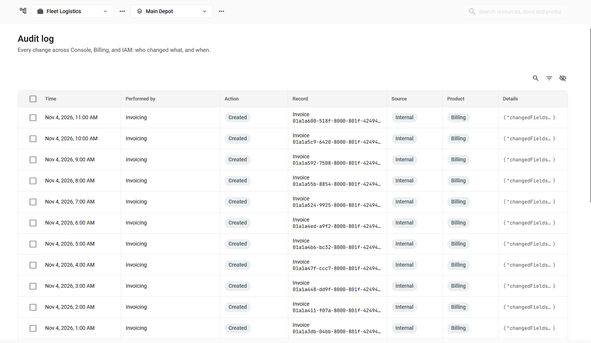

# Audit log

**Audit log** shows who changed your organization's setup and when. It covers organizations and workspaces, users, roles and invitations, API keys, and plans and payments. Use it to find out who removed a member, which role an API key received, or when a workspace was renamed. The page shows the events of the organization that you selected in the top navigation bar. To open it, click **Audit log** on the sidebar.

Any member can open the page. Each product shows its events only if your role allows you to read them. For example, to see Console events, you need the Owner role or a role that includes the Console product, and so on. When your role covers every workspace of the organization, the page shows all Billing events related to them. Otherwise, it shows the Billing events of the selected workspace. When a product's events can't be loaded, the page lists other products' events.

<figure><figcaption>
The Audit log page
</figcaption></figure>

Here's what you can do in **Audit log**:

* Find events: The list shows the newest events first. Click <picture><source srcset="../.gitbook/assets/icons/search-dark.svg" media="(prefers-color-scheme: dark)"></picture> to search by person or app name, record, or trace ID, or <picture><source srcset="../.gitbook/assets/icons/filter_list-dark.svg" media="(prefers-color-scheme: dark)"></picture> to filter the list. See [Search and filters](./#search-and-filters).
* Open an event: Click <picture><source srcset="../.gitbook/assets/icons/open_in_full-dark.svg" media="(prefers-color-scheme: dark)"></picture> in the event's **Time** cell to open its details. They show who made the change, which record changed, where the request came from, and the data that changed. See [Event details](./#event-details).
* See related events: One action, such as creating an API key, can change several records. From the event's details, **View related events** lists every event that the same request caused.
* Export events: Select the events and click **Export to CSV** or **Export to JSON** in the bar that appears. See [Export](./#export).
* Hide columns: <picture><source srcset="../.gitbook/assets/icons/visibility_off-dark.svg" media="(prefers-color-scheme: dark)"></picture> hides any column except **Time**. The choice is saved in your browser.

The list shows the 1,000 most recent events for each product. To see older events, narrow down the list with a filter or a search, which looks through every event.

## What the audit log records

Each product records its own changes, in the same format. An event describes one change to one record: who made it, what happened, and the values before and after.

<table><thead><tr><th width="103.7999267578125">Product</th><th>Records</th></tr></thead><tbody><tr><td><strong>Console</strong></td><td><ul><li>Organizations: created, changed, attached to a parent organization, detached, deleted. </li><li>Workspaces: created, renamed or changed, a request to enable or disable a product, a requested or completed termination. </li><li>Members: renamed, removed. Invitations: sent, accepted, revoked, expired. API keys: created, deleted.</li></ul></td></tr><tr><td><strong>IAM</strong></td><td><ul><li>Roles: created, changed, deleted.</li><li>Role assignments: a role given to a person or an API key, reissued with another expiration date, revoked, expired, or ended with the membership.</li><li>Security profiles: created, changed, deleted. Access limits: deleted.</li></ul></td></tr><tr><td><strong>Billing</strong></td><td><ul><li>Created and changed plans and their parts.</li><li>Subscriptions: a workspace subscribed to a plan or a cancelled subscription. Issued invoices.</li><li>Payments and balance corrections that Navixy added manually.</li></ul></td></tr></tbody></table>

The audit log doesn't record sign-ins and sign-outs, or what people viewed. It also doesn't show changes to business data, such as devices, assets, and geo objects. Those changes are recorded in the workspace's own log, which developers read through the Navixy GraphQL API. See [Audit log](https://app.gitbook.com/s/eaPUYn5ATRhY1fALtOkq/audit-log) in the API documentation.

A person stays the author of their changes after they leave the organization. There is no time limit for stored events.

## Event list

The audit log's event list has these columns:

<table><thead><tr><th width="135">Column</th><th>Description</th></tr></thead><tbody><tr><td><strong>Time</strong></td><td>When the change happened, in your browser's time zone. Click a column heading to sort the list by that column. The sorting covers the events that the page has loaded.</td></tr><tr><td><strong>Performed by</strong></td><td>Who made the change: member or API key. <strong>Staff</strong> means a Navixy employee. For a change that Navixy made on its own, it shows the service that made it, such as <strong>Invoicing</strong> or <strong>System</strong>. <strong>Unknown</strong> means that Console has no record of the person or key, and their ID is shown instead.</td></tr><tr><td><strong>Action</strong></td><td>What happened to the record: <strong>Created</strong>, <strong>Updated</strong>, <strong>Deleted</strong>, or <strong>Restored</strong>.</td></tr><tr><td><strong>Record</strong></td><td>What changed: the record type, such as <strong>Workspace</strong>, <strong>Role assignment</strong>, or <strong>API key</strong>, with its ID under it.</td></tr><tr><td><strong>Source</strong></td><td>Where the change came from: <strong>API</strong> for a person in Console, an app, or Navixy staff, <strong>AI agent</strong> for a change that an AI assistant made, <strong>Internal</strong> for a change that Navixy made on its own. A product can also record <strong>Web</strong>, <strong>Mobile</strong>, or <strong>Integration</strong>.</td></tr><tr><td><strong>Product</strong></td><td>The product that recorded the event: <strong>Console</strong>, <strong>IAM</strong>, or <strong>Billing</strong>.</td></tr><tr><td><strong>Details</strong></td><td>A preview of the changed data. Click to see it in JSON format and copy it.</td></tr></tbody></table>

Change the organization or the workspace in the top navigation bar to reload the list and clear the search and the filters.

## Event details

The details panel shows everything that was recorded about one change. Its title is the record type, with the time of the change under it. It opens when you click <picture><source srcset="../.gitbook/assets/icons/open_in_full-dark.svg" media="(prefers-color-scheme: dark)"></picture> in the event's **Time** cell.

<table><thead><tr><th width="154.199951171875">Section</th><th>Description</th></tr></thead><tbody><tr><td><strong>Event ID</strong></td><td>The ID of the event. Click <picture><source srcset="../.gitbook/assets/icons/content_copy-dark.svg" media="(prefers-color-scheme: dark)"></picture> to copy it for a support request or for a developer.</td></tr><tr><td><strong>Performed by</strong></td><td>Who made the change, with the <strong>Source</strong> and the <strong>Product</strong>.</td></tr><tr><td><strong>Record</strong></td><td>The <strong>Action</strong>, the <strong>Type</strong> of the record that changed, and its <strong>ID</strong>, with <picture><source srcset="../.gitbook/assets/icons/content_copy-dark.svg" media="(prefers-color-scheme: dark)"></picture> to copy it. For a workspace or a person, it's the same ID that Console shows on their page.</td></tr><tr><td><strong>Request</strong></td><td>The <strong>IP address</strong> and the <strong>User agent</strong> of the request, when they are known. The <strong>Trace ID</strong> identifies the request that caused the change. Every change that one request made has the same trace ID, and a developer can use it to find the request in the app's own logs. Click <picture><source srcset="../.gitbook/assets/icons/content_copy-dark.svg" media="(prefers-color-scheme: dark)"></picture> to copy it.</td></tr><tr><td><strong>Event data</strong></td><td>The changed fields with their old and new values and the record's state before and after the change. The data is shown as the product recorded it, so the field names are the product's own, not the labels you see in Console.</td></tr></tbody></table>

**View related events** shows only when the event has a trace ID. Clicking it closes the panel, clears the search and the filters, and sets a **Trace ID** filter with the event's trace ID, so the list shows every event with that ID. A request that didn't send a trace ID receives one from Navixy, so that related events can be found.

## Search and filters

The search finds events based on the member or API key name, record ID or type, or trace ID. It looks through every event of the organization, not only the events shown on screen. The search also finds the names of the removed members. Navixy staff and services are found only when one of their events is already in the list.

The filters narrow the list by one or several of these fields:

<table><thead><tr><th width="161.4000244140625">Filter</th><th>Value</th></tr></thead><tbody><tr><td><strong>Date</strong></td><td>A period in whole days, in your browser's time zone. Select one day to see only that day.</td></tr><tr><td><strong>Product</strong></td><td>One or more of the three products (Console, IAM, Billing).</td></tr><tr><td><strong>Action</strong></td><td>One or more of the four actions.</td></tr><tr><td><strong>Record type</strong></td><td>One or more types. The list shows only those that belong to already loaded events.</td></tr><tr><td><strong>Record ID</strong></td><td>An ID, or part of one. Copy it from the page of a workspace or a person, or from another event.</td></tr><tr><td><strong>Source</strong></td><td>One or more sources. The list shows only those that belong to already loaded events.</td></tr><tr><td><strong>Performed by</strong></td><td>One or more members, API keys, or services. The list shows only those that belong to already loaded events.</td></tr><tr><td><strong>Trace ID</strong></td><td>A trace ID or part of one.</td></tr></tbody></table>

Each filter can be used once. The filters combine: an event must match every filter you set. A text value takes up to 255 characters, with no tabs or line breaks. When nothing matches the search and the filters, the list says so, and **Clear filters** removes all of them.

## Export

Select the events to export. The bar that appears shows how many are selected and the options **Export to CSV** and **Export to JSON**. You can select events on one page at a time, so a file contains at most one page of events, up to 100 with the largest page size. The files are named `audit-log.csv` and `audit-log.json`. They contain the values as the products recorded them, not the labels you see in Console. For example, the product is `iam`, not `IAM`, and the action is `CREATED`, not `Created`.

## See also

* [Investigate changes](investigate-changes.md): Find who changed a workspace, a role, or an API key, the other changes that the same request made, and what to pass to a developer.
* [Users and roles](../users-and-roles/): Learn how users, roles, and invitations work.
* [API keys](../api-keys/): Learn what an API key can do and when Console deletes it.
* [Audit log](https://app.gitbook.com/s/eaPUYn5ATRhY1fALtOkq/audit-log) in Navixy GraphQL API: Learn how developers read the same events, and the events of business data, through the API.

