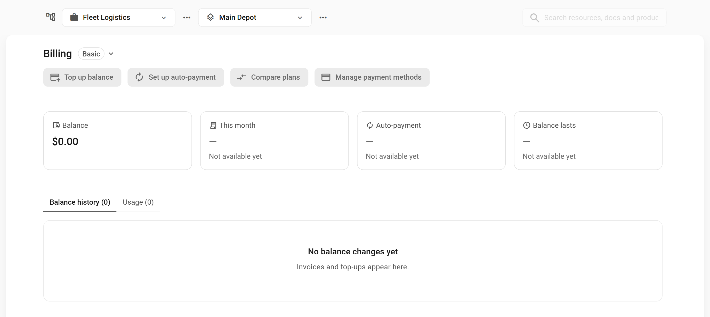

# Billing

**Billing** is where you see a workspace's tariff plans, its balance, and how the balance changes. The page shows the workspace that you selected in the top navigation bar. To open it, click **Billing** on the sidebar. To see the plans, you need the Owner role or a role that includes the **Console** product.

<figure><figcaption>
The Billing page
</figcaption></figure>

Here's what you can do:

- See the workspace's plans: The label next to the title names the workspace's plan. Click it to see the active plans, each with the number of products that it covers.
- Check the balance: **Balance** displays how much money the workspace has. A negative balance is red.
- Follow the balance: **Balance history** lists every change to the balance, such as an invoice, a top-up, or a manual correction, with its date, its amount, and the balance after it.
- See the usage: **Usage** shows what each enabled product used in a period, by metric. <picture><source srcset="../.gitbook/assets/icons/filter_list-dark.svg" media="(prefers-color-scheme: dark)"></picture> narrows down the list to one product or one metric.
- Hide columns: <picture><source srcset="../.gitbook/assets/icons/visibility_off-dark.svg" media="(prefers-color-scheme: dark)"></picture> hides any column of **Balance history** or **Usage** except the first one. The choice is saved in your browser.

You can't top up the balance, set up auto-payment, compare plans, or manage payment methods in Console: these four buttons are dimmed. To change a workspace's plan, contact <sales@navixy.com>.
