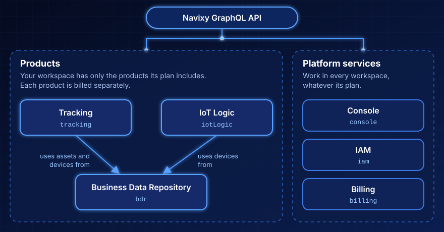

# Overview


Navixy GraphQL API is separate from the RESTful [Navixy API](https://navixy.com/docs/navixy-api/). The two APIs have different endpoints, authentication, and data models. Use the REST documentation for the Platform API and the Admin Panel API, and this space for the GraphQL API.


**Navixy GraphQL API** is the programming interface of several Navixy products and of the platform services that run your account. Not every Navixy product is described here: some products have no API, and some have an API of their own. Each product based on this API has a separate section: you can read about your workspace's products and ignore the rest. All products share one endpoint, one access token, and one way of sending requests.

The API is based on GraphQL. Every request is an HTTP POST to one endpoint, authenticated with an OpenID Connect access token. The endpoint is `https://nvx4.eu.navixy.com/api/graphql`. To send your first request, see [Getting started](getting-started.md). For the token, see [Authentication](authentication.md). If you're new to GraphQL, start with [GraphQL basics](graphql-basics/).

<figure><figcaption></figcaption></figure>

## Key concepts

These terms apply to every part of the API. Each product and platform service defines its own terms on its overview page.

<table><thead><tr><th width="200">Term</th><th>Definition</th></tr></thead><tbody><tr><td><strong>Organization</strong></td><td>A company's account in Navixy Console, with its own workspaces, members, and roles. One person can belong to several organizations, including child organizations that a channel partner created for its customers.</td></tr><tr><td><strong>Workspace</strong></td><td>The space that holds the data of one customer and has its own set of products. Your access token names the workspace, so most operations take no workspace ID. Navixy Console creates workspaces.</td></tr><tr><td><strong>Product</strong></td><td>A part of Navixy that a workspace has or doesn't have, such as Business Data Repository or Tracking. The plan of the workspace decides which products it can have, and each product is billed separately. Each product that this API serves has its own field in the schema.</td></tr><tr><td><strong>Platform service</strong></td><td>A part of the API that works for every workspace, whatever its plan: Console, IAM, and Billing. The platform services manage your account: its organizations and workspaces, its roles, and its plans.</td></tr><tr><td><strong>Access token</strong></td><td>A signed JSON Web Token from the Navixy identity service. It names your organization and your workspace and lists the products of your workspace. Every request sends it in the <code>Authorization</code> header.</td></tr></tbody></table>

## Products

A product works only in a workspace that has access to it. Your access token lists your workspace's products, and the API rejects operations with a product not on the list. See [What your roles and products allow](authentication.md#what-your-roles-and-products-allow).

Products are billed separately, but they can use each other's records. Tracking and IoT Logic work with the records stored by Business Data Repository, Tracking can use its assets and devices, and IoT Logic can use its devices.

### Business Data Repository

[Business Data Repository](business-data-repository/) manages your workspace's business data: the assets you track, their types and groups, GPS devices and inventories, geo objects, and schedules. You can add your own custom fields and lists and see who changed a record in the audit log.

### Tracking

[Tracking](tracking/) answers where your assets are and what their devices report. It returns the live state of assets and devices, follows that state as it changes, and calculates trips and stops from device messages.

### IoT Logic

[IoT Logic](iot-logic/) holds your workspace's flows. A flow processes your devices' messages as they arrive, for example, to calculate a value that a device doesn't send. You can list, create, change, and delete flows and choose the devices whose messages enter each flow.

## Platform services

The platform services work in every workspace, regardless of which products it has.

### Console

[Console](console/) shows the organizations you belong to, the workspaces you can reach, and the workspace's products. You can enable or disable a product covered by the workspace's plan.

[IAM](iam/) (identity and access management) stores your organization's roles: what access each role gives and who holds it. You can create and change roles and assign them to members or revoke them.

### Billing

[Billing](billing/) keeps what your workspace pays for: the plans it can subscribe to, subscriptions, prepaid balance with the statement, and the usage that products reported for it.

## How requests work

Every operation is nested under the field of its product or platform service, and the response has the same shape. The following query reads the title of your workspace through the Business Data Repository product:

```graphql
query {
  bdr {
    workspace {
      title
    }
  }
}
```

```json
{
  "data": {
    "bdr": {
      "workspace": {
        "title": "Northwind Logistics"
      }
    }
  }
}
```

Send the query in the `query` field of a JSON body, with any variables in the `variables` field. [Getting started](getting-started.md) shows the full HTTP request.

## Shared API resources

The pages at the top of this space apply to every product and platform service. They state the rules that every product follows, so the product pages don't repeat them:

* [GraphQL basics](graphql-basics/): GraphQL for developers who know REST, record IDs and the `node` query, and how subscriptions connect. See also [tips and patterns](graphql-basics/graphql-tips-and-patterns.md).
* [Getting started](getting-started.md): Your first authenticated requests.
* [Authentication](authentication.md): How to obtain and send an access token, and what your roles and products allow.
* [Pagination](pagination.md) and [Filtering and sorting](filtering-and-sorting/): How to page through list results and narrow them down.
* [Error handling](error-handling.md): Error structure, every error code, and how one request can partly fail.
* [Optimistic locking](optimistic-locking.md): How the API prevents concurrent updates from overwriting each other.
* [Deleting records](deletion.md): What a delete does, which references block it, and what you can't get back.
* [Limits](limits.md): Request rate, subscription, pagination, and input size limits.

## Developer resources

* [Public GraphQL schema](developer-resources/public-graphql-schema.md): The full type system, one file for the shared types and one per product.
* [Introspection](graphql-basics/#introspection): Explore the schema from your own GraphQL client.

## Explore the API

<table data-view="cards"><thead><tr><th></th><th></th><th></th><th data-hidden data-card-target data-type="content-ref"></th></tr></thead><tbody><tr><td><h3><i class="fa-database">:database:</i></h3></td><td><strong>Business Data Repository</strong></td><td>Store and change assets, devices, geo objects, schedules, and your own fields and lists.</td><td><a href="business-data-repository/">business-data-repository</a></td></tr><tr><td><h3><i class="fa-location-arrow">:location-arrow:</i></h3></td><td><strong>Tracking</strong></td><td>Read where your assets are, follow their state as it changes, and get their trips and stops.</td><td><a href="tracking/">tracking</a></td></tr><tr><td><h3><i class="fa-diagram-project">:diagram-project:</i></h3></td><td><strong>IoT Logic</strong></td><td>Create the flows that process your devices' messages, and choose which devices enter each flow.</td><td><a href="iot-logic/">iot-logic</a></td></tr><tr><td><h3><i class="fa-building">:building:</i></h3></td><td><strong>Console</strong></td><td>See your organizations and workspaces, and enable or disable the products of a workspace.</td><td><a href="console/">console</a></td></tr><tr><td><h3><i class="fa-user-shield">:user-shield:</i></h3></td><td><strong>IAM</strong></td><td>Create roles, decide what each one gives access to, and assign them to members.</td><td><a href="iam/">iam</a></td></tr><tr><td><h3><i class="fa-credit-card">:credit-card:</i></h3></td><td><strong>Billing</strong></td><td>Choose a plan, subscribe your workspace, and read its balance and reported usage.</td><td><a href="billing/">billing</a></td></tr></tbody></table>
