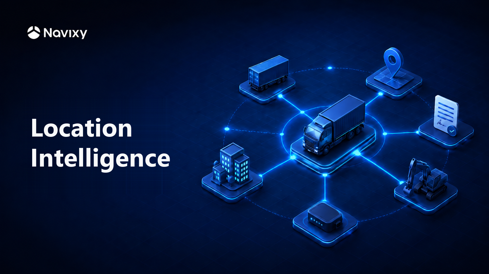

# Location Intelligence

<figure><figcaption></figcaption></figure>

A fleet business needs different tools for different jobs: connecting GPS devices, following vehicles on the map, and reporting on what they did. Location Intelligence is the shared interface of the Navixy products. Every product opens from the same menu and works on the data of the same workspace. The menu shows the products that your workspace includes, and each product does one job.

## What each product does

### Business Data Repository

Business Data Repository stores your fleet's business data: what you track, the places that matter to it, and its working hours. In the menu, you open its three parts separately, as **Assets**, **Geo objects**, and **Schedules**.

* **Assets:** Describe your vehicles, people, and containers. Each asset is based on an asset type, which decides the properties that the asset has, such as a license plate or an inspection date. You can start from the preset types Vehicle, Workforce, and Cargo, or build your own. You assign GPS devices to assets, so the data that a device sends is about the van, not about the device.
* **Geo objects:** Draw depots, customer sites, and delivery zones on the map as points, lines, or areas. You create the geo object types that you need, each with its own properties. You can assign a geo object to an asset, such as a van's home depot.
* **Schedules:** Describe a depot's opening hours, a vehicle's service window, or a team's shift. A schedule can happen once or regularly, such as every Monday, and you can assign it to any number of assets and geo objects.

### Device Management

Device Management connects GPS devices to Navixy. You activate a device in one form. You select the model, then enter the SIM card's phone number, the mobile carrier's access point name (APN), and the device's IMEI. Navixy then sends the device its settings by SMS, so you don't configure the device by hand.

The device page shows the progress of each activation until the device connects. If the device doesn't connect, the page lists the possible causes and lets you send the settings again. In the device list, you can find a device by its name or its IMEI.

### Tracking

Tracking shows your assets on the map at their current position. For each asset, you see whether it's moving, idling, stopped, or parked, or whether it's offline, and when it sent its last message. The asset's details also show its coordinates and the readings of its sensors.

You can filter the assets by status, group them by asset group, and show your geo objects on the same map. **Trip history** shows the trips that an asset made over a period that you choose.

### IoT Logic

IoT Logic changes device data as it arrives, before anything else uses it. You build a flow on a canvas. You drag in the steps that you want and join them with lines, and the data follows the lines. No programming is needed.

A flow can calculate values that a device doesn't send, such as litres from a raw sensor count. It can compare a reading with the last twelve values of the same attribute. That way, you know that fuel fell by 40 litres, not only that it is at 40 litres. A flow can also send messages different ways, depending on what they contain, and send the result to other systems.

### Reports

Reports shows what your assets did over a period. You choose a report, the assets, and a period, and Reports builds a table with totals that you can sort, filter, and export.

* **Trips & Stops** lists every trip of every asset: when and where it started and ended, its distance and duration, and the average and maximum speed. It also shows how long each asset stood still between trips.
* **Sensor readings** shows the values that your assets' GPS devices sent over the period, such as fuel level or temperature. For each value, it shows the lowest, highest, and average reading.

You can save a report and export it to an Excel file or a PDF. A report shows data up to the moment when you generate it.

### Dashboards

Dashboards shows ready-made dashboards for the whole fleet, so you don't build them or write queries.

* **Live status** counts your assets by connection status and by movement, and lists the assets that haven't reported the longest. It reloads its data every 90 seconds.
* **Trips, 14 days** adds up the trips, distance, and driving time of the last 14 days, and ranks the assets by distance, number of trips, and top speed.
* **Conditions, 14 days** shows where GPS accuracy is poor and lists the fault codes that vehicles report. It also marks the batteries and power supplies whose voltage drops below their own 14-day average.

You can export a dashboard to PDF, or a single panel to CSV or Excel.

### IoT Query Premium

[IoT Query Premium](https://app.gitbook.com/o/YVLWhgAwCZPoU5vlRsCs/s/75iUkTidqKcVcd2J49aB/), which gives you SQL access to your data, is coming soon.

## How the products can work together

The products can use each other's data, so something that you set up in one product can appear in another. For example, you can assign a GPS device from Device Management to a vehicle in Assets. Tracking, Reports, and Dashboards can then show that vehicle under its own name, with the data of its device.

## Who it is for

Location Intelligence is for the people who run a fleet every day: fleet managers, dispatchers, installers, and maintenance managers. It's also for the telematics service providers and integrators who set up Navixy for these fleets.

## Access to products

What you can do in Location Intelligence depends on the products of your workspace and on your roles. Your roles decide which records you see in each product and what you can do with them. The people who set up your workspace decide both. [Access and roles](access-and-roles.md) explains what a role can limit in each product and what you see when something isn't allowed.

## Where to start

To go from a GPS device in a box to a vehicle on the map, follow [Getting started](getting-started.md). It uses Device Management, Assets, and Tracking. To start with one product, choose it under [Products](./#products).

## Products

<table data-view="cards"><thead><tr><th></th><th></th><th></th><th data-hidden data-card-target data-type="content-ref"></th></tr></thead><tbody><tr><td><h3><i class="fa-database">:database:</i></h3></td><td><strong>Business Data Repository</strong></td><td>Describe your assets, geo objects, and schedules, and assign GPS devices to your assets.</td><td><a href="bdr/">bdr</a></td></tr><tr><td><h3><i class="fa-tower-broadcast">:tower-broadcast:</i></h3></td><td><strong>Device Management</strong></td><td>Activate GPS devices and follow each one until it connects.</td><td><a href="device-management/">device-management</a></td></tr><tr><td><h3><i class="fa-location-arrow">:location-arrow:</i></h3></td><td><strong>Tracking</strong></td><td>Follow your assets on the map, with their status, readings, and trips.</td><td><a href="tracking/">tracking</a></td></tr><tr><td><h3><i class="fa-diagram-project">:diagram-project:</i></h3></td><td><strong>IoT Logic</strong></td><td>Process device data as it arrives: calculate values and send the data where it's needed.</td><td><a href="iot-logic/">iot-logic</a></td></tr><tr><td><h3><i class="fa-file-lines">:file-lines:</i></h3></td><td><strong>Reports</strong></td><td>See the trips, stops, and sensor readings of your assets over a period, and export them.</td><td><a href="reports/">reports</a></td></tr><tr><td><h3><i class="fa-chart-line">:chart-line:</i></h3></td><td><strong>Dashboards</strong></td><td>See the state of the whole fleet, its trips, and its device health in ready-made dashboards.</td><td><a href="dashboards/">dashboards</a></td></tr></tbody></table>
