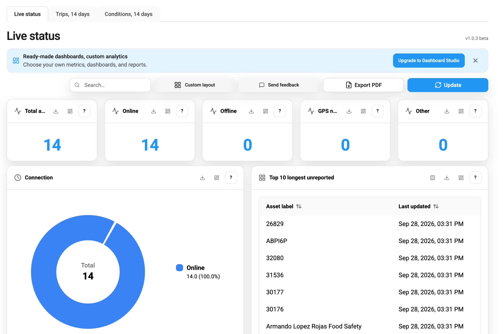

# Dashboards

Dashboards answers the questions that a fleet team asks every day about the whole fleet. Which assets stopped reporting this morning, which vehicles drove the most in the last 14 days, and which GPS device batteries are losing charge? Its ready-to-use views show the whole fleet from the data that your GPS devices send, so you don't build or set up anything. They complement [Tracking](../tracking/), which shows where each asset is now.

<figure><figcaption>Live status, the first of the three dashboards</figcaption></figure>

## What you can do with Dashboards

**See the state of the whole fleet in one place.** At the start of a shift, [Live status](live-status.md) counts your assets by connection status and by movement. It lists the assets that haven't reported the longest and shows which assets are inside each geofence.

**See how the fleet was used.** For a weekly review, [Trips, 14 days](trips.md) adds up the trips, distance, and driving time of the last 14 days. It ranks assets by distance, by the number of trips, and by top speed, and it lists the trips with their start and end.

**Watch the health of vehicles and GPS devices.** When you plan maintenance, [Conditions, 14 days](conditions.md) shows where GPS accuracy is poor and lists the fault codes that vehicles report. It also marks GPS device batteries and vehicle power supplies whose voltage drops below their own 14-day average.

On every dashboard, you can hide and arrange the panels, save the dashboard as a PDF file, and save the data of a panel as a CSV or Excel file. To report a problem or suggest a change, click **Send feedback**. [Search, layout, and export](dashboard-tools.md) describes these tools.


**Navigation**

Dashboards is a product of Location Intelligence. Open it from the platform menu.


## Who it is for

Dashboards is for teams that look after a whole fleet rather than a single vehicle:

* A dispatcher checks the fleet during a shift, without opening each asset on the map.
* A fleet manager reviews how vehicles were used, without generating a report first.
* A maintenance manager watches the health of vehicles and devices, without checking each GPS device.
* Operations teams and executives see the whole fleet's numbers in one place, without asking an analyst for them.

Everyone who works in the same workspace sees the same data, in the office on a computer or in the field on a phone. Each person arranges the panels for their own job, in their own browser.

To choose your own metrics and build your own dashboards, use Dashboard Studio, the AI dashboard builder of [IoT Query Premium](https://app.gitbook.com/s/75iUkTidqKcVcd2J49aB/), which is coming soon. You describe a dashboard in plain language, and its AI assistant builds it, so you can start without writing SQL. You can [request access to Dashboard Studio](dashboard-tools.md#dashboard-studio) from any dashboard.

## Core concepts

* **Dashboard:** A set of panels on one tab. Dashboards is a set of three tabs, with one dashboard on each.
* **Panel:** One number, chart, or table on a dashboard. The **?** in the panel header explains what the panel shows.
* **Asset:** The vehicle, person, or other thing that you track, as you describe it in [Business Data Repository](../bdr/). Most counts on a dashboard are counts of assets, and most table rows are assets. Some panels count trips or device events instead, or list geofences. An asset gets its data from the GPS devices assigned to it.
* **Workspace:** A dashboard shows the assets of the workspace that you work in. You don't choose a workspace in Dashboards.
* **Period:** Every dashboard covers a fixed period that counts back from now. Live status shows the current moment and the last 24 hours. The two other dashboards show the last 14 days. A dashboard has no date picker. For other periods, use [Reports](../reports/).
* **Status update:** Navixy records the connection and movement status of an asset with each message from its GPS device. It also records a status update when the connection status changes because no message arrived.

Each of the three dashboards answers its own question:

| Dashboard | Question it answers | Period |
| --- | --- | --- |
| [**Live status**](live-status.md) | What is the fleet doing now, and which assets stopped reporting? | Now and the last 24 hours |
| [**Trips, 14 days**](trips.md) | How was the fleet used, and which vehicles drove the most? | The last 14 days |
| [**Conditions, 14 days**](conditions.md) | Which vehicles and GPS devices need attention? | The last 14 days |

The language of the dashboards and the measurement units of distance and speed follow your settings in Navixy Console. Times show in the time zone of your browser.

Navixy calculates every value in metric units and converts distance and speed when it shows them. Each value in a table shows its unit, such as 25 mph. The rules on these pages, such as moving above 3 km/h and trips of at least 50 m, are given in metric units, whatever units you use.

## How current the data is

The Navixy platform updates each part of the data at a different rate:

* **Connection status:** Navixy updates it with each message that a GPS device sends, and again after 5 minutes and after 1 hour without a message.
* **Movement status:** Navixy updates it only when a message arrives. An asset whose device stopped sending keeps the movement status of its last message.
* **Geofences:** Navixy updates which assets are inside each geofence every 30 minutes.
* **Trips:** Navixy builds trips every 4 hours, and a trip appears only after it ends. A vehicle that is driving now has no trip for this drive yet. For the details, see [How Navixy detects a trip](trips.md#how-navixy-detects-a-trip).
* **Sensor values:** Navixy updates the battery, voltage, odometer, and RPM values every 4 hours. So they can be several hours older than the connection status.
* **A new device:** After you assign a device to an asset, the dashboards can take up to 30 minutes to show the asset with that device.

A dashboard reloads its data every 90 seconds. To reload it immediately, click **Update**.

## Access to Dashboards

Dashboards is in the menu when your workspace includes it and one of your roles includes Dashboards. A role gives access to Dashboards as a whole, with all three dashboards.

The dashboards show the data of all the assets of the workspace. A role that lets you see only some assets in **Assets** doesn't change what a dashboard shows. To learn more, see [Access and roles](../access-and-roles.md).

## Where to start

Start with [Live status](live-status.md). It shows the current state of the fleet and explains the connection and movement statuses that the other dashboards use.

## Section contents

* [Live status](live-status.md): Learn what each panel on the Live status dashboard shows and what the connection and movement statuses mean.
* [Trips, 14 days](trips.md): Learn how Navixy detects trips and what the totals, rankings, and trip list on the Trips dashboard show.
* [Conditions, 14 days](conditions.md): Learn how the Conditions dashboard rates GPS accuracy and power supply and which device data each panel needs.
* [Search, layout, and export](dashboard-tools.md): Learn how to search a dashboard, hide and arrange panels, export data, send feedback, and request Dashboard Studio.
