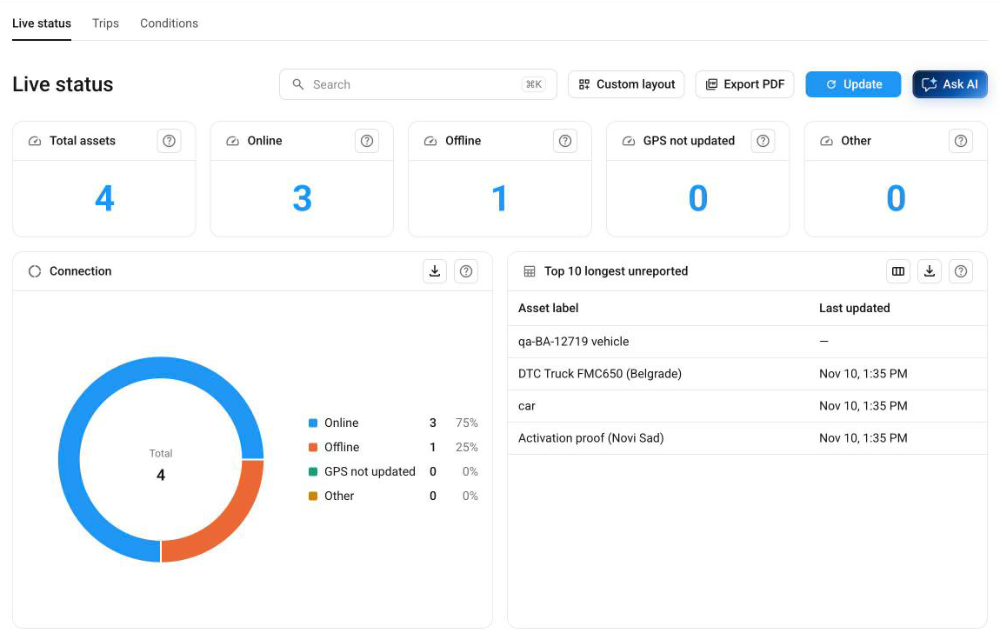

# Dashboards

Dashboards answers the questions that a fleet team asks every day about the whole fleet. Which assets stopped reporting this morning, which vehicles drove the most in the last 14 days, and which GPS device batteries are losing charge? Its ready-to-use views show the whole fleet from the data that your GPS devices send, so you don't build or set up anything. They complement [Tracking](../tracking/), which shows where each asset is now.

<figure><figcaption>Live status, the first of the three dashboards</figcaption></figure>


**Ask about your dashboards**

Click **Ask AI** on any dashboard and ask about the figures in plain language, for example "Which assets are offline?" or "What changed from the period before?". Navixy AI Assistant answers from the dashboard panels, with the figures and their units.

<a href="https://app.gitbook.com/s/QZR0A6r78SoqVYXZIB0p/navixy-ai-assistant/dashboards" class="button primary">Learn how to use Ask AI</a>


## What you can do with Dashboards

**See the state of the whole fleet in one place.** At the start of a shift, [Live status](live-status.md) counts your assets by connection status and by movement. It lists the assets that haven't reported the longest and shows which assets are inside each geofence.

**See how the fleet was used.** For a weekly review, [Trips](trips.md) adds up the trips, distance, and driving time of a period that you choose, such as the last 7 days. It ranks assets by distance, by the number of trips, and by top speed, and it lists the trips with their start and end.

**Watch the health of vehicles and GPS devices.** When you plan maintenance, [Conditions](conditions.md) shows where GPS accuracy is poor. It also marks GPS device batteries and vehicle power supplies whose voltage drops below their own average for the period.

On every dashboard, you can search, hide, and arrange the panels. You can also print the dashboard or save it as a PDF file, and save a panel's data as a CSV or Excel file. On Trips and Conditions, you also choose the period. [Dashboard tools](dashboard-tools.md) describes these tools.


**Navigation**

Dashboards is a product of Location Intelligence. Open it from the Navixy platform menu.


## Who it is for

Dashboards is for teams that look after a whole fleet rather than a single vehicle:

* A dispatcher checks the fleet during a shift, without opening each asset on the map.
* A fleet manager reviews how vehicles were used, without generating a report first.
* A maintenance manager watches the health of vehicles and devices, without checking each GPS device.
* Operations teams and executives see the whole fleet's numbers in one place, without asking an analyst for them.

Each person sees the assets that their roles let them see. They can open Dashboards in the office on a computer or in the field on a phone. Each person arranges the panels for their own job, in their own browser.

To choose your own metrics and build your own dashboards, use Dashboard Studio, the AI dashboard builder of [IoT Query Premium](https://app.gitbook.com/s/75iUkTidqKcVcd2J49aB/), which is coming soon. You describe a dashboard in plain language, and its AI assistant builds it, so you can start without writing SQL.

## Core concepts

* **Dashboard**: A set of panels on one tab. Dashboards is a set of three tabs, with one dashboard on each.
* **Panel**: One number, chart, or table on a dashboard. The **?** in the panel header explains what the panel shows.
* **Asset**: The vehicle, person, or other thing that you track, as you describe it in [Business Data Repository](../bdr/). Most counts on a dashboard are counts of assets, and most table rows are assets. Some panels count trips or device events instead, or list geofences. An asset gets its data from the GPS devices assigned to it. A dashboard shows an asset by its name, or by its ID when the asset has no name. When two assets have the same name, each name gets a short code, such as "Van (20d35946)".
* **Workspace**: A dashboard shows the assets of the workspace that you work in. You don't choose a workspace in Dashboards.
* **Period**: Trips and Conditions show a period that ends now: 1, 6, 12, or 24 hours, or 7, 14, or 31 days. Both dashboards show the last 14 days when you open them, and you choose another period in the period menu. Live status shows the current moment and the last 24 hours and has no period menu. For a period that doesn't end now, use [Reports](../reports/).
* **Message**: The data that a GPS device sends to Navixy, such as a position, a speed, or a sensor reading. An asset's connection status depends on when its device sent the last message.
* **Ask AI**: A chat next to the dashboard that answers questions about the dashboards from their panels. It's Navixy AI Assistant in Dashboards. To learn how to use it, see [Ask AI in Dashboards](https://app.gitbook.com/s/QZR0A6r78SoqVYXZIB0p/navixy-ai-assistant/dashboards).

Each of the three dashboards answers its own question:

| Dashboard | Question it answers | Period |
| --- | --- | --- |
| [**Live status**](live-status.md) | What is the fleet doing now, and which assets stopped reporting? | Now and the last 24 hours |
| [**Trips**](trips.md) | How was the fleet used, and which vehicles drove the most? | A period that you choose, 14 days by default |
| [**Conditions**](conditions.md) | Which vehicles and GPS devices need attention? | A period that you choose, 14 days by default |

Dashboards shows text in English, distance in kilometers, and speed in km/h. Each value in a table shows its unit. Times show in your browser's time zone.

## How current the data is

The Navixy platform updates each part of the data at a different rate:

* **Connection status:** Navixy sets it from the time of the last message, each time the dashboard loads its data.
* **Movement status:** Navixy updates it only when a message arrives. An asset whose device stopped sending keeps the movement status of its last message.
* **Geofences:** Navixy updates which assets are inside each geofence with each message. The dashboard shows the change when it reloads.
* **Trips:** Navixy builds trips every 4 hours, and a trip appears only after it ends. A vehicle that is driving now has no trip for this drive yet, unless the drive has lasted more than 24 hours. For the details, see [How Navixy detects a trip](trips.md#how-navixy-detects-a-trip).
* **Sensor values:** Navixy updates the battery, voltage, odometer, and RPM values every 4 hours. As a result, these values can be several hours older than the connection status.
* **A new device:** After you assign a device to an asset, the dashboards can take up to 30 minutes to show the asset with that device.

A dashboard reloads its data every 90 seconds. To reload it immediately, click **Update**.

## Access to Dashboards

Dashboards is in the menu when your workspace includes it and one of your roles includes Dashboards. A role can give access to each dashboard on its own, and you see a tab only for the dashboards that your roles include. If your roles include no dashboard, Dashboards says that no dashboard is available to you.

A dashboard shows only the assets, GPS devices, and geo objects, such as geofences, that your roles let you see in [Business Data Repository](../bdr/). So two people in the same workspace can see different numbers on the same panel. Anyone who can open a dashboard can also use [Ask AI](https://app.gitbook.com/s/QZR0A6r78SoqVYXZIB0p/navixy-ai-assistant/dashboards) on it. To learn more, see [Access and roles](../access-and-roles.md).

## Where to start

Start with [Live status](live-status.md). It shows the current state of the fleet and explains the connection and movement statuses that the other dashboards use.

## Section contents

* [Live status](live-status.md): Learn what each panel on the Live status dashboard shows and what the connection and movement statuses mean.
* [Trips](trips.md): Learn how Navixy detects trips and what the totals, rankings, and trip list on the Trips dashboard show.
* [Conditions](conditions.md): Learn how the Conditions dashboard rates GPS accuracy and power supply and which device data each panel needs.
* [Ask AI in Dashboards](https://app.gitbook.com/s/QZR0A6r78SoqVYXZIB0p/navixy-ai-assistant/dashboards): Learn which questions Ask AI answers, how it compares two periods, and what its limits are.
* [Dashboard tools](dashboard-tools.md): Learn how to search a dashboard, hide and arrange panels, sort tables, and export data.
