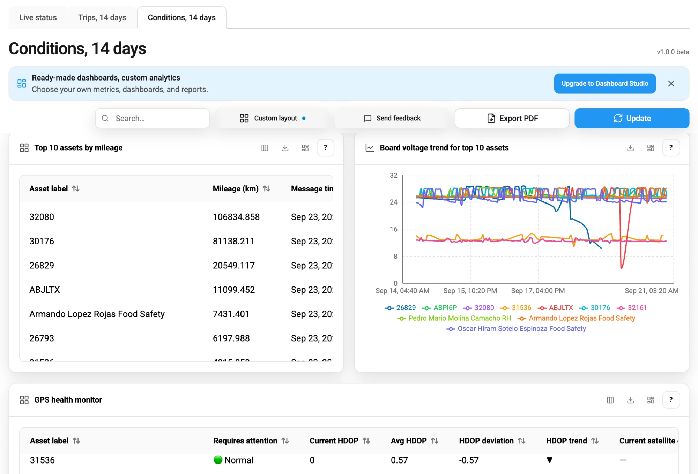

# Conditions, 14 days

**Conditions, 14 days** shows the technical condition of your assets and their GPS devices over the last 14 days. Use it to find devices that stopped reporting and positions with poor accuracy. It also shows batteries and power supplies whose voltage drops, and vehicles that report fault codes. It's the third dashboard in [Dashboards](./).

<figure><figcaption>Mileage, board voltage, and GPS health on the Conditions dashboard</figcaption></figure>

Here's what you can do:

* Count the assets that reported and the fleet events, in [Fleet summary](#fleet-summary).
* Find assets with poor GPS accuracy, in [GPS accuracy](#gps-accuracy).
* Find batteries and power supplies whose voltage drops, in [Battery and vehicle power](#battery-and-vehicle-power).
* Check odometer readings, engine RPM, and speed, in [Mileage, RPM, and speed](#mileage-rpm-and-speed).
* See the fault codes that vehicles report, in [Fault codes](#fault-codes).
* Look up the latest readings of one asset, in [Latest diagnostics](#latest-diagnostics).

## Which data the panels need

Most panels on this dashboard show values that only some GPS devices report. These values are battery level, battery voltage, the voltage of the vehicle power supply, the odometer, and engine RPM. They also include events such as SOS, seatbelt, and fault codes. A panel shows an asset only if the device of the asset reports that value. If no device in your fleet reports a value, the panels for that value stay empty.

Navixy summarizes sensor values in 5-minute periods. The battery, voltage, odometer, and RPM panels show one value for each period: the latest reading, or the highest reading for engine RPM. Navixy updates these values every 4 hours, so they can be several hours older than **Last update** in [Latest diagnostics](#latest-diagnostics).

## Fleet summary

The numbers at the top of the dashboard describe the whole fleet over the last 14 days:

| Panel | What it shows |
| --- | --- |
| **Total assets** | All assets in your workspace. |
| **Active assets** | Assets with at least one status update from their GPS device. Sensor values alone don't make an asset active. |
| **Inactive assets** | **Total assets** minus **Active assets**. |
| **GPS degraded events** | Status updates with poor GPS accuracy, as described in [GPS accuracy](#gps-accuracy). |
| **SOS events** | SOS alarms that devices reported. |
| **Seatbelt events** | Events from the seatbelt sensor that devices reported. |
| **DTC events count** | Fault codes that vehicles reported, as described in [Fault codes](#fault-codes). |

An asset in **Inactive assets** had no status update from its GPS device in 14 days. The panel shows only the number. To find these assets, see **Top 10 longest unreported** on [Live status](live-status.md#assets-that-stopped-reporting), or [Latest diagnostics](#latest-diagnostics) on this dashboard. For each of these assets, check whether its device has power and a connection, or whether the asset has a device assigned at all.

## GPS accuracy

Navixy rates GPS accuracy by HDOP (horizontal dilution of precision), a number that the GPS device reports with each position. The lower it is, the more accurate the position. A value above 5 means a poor position, for example among tall buildings or under a roof.

Two panels count positions with poor accuracy, where HDOP is above 5 or negative, which marks an invalid value:

* **GPS degraded events:** The number of such status updates in the fleet.
* **Top 10 assets by GPS degraded events:** The 10 assets with the most such updates.

A position without any HDOP value isn't counted.

**GPS health monitor** compares the latest HDOP of each asset with its average over 14 days. It shows the current value, the average, the difference between them, and an arrow. The arrow is ▲ when the current value is above the average, ▼ when it's below, and ► when they're equal. Because a lower HDOP is better, ▲ means that accuracy got worse. The **Requires attention** column rates the latest HDOP:

| Rating | Latest HDOP |
| --- | --- |
| ⚫ **No GPS Fix** | Negative, which marks an invalid value. |
| 🔴 **Critical** | Above 5. |
| 🟡 **Warning** | Above 2, up to 5. |
| 🟢 **Normal** | 2 or less. |

The table lists the assets with no GPS fix first, then the assets rated critical, warning, and normal. An asset whose GPS device sends no HDOP value is rated **Normal**.

## Battery and vehicle power

Two voltages describe the power of an asset:

* **Battery voltage:** The voltage of the built-in battery of the GPS device. In a device mounted in a vehicle, this battery usually keeps the device working when the vehicle power is lost. In a portable device, it's usually the main power source.
* **Board voltage:** The voltage of the vehicle power supply that the device is connected to. It's usually about 12 V in a car and about 24 V in a truck.

Two line charts show the voltage over the last 14 days:

* **Battery voltage trend for top 10 assets:** The 10 assets with the lowest current battery voltage.
* **Board voltage trend for top 10 assets:** The 10 assets with the lowest current board voltage.

A drop on a line can mean a failing power supply. A slow decline of the battery voltage can mean a battery that no longer holds its charge.

Dashboards doesn't detect power cuts. **Board voltage trend for top 10 assets** leaves out readings of 0 V, and assets whose latest board voltage is 0 V. A cut that the GPS device reports as 0 V therefore appears as a gap in the line, or the asset is missing from the chart. **Latest diagnostics** shows the latest board voltage as the device reported it.

**Battery power supply health monitor** and **Board power supply health monitor** compare the current voltage of each asset with its own average over 14 days. They show the current and average voltage, the difference, the change in %, and a trend arrow. The **Requires attention** column rates the change:

| Rating | Current voltage compared with the average |
| --- | --- |
| 🔴 **Critical** | 20% or more below the average. |
| 🟡 **Warning** | 10% to 20% below the average. |
| 🟢 **Normal** | Less than 10% below the average, or above it. |

The assets with the largest drop come first. The monitors ignore readings below 1 V and above 50 V, because Navixy treats them as sensor errors.

Because the monitors compare each asset with its own average, they rate a car at 12 V and a truck at 24 V the same way.

## Mileage, RPM, and speed

These panels show odometer readings, engine RPM, and speed:

* **Top 10 assets by mileage (total odometer):** The 10 assets with the highest odometer reading. **Message time** shows when Navixy last updated the summary with that reading, not when the device sent it.
* **Mileage trend for top 10 assets (total odometer):** The odometer readings of the same 10 assets over the last 14 days.
* **Top 10 events by RPM:** The 10 highest engine RPM values in the fleet, with the asset and the time. Each row is one 5-minute period, so one asset can fill several rows.
* **Speed trend for top 10 assets:** The top speed per hour of the 10 assets with the lowest current speed above zero.

Mileage and speed use the units from your settings in Navixy Console: kilometers or miles. The column headers name the unit, such as **Mileage (km)**.

## Fault codes

A fault code, or DTC (diagnostic trouble code), is a code that the vehicle reports through its diagnostic interface when it detects a fault. For example, `P0301` means an engine misfire. The GPS device reads the code from the vehicle and sends it to Navixy.

**Assets with active fault codes** lists every fault code of the last 14 days, the most recent first. It shows the asset, the time in **Created at**, and the code in **DTC code**. **Error description** shows the kind of code that the device reported, such as `j1939_dtc`. It doesn't explain the fault: look up the code in the documentation of the vehicle.

## Latest diagnostics

**Latest diagnostics** shows the latest readings of every asset, with the most recent update first. It has one row for each GPS device of an asset and shows up to 600 rows:

| Column | What it shows |
| --- | --- |
| **Asset label**, **Last update** | The asset, and the time of its latest status update. |
| **Battery level %**, **Battery voltage** | The charge and the voltage of the built-in battery of the GPS device. |
| **Board voltage** | The voltage of the vehicle power supply. |
| **HDOP** | GPS accuracy of the latest position. |
| **Mileage**, **RPM**, **Max speed** | The latest odometer reading, the latest engine RPM, and the latest speed. |

The table has more columns, which always show the same value: **Satellites**, **DTC codes**, and **Max acceleration** show "—", and **DTC events**, **SOS events**, and **Seatbelt events** show 0. For the fault codes, see [Fault codes](#fault-codes). For the SOS and seatbelt events, see [Fleet summary](#fleet-summary). To choose which columns you see, use **Columns** in the panel header.

## See also

* [Live status](live-status.md): Learn which assets report right now and what the connection statuses mean.
* [Trips, 14 days](trips.md): Learn how the fleet was used over the last 14 days.
* [Search, layout, and export](dashboard-tools.md): Learn how to choose columns and export the data of a panel.
