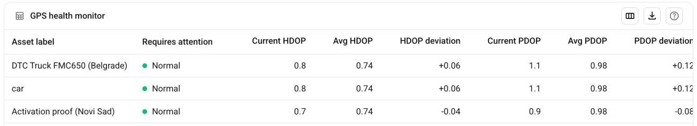

# Conditions

**Conditions** shows the technical condition of your assets and their GPS devices in a period that you choose, the last 14 days by default. Use it to find devices that stopped reporting and positions with poor accuracy. It also shows batteries and power supplies whose voltage drops. It's the third dashboard in [Dashboards](./).

<figure><figcaption>GPS health of three assets on the Conditions dashboard</figcaption></figure>

Here's what you can do:

* Count the assets that reported and the hours with poor GPS accuracy, in [Fleet summary](#fleet-summary).
* Find assets with poor GPS accuracy, in [GPS accuracy](#gps-accuracy).
* Find batteries and power supplies whose voltage drops, in [Battery and vehicle power](#battery-and-vehicle-power).
* Check odometer readings, engine RPM, and speed, in [Mileage, RPM, and speed](#mileage-rpm-and-speed).
* Learn which panels show no data, in [Panels without data](#panels-without-data).
* Look up the latest readings of one asset, in [Latest diagnostics](#latest-diagnostics).

## Which data the panels need

Most panels on this dashboard show values that only some GPS devices report. These values are battery level, battery voltage, the voltage of the vehicle power supply, the odometer, and engine RPM. A panel shows an asset only if the asset's device reports that value. If no device in your fleet reports a value, the panels for that value stay empty.

Choose the period in the period menu: 1, 6, 12, or 24 hours, or 7, 14, or 31 days. Every panel shows data for the period, except **Total assets**.

Navixy summarizes sensor values in 5-minute intervals. A trend shows one point for every 5 minutes when you choose a period in hours, and one point for every hour when you choose a period in days. Navixy updates these values every 4 hours, so they can be several hours older than **Last update** in [Latest diagnostics](#latest-diagnostics).

## Fleet summary

The numbers at the top of the dashboard describe the whole fleet over the period:

| Panel | What it shows |
| --- | --- |
| **Total assets** | The assets that have a GPS device and that your roles let you see. |
| **Active assets** | Assets that sent at least one message in the period. Sensor values alone don't make an asset active. |
| **Inactive assets** | **Total assets** minus **Active assets**. |
| **GPS degraded events** | Hours with poor GPS accuracy, as described in [GPS accuracy](#gps-accuracy). |
| **SOS events** | No data. See [Panels without data](#panels-without-data). |
| **Seatbelt events** | No data. See [Panels without data](#panels-without-data). |
| **DTC events count** | No data. See [Panels without data](#panels-without-data). |

An asset in **Inactive assets** sent no message in the period. The panel shows only the number. To find these assets, see **Top 10 longest unreported** on [Live status](live-status.md#assets-that-stopped-reporting), or [Latest diagnostics](#latest-diagnostics) on this dashboard. For each of these assets, check whether its GPS device has power and a connection.

## GPS accuracy

Navixy rates GPS accuracy by the fix type and by HDOP (horizontal dilution of precision). The fix type says how the GPS device found its position, such as a 3D fix or a 2D fix. HDOP is a number that the device reports with each position: the lower it is, the more accurate the position. A position has poor accuracy when its fix type needs fewer than 4 satellites, or when its HDOP is above 5. Fix types that need fewer than 4 satellites are a 2D fix, no fix, dead reckoning, and a last known position.

Two panels count the hours with poor accuracy:

* **GPS degraded events:** The number of clock hours with poor accuracy, added up over all assets. For each asset, an hour counts once, however many of its positions had poor accuracy.
* **Top 10 assets by GPS degraded events:** The 10 assets with the most such hours.

**GPS health monitor** compares each asset's latest GPS reading with its average over the period. It shows three numbers: HDOP, PDOP (position dilution of precision), and the fewest satellites that the fix type needs. For each number, it shows the current value, the average, and the deviation. A deviation is a signed number, such as +0.42. Because a lower HDOP is better, a positive HDOP deviation means that accuracy got worse. The **Requires attention** column rates the latest reading:

| Rating | Latest GPS reading |
| --- | --- |
| **No GPS fix** | The fix type needs no satellites: no fix, dead reckoning, or a last known position. |
| **Critical** | A 2D fix, or HDOP above 5. |
| **Warning** | HDOP above 2, up to 5. |
| **Normal** | HDOP 2 or less, or no HDOP value. |

The table lists the assets with no GPS fix first, then the assets rated critical, warning, and normal. Within each rating, the highest HDOP comes first. It shows up to 1,000 assets with a GPS reading in the period.

## Battery and vehicle power

Two voltages describe an asset's power:

* **Battery voltage:** The voltage of the GPS device's built-in battery. In a device mounted in a vehicle, this battery usually keeps the device working when the vehicle power is lost. In a portable device, it's usually the main power source.
* **Board voltage:** The voltage of the vehicle power supply that the device is connected to. It's usually about 12 V in a car and about 24 V in a truck.

Two line charts show the voltage over the period:

* **Battery voltage trend for top 10 assets:** The 10 assets with the lowest current battery voltage.
* **Board voltage trend for top 10 assets:** The 10 assets with the lowest current board voltage.

A drop on a line can mean a failing power supply. A slow decline of the battery voltage can mean a battery that no longer holds its charge.

Dashboards doesn't detect power cuts. The two voltage trends leave out every reading at 0 V or below. A cut that the GPS device reports as 0 V therefore appears as a gap in the line. **Latest diagnostics** shows the latest board voltage as the device reported it.

**Battery power supply health monitor** and **Board power supply health monitor** compare each asset's current voltage with its own average over the period. They show the current and average voltage, the difference, and the change in %. The **Requires attention** column rates the change:

| Rating | Current voltage compared with the average |
| --- | --- |
| **Critical** | 20% or more below the average. |
| **Warning** | 10% to 20% below the average. |
| **Normal** | Less than 10% below the average, or above it. |

The assets with the largest drop come first. The monitors ignore readings below 1 V and above 50 V, because Navixy treats them as sensor errors. For an asset with several GPS devices, the monitors show the device that sent the last reading, compared with that device's own average.

Because the monitors compare each asset with its own average, they rate a car at 12 V and a truck at 24 V the same way.

## Mileage, RPM, and speed

These panels show odometer readings, engine RPM, and speed:

* **Top 10 assets by mileage (total odometer):** The 10 assets with the highest odometer reading. **Message time** shows the time of that reading, accurate to 5 minutes.
* **Mileage trend for top 10 assets (total odometer):** The odometer readings of the same 10 assets over the period.
* **Top 10 events by RPM:** The 10 clock hours with the highest engine RPM in the fleet, with the asset and the hour. One asset can fill several rows.
* **Speed trend for top 10 assets:** The top speed of 10 assets. Among the assets that moved in their latest hour with a speed reading, these are the 10 with the lowest top speed in that hour. The line shows the top speed for every 5 minutes over a period in hours, and for every hour over a period in days.

The dashboard shows mileage in kilometers, such as 1,250 km, and speed in km/h.

## Panels without data

Four panels show no data: **SOS events**, **Seatbelt events**, **DTC events count**, and **Assets with active fault codes**. The data that Dashboards reads doesn't include these events. Each panel says so instead of showing a number. The **DTC codes**, **DTC events**, **SOS events**, and **Seatbelt events** columns in [Latest diagnostics](#latest-diagnostics) are for the same events, and they always show "—".

A fault code, or DTC (diagnostic trouble code), is a code that the vehicle reports through its diagnostic interface when it detects a fault. For example, `P0301` means an engine misfire.

## Latest diagnostics

**Latest diagnostics** shows each asset's latest readings, one row for each asset, with the most recent message first. It lists up to 1,000 assets that have a GPS device. Assets without data in the period come last. When an asset has several GPS devices, each value comes from the device that sent it last. The panel has these columns:

| Column | What it shows |
| --- | --- |
| **Asset label**, **Last update** | The asset, and the time of its last message. |
| **Battery level**, **Battery voltage** | The charge and the voltage of the GPS device's built-in battery. |
| **Board voltage** | The voltage of the vehicle power supply. |
| **GSM signal**, **Roaming** | The mobile signal level, on the scale of the device's protocol, and whether the SIM card is in its home network: **Home** or **Roaming**. |
| **HDOP**, **PDOP**, **Min. satellites for fix type** | GPS accuracy of the latest GPS reading, as in [GPS health monitor](#gps-accuracy). |
| **Mileage**, **RPM**, **Max speed** | The latest odometer reading, the highest engine RPM of the latest hour with an RPM reading, and the top speed of the latest hour with a speed reading. |

The **DTC codes**, **DTC events**, **SOS events**, **Seatbelt events**, and **Max acceleration** columns always show "—". To choose which columns you see, use **Columns** in the panel header.

## See also

* [Live status](live-status.md): Learn which assets report right now and what the connection statuses mean.
* [Trips](trips.md): Learn how the fleet was used in a period that you choose.
* [Ask AI in Dashboards](https://app.gitbook.com/s/QZR0A6r78SoqVYXZIB0p/navixy-ai-assistant/dashboards): Learn how to ask about the assets that need attention.
* [Dashboard tools](dashboard-tools.md): Learn how to choose columns and export a panel's data.
