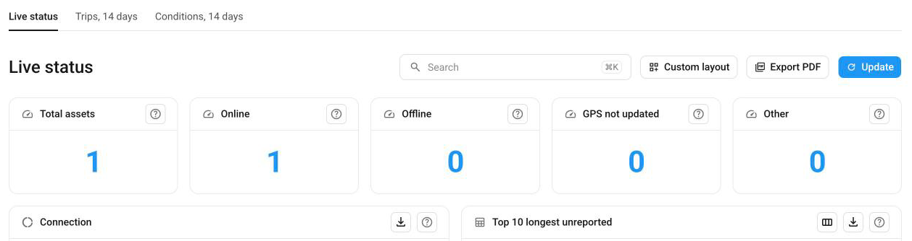

# Search, layout, and export

Every dashboard in [Dashboards](./) has the same tools. You can search it, hide and arrange its panels, choose and sort table columns, export its data, and reload it. This page describes what each tool does and what it changes.

<figure><figcaption>The toolbar and the panel headers of a dashboard</figcaption></figure>

Here's what you can do:

* Find an asset, a value, or a panel, in [Search a dashboard](#search-a-dashboard).
* Hide, move, and resize panels, and hide whole dashboards, in [Custom layout](#custom-layout).
* Choose and sort the columns of a table, in [Table columns](#table-columns).
* Print a dashboard or save the data of a panel, in [Export](#export).
* Reload the data, in [Update](#update).

## Search a dashboard

The search field in the toolbar finds text on the current dashboard. It searches panel titles, the panel explanations under **?**, the values in tables, such as an asset name or a fault code, and the names in charts, such as the bars of a bar chart. It doesn't search the panels that show a single number, or the numbers in charts. Search starts when you stop typing, and capital and small letters count as the same.

Navixy highlights every match, marks the current match with a stronger color, and shows its position, such as "3 of 12". When nothing matches, the field shows "No matches". Use the arrows next to the field, or the keys below, to go from one match to the next.

Search highlights matches and dims the panels that have none. It doesn't filter: the values and totals on the panels stay the same. A dashboard has no filters that narrow its panels to some assets, groups, or geo objects.

| Key | Effect |
| --- | --- |
| **Ctrl+K**, or **⌘K** on a Mac | Moves to the search field. The field shows this shortcut while it's empty. |
| **Enter** | Goes to the next match. |
| **Shift+Enter** | Goes to the previous match. |
| **Esc** | Clears the search. |

Search covers only the panels and columns that you can see. When the current dashboard has no match, the list "Found in titles and help on" shows the other dashboards whose panel titles or **?** texts match, with the number of matches on each. Table values on other dashboards aren't searched. A dashboard in that list opens when you click it.

The search field is hidden while you edit the layout.

## Custom layout

**Custom layout** lets you change how a dashboard looks for you: which panels and dashboards you see, and where the panels are. It doesn't change the data or what other people see. **Custom layout** switches the dashboard to editing, and **Done** ends it. Each change is saved as soon as you make it.

While you edit the layout, you can:

* **Hide** a panel. **Hidden panels** in the toolbar lists the hidden panels, so you can show them again. You can't hide the last visible panel of a dashboard.
* Move a panel by dragging its handle, and resize it by dragging its corner. With the keyboard, the arrow keys on the handle move the panel, and **Shift** with an arrow key resizes it. Panels in the way move down.
* Hide a whole dashboard with the **×** on its tab. **Hidden dashboards** lists the hidden dashboards, so you can show them again. You can't hide the last visible dashboard.
* Undo your changes to the panels of the current dashboard with **Reset layout**, after you confirm with **Reset to default**. Hidden dashboards stay hidden.

Your layout is saved in this browser, for your user account. It isn't available in another browser or on another computer or phone. Another person who signs in to the same browser has their own layout. A dot on **Custom layout** shows that the dashboard differs from its default layout.

On a screen narrower than 1024 pixels, such as a phone or a tablet, you can hide and show panels, but you can't move or resize them.

When Navixy adds panels to a dashboard, the new panels appear below the panels that you arranged.

## Table columns

**Columns** in the header of a table lets you choose which columns you see. At least one column stays visible. When you hide a column, **Show all columns** shows them all again. Hidden columns are also left out of the search, the export, and the printout. The choice is saved in this browser for your user account, like the layout.

To sort a table, click a column header. A table sorts by one column at a time. Text sorts from A to Z first, numbers and times from the highest first, and empty cells come last. The export and the printout keep the order. The table returns to its default order when you reload the page.

## Export

You can print a whole dashboard or save the data of a single panel:

* **Export PDF** in the toolbar opens the print dialog of your browser. To get a PDF file, choose to save as PDF in that dialog. The printout contains the panels that you see, and the date, time, and time zone of the printout. Its tables keep your sorting and leave out the columns that you hid. When a table has more rows than fit in its panel, the printout says how many of them it shows, such as "20 of 140 rows. The CSV or Excel file has them all." **Export PDF** becomes available when every panel has loaded.
* The export button in the header of a panel saves the data of that panel as **CSV** or **Excel (XLSX)**. Every panel with a chart or a table has this button. The file name has the names of the dashboard and the panel, and the date and time of the export. A table exports all its rows, in the order on screen, with the columns that you see. A chart exports all of its data.

In the file, each column header names the unit, such as **Distance (km)**. Times are in the time zone of your browser.

## Update

Every dashboard reloads its data every 90 seconds. It pauses while you are on another browser tab. Nothing on the page shows this automatic reload. **Update** reloads all panels immediately. While the dashboard reloads, the button shows "Updating…" with a spinning icon.

When a panel fails to load, Navixy tries twice more. If it still fails, the panel shows "This panel could not be loaded." Click **Try again** to load that panel again. A panel that already shows data keeps it when a reload fails.

## Phone and tablet

On a screen narrower than 768 pixels, the panels of a dashboard appear in one column, in their order on the dashboard. On a screen from 768 to 1023 pixels wide, they appear in two columns. The tabs of the dashboards scroll sideways on narrow screens.

## See also

* [Live status](live-status.md): Learn what the panels of the Live status dashboard show.
* [Trips, 14 days](trips.md): Learn what the panels of the Trips dashboard show.
* [Conditions, 14 days](conditions.md): Learn what the panels of the Conditions dashboard show.
