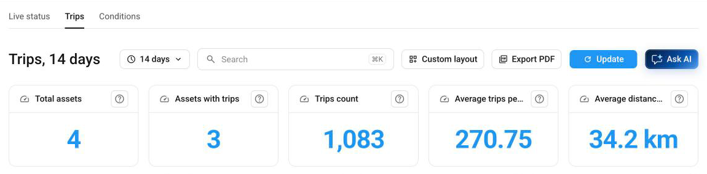

# Dashboard tools

Every dashboard in [Dashboards](./) has the same tools. You can search it, hide and arrange its panels, choose and sort table columns, export its data, and reload it. Trips and Conditions also have a period menu. **Ask AI** opens a chat about the dashboards. To learn how to use the chat, see [Ask AI in Dashboards](https://app.gitbook.com/s/QZR0A6r78SoqVYXZIB0p/navixy-ai-assistant/dashboards). This page describes what each tool does and what it changes.

<figure><figcaption>The toolbar and the panel headers of a dashboard</figcaption></figure>

Here's what you can do:

* Choose the period of Trips and Conditions, in [Period](#period).
* Find an asset, a value, or a panel, in [Search a dashboard](#search-a-dashboard).
* Hide, move, and resize panels, and hide whole dashboards, in [Custom layout](#custom-layout).
* Choose and sort the columns of a table, in [Table columns](#table-columns).
* Print a dashboard or save the data of a panel, in [Export](#export).
* Reload the data, in [Update](#update).

## Period

The period menu on Trips and Conditions sets the period that every panel shows. You can choose 1, 6, 12, or 24 hours, or 7, 14, or 31 days. Each period ends at the current time. Both dashboards open with a period of 14 days.

The dashboard title shows the period, such as "Trips, 7 days". The page address includes the period, so a reload, a link, or **Back** opens the same period. The period applies only to the dashboard on screen. When you open another dashboard, that dashboard opens with a period of 14 days.

Live status has no period menu. It shows the current moment and the last 24 hours.

## Search a dashboard

The search field in the toolbar finds text on the current dashboard. It searches panel titles, the panel explanations under **?**, the values in tables, and the names in charts. Table values include asset names and statuses. Chart names include the bars of a bar chart. It doesn't search the numbers in single-number panels or in charts. Search starts when you stop typing, and capital and small letters count as the same.

Navixy highlights every match, marks the current match with a stronger color, and shows its position, such as "3 of 12". When nothing matches, the field says so. Use the arrows next to the field, or the keys below, to go from one match to the next.

Search highlights matches and dims the panels that have none. It doesn't filter: the values and totals on the panels stay the same. A dashboard has no filters that narrow its panels to some assets, groups, or geo objects.

| Key | Effect |
| --- | --- |
| **Ctrl+K**, or **⌘K** on a Mac | Moves to the search field. On a screen 640 pixels wide or more, the field shows this shortcut while it's empty. |
| **Enter** | Goes to the next match. |
| **Shift+Enter** | Goes to the previous match. |
| **Esc** | Clears the search and leaves the field. |

Search covers only the panels and columns that you can see. When the current dashboard has no match, the **Found in titles and help on** list shows the other dashboards whose panel titles or **?** texts match. The list shows the number of matches on each dashboard. Search doesn't look at table values on other dashboards. To open a dashboard from the list, click it.

The search field is hidden while you edit the layout.

## Custom layout

**Custom layout** lets you change how a dashboard looks for you: which panels and dashboards you see, and where the panels are. It doesn't change the data or what other people see. **Custom layout** switches the dashboard to editing, and **Done** ends it. Navixy saves each change as soon as you make it. While you edit the layout, the other tools in the toolbar are hidden.

While you edit the layout, you can:

* **Hide** a panel. **Hidden panels** in the toolbar lists the hidden panels, so you can show them again. You can't hide the last visible panel of a dashboard.
* Move a panel by dragging its handle, and resize it by dragging its corner. With the keyboard, the arrow keys on the handle move the panel, and **Shift** with an arrow key resizes it. Panels that the moved panel would cover move down.
* Hide a whole dashboard with the **×** on its tab. **Hidden dashboards** lists the hidden dashboards, so you can show them again. You can't hide the last visible dashboard.
* Undo your changes to the panels of the current dashboard: click **Reset layout**, then confirm with **Reset to default**. Hidden dashboards stay hidden.

Navixy saves your layout in this browser, for your user account. The layout is the same in every workspace. It isn't available in another browser or on another computer or phone. Another person who signs in to the same browser has their own layout. A dot on **Custom layout** shows that the dashboard differs from its default layout.

On a screen narrower than 1,024 pixels, such as a phone or a tablet, you can hide and show panels, but you can't move or resize them.

When Navixy adds panels to a dashboard, the new panels appear below the panels that you arranged.

## Table columns

A table with more than one column has **Columns** in its header. **Columns** lets you choose which columns you see. At least one column stays visible. When you hide a column, **Show all columns** shows them all again. The search, the export, and the printout also leave out hidden columns. Navixy saves the choice in this browser for your user account, like the layout.

To sort a table, click a column header. Click it again to reverse the order, and a third time to return to the default order. A table sorts by one column at a time. On the first click, text sorts from A to Z. Numbers and times sort from the highest value, and a rating sorts from the value that needs the most attention. Empty cells come last. The export and the printout keep the order. The table returns to its default order when you reload the page or open another dashboard.

## Export

You can print a whole dashboard or save the data of a single panel:

* **Export PDF** in the toolbar opens your browser's print dialog. To get a PDF file, choose to save as PDF in that dialog. The printout contains the panels that you see. It also shows the date, time, and time zone of the printout. Its tables keep your sorting and leave out the columns that you hid. When a table has more rows than fit in its panel, the printout says how many of the rows it shows and that the CSV or Excel file has them all. **Export PDF** becomes available when every panel has loaded.
* The export button in a panel header saves that panel's data as **CSV** or **Excel (XLSX)**. Every panel with a chart or a table has this button. The button is unavailable while the panel has no data. The file name contains the dashboard title with its period, the panel name, and the export date and time. A table exports all its rows, in the order on screen, with the columns that you see. A chart exports all of its data.

In the file, the header of a column with a unit names the unit, such as **Distance (km)**. The header of a time column names the time zone of your browser, such as **Starting time (Europe/Berlin)**.

## Update

Every dashboard reloads its data every 90 seconds. The automatic reload pauses while you are on another browser tab. **Update** immediately reloads all the panels that you see. While the dashboard reloads, automatically or after you click **Update**, the button shows "Updating…" with a spinning icon.

When a panel fails to load because of a server or network error, Navixy tries twice more. If it still fails, the panel says that it couldn't be loaded. Click **Try again** to load that panel again. A panel that already shows data keeps it when a reload fails.

## Phone and tablet

On a screen narrower than 768 pixels, the panels of a dashboard appear in one column, in their order on the dashboard. On a screen from 768 to 1,023 pixels wide, they appear in two columns. The tabs of the dashboards scroll sideways on narrow screens.

## See also

* [Live status](live-status.md): Learn what the panels of the Live status dashboard show.
* [Trips](trips.md): Learn what the panels of the Trips dashboard show.
* [Conditions](conditions.md): Learn what the panels of the Conditions dashboard show.
* [Ask AI in Dashboards](https://app.gitbook.com/s/QZR0A6r78SoqVYXZIB0p/navixy-ai-assistant/dashboards): Learn how to ask questions about the dashboard on the screen.
