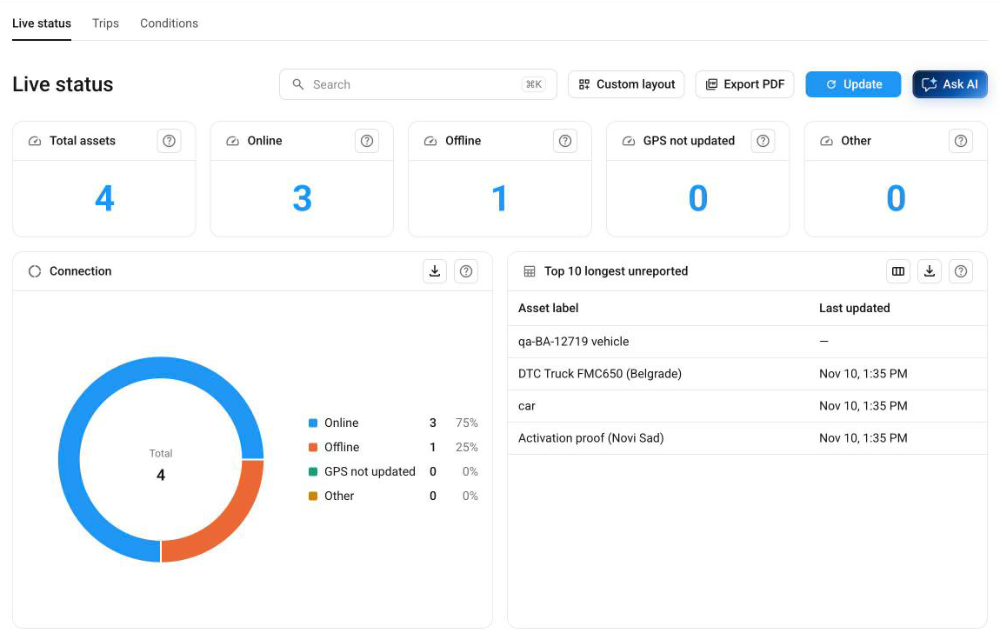

# Live status

**Live status** shows the current state of every asset in your workspace that has a GPS device. Use it during a shift to see which assets report, which of them move, and which stopped reporting. It's the first dashboard in [Dashboards](./).

<figure><figcaption>Live status for a fleet of 4 assets, 3 of them online</figcaption></figure>

Here's what you can do:

* Check how many assets report right now, in [Connection status](#connection-status).
* See which assets move, stand, or idle, in [Movement status](#movement-status).
* Find the assets that stopped reporting, in [Assets that stopped reporting](#assets-that-stopped-reporting).
* Compare the fleet's speed over the last 24 hours, in [Speed over the last 24 hours](#speed-over-the-last-24-hours).
* See which assets are inside each geofence, in [Geofences](#geofences).
* Look up one asset's latest data, in [Fleet details](#fleet-details).

## Connection status

The connection status shows whether an asset's GPS device sends messages. When an asset has several GPS devices, its connection status comes from the device that sent a message last. Navixy sets the status from the time that has passed since the last message:

| Status on the dashboard | Meaning |
| --- | --- |
| **Online** | Navixy received a message in the last 5 minutes (the default). |
| **GPS not updated** | The last message is more than 5 minutes (the default) and less than 6 minutes old. |
| **Other** | The last message is 6 minutes to 2 days old. |
| **Offline** | The last message is more than 2 days old, or the device has never sent a message. |

The next message makes the asset **Online** again. Despite its name, **GPS not updated** doesn't depend on the position in the message.

The map in [Tracking](../tracking/) uses its own rule and shows a device as offline after 10 minutes without a message. So an asset can be offline on the map and **Other** on this dashboard for up to 2 days.

These panels show the connection status:

* **Total assets:** The number of assets that have a GPS device and that your roles let you see.
* **Online**, **Offline**, **GPS not updated**, and **Other:** The number of assets with each status.
* **Connection:** The same four groups as a donut chart, with their shares of the fleet.

Each asset has exactly one status, so the four numbers add up to **Total assets**. An asset without a GPS device isn't counted on this dashboard.

## Movement status

The movement status shows whether an asset is driving or standing. Navixy sets it from the latest position that the asset's GPS devices sent. When an asset has several devices, the device with the newest position decides the status:

| Status on the dashboard | Meaning |
| --- | --- |
| **Moving** | The speed is at or above the device's moving threshold, 3 km/h by default. |
| **Idle** | The ignition is on, but the asset is stopped or parked. |
| **Stopped** | The asset has stood still for less than the device's parking time, for example at a traffic light. |
| **Parked** | The asset has stood still for the device's parking time or longer, 5 minutes by default. |
| **Unknown** | The asset is **Offline**, or none of its messages has a position. |

A message without a position, such as a sensor reading, doesn't change the movement status. The movement status also doesn't change while no message arrives: an asset that stopped and then went silent stays **Stopped** and doesn't become **Parked**. After 2 days without a message, the asset is **Offline**, and its movement status is **Unknown**.

**Parked** on this dashboard is what [Trips](trips.md) calls a stop between two trips. **Stopped** is a short halt inside a trip. **Idle** needs the ignition to be on, the same rule that **Top 10 assets by idle time** on Trips uses.

**Movement distribution** shows the number of assets with each status as a bar chart. **Movement** shows the same numbers as a donut chart. If you need only one of them, hide the other, as described in [Dashboard tools](dashboard-tools.md).

## Assets that stopped reporting

**Top 10 longest unreported** lists the 10 assets whose last message is the oldest. **Last updated** shows the time of that message. It helps you find a device that lost power or connection. An asset whose device has never sent a message comes first.

The usual reasons why a device goes silent are on the device side:

* The device's battery is dead or disconnected.
* The vehicle is in a place with poor mobile coverage, such as an underground car park.
* The SIM card's data allowance is used up.
* The device was removed or retired, but it's still assigned to the asset in Navixy. Check the asset's devices.

## Speed over the last 24 hours

Two panels show speed over the last 24 hours:

* **Average and max speed:** A line chart with one point per hour. One line is the fleet's average speed in that hour. The other line is the highest speed that any asset reached in that hour.
* **Top 10 assets by speed:** The 10 assets with the highest speed in the last 24 hours. The panel leaves out assets that didn't move.

**Top 10 assets by speed** shows the speed as the GPS device sent it, without removing implausible values. An implausibly high speed can come from a GPS error. To find the assets that have many positions with poor accuracy, see [GPS accuracy](conditions.md#gps-accuracy) on the Conditions dashboard.

The average line in **Average and max speed** counts every message with a speed in that hour, including messages from assets that don't move. So a low average can mean that most of the fleet was parked, not that the fleet drove slowly.

## Geofences

**Geofences** lists every geofence that has assets inside it, with the number of assets and their names. The geofence that has the most assets comes first. Navixy updates the list with each message, so the panel shows a change when the dashboard reloads. A geofence here is a geo object from [Business Data Repository](../bdr/geo-objects/). A geo object without a name appears as `#` and its ID. The panel shows up to 1,000 geofences.

## Fleet details

**Fleet details** shows each asset's latest data, one row per asset, with the most recent message first. It lists up to 1,000 assets that have a GPS device.

| Column | What it shows |
| --- | --- |
| **Asset label** | The asset's name. An asset without a name appears as its ID. |
| **Last updated** | The time of the last message. |
| **Offline category** | How long ago **Last updated** was: "24+ hours", "3+ days", "7+ days", "14+ days", or "30+ days". It shows "—" when **Last updated** is less than 24 hours ago. |
| **Last connection status**, **Last movement status** | The latest connection and movement status of the asset. The values are the same as in [Connection status](#connection-status) and [Movement status](#movement-status). |
| **Speed**, **Altitude**, **Heading** | The speed, the height above sea level, and the direction of travel from the latest position. The heading appears as a compass arrow and direction, such as "↗ NE". |
| **HDOP** | GPS accuracy of the latest position. HDOP (horizontal dilution of precision) is a number that the GPS device reports: the lower it is, the more accurate the position. |
| **Latitude**, **Longitude** | The latest position. |
| **Current geofence** | The geofences that the asset is inside. |

**Offline category** counts from the last message, so "24+ hours" appears 24 hours after the last message. An asset that has been silent for a few hours is **Other**, and its **Offline category** shows "—".

The **Address** and **Satellites** columns always show "—". To choose which columns you see, use **Columns** in the panel header.

## See also

* [Trips](trips.md): Learn how the fleet was used in a period that you choose.
* [Conditions](conditions.md): Learn which devices report poor GPS accuracy or falling voltage.
* [Ask AI in Dashboards](https://app.gitbook.com/s/QZR0A6r78SoqVYXZIB0p/navixy-ai-assistant/dashboards): Learn how to ask questions about this dashboard.
* [Dashboard tools](dashboard-tools.md): Learn how to hide panels, choose columns, and export a panel's data.
