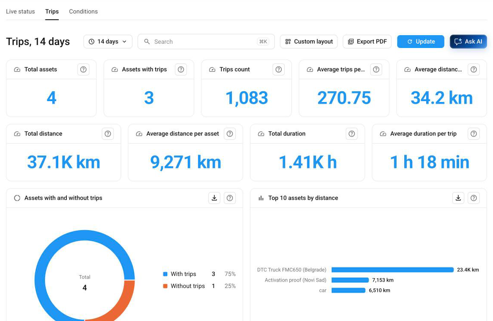

# Trips

**Trips** shows how your fleet was used in a period that you choose, the last 14 days by default. It shows how many assets made trips, how far and how long they drove, and which assets drove the most. Use it to review vehicle use and to find assets that stand unused. It's the second dashboard in [Dashboards](./).

<figure><figcaption>Trips over the default period of 14 days</figcaption></figure>

Here's what you can do:

* See the fleet's totals and averages, in [Fleet totals](#fleet-totals).
* Find the assets that drove, stood, or sped the most, in [Rankings of assets](#rankings-of-assets).
* Look up a single trip, in [Asset trip details](#asset-trip-details).

Choose the period in the period menu: 1, 6, 12, or 24 hours, or 7, 14, or 31 days. **Total assets** counts the fleet and doesn't depend on the period. **Top 10 assets by idle time** and **Top 10 assets by engine hours** count the time inside the period. Every other panel counts the trips that started in that period.

Navixy builds trips every 4 hours. So over a period of a few hours, the panels that count trips can show 0 while your vehicles drive.

## How Navixy detects a trip

A trip starts when an asset's speed goes above 3 km/h. It ends when the speed stays at 3 km/h or below for 5 minutes without a break. A shorter halt, such as at a traffic light, stays inside the trip. The time between two trips is a stop, and [Live status](live-status.md#movement-status) shows an asset in a stop as **Parked**.

Navixy also applies these rules:

* A trip shorter than 50 m doesn't count. Navixy treats it as GPS noise, such as a position that drifts while the vehicle is parked.
* When the GPS device sends no position for more than 15 minutes, the trip ends at the last position before the gap. The next position starts a new trip or stop. So a drive through a long tunnel can appear as two trips.
* A trip lasts at most 24 hours. When an asset drives for more than 24 hours without a stop, each 24 hours of the drive count as a separate trip.
* A trip appears on the dashboard only after it ends. A vehicle that is driving now has no trip for the current drive yet, unless the drive has lasted more than 24 hours.
* Navixy builds trips every 4 hours. A trip is complete when the asset stands still for 5 minutes and the GPS device keeps sending positions during that time. Then the trip appears the next time Navixy builds trips, up to about 4 hours later.
* Some GPS devices stop sending positions when a vehicle parks. Then the trip appears when the device sends positions again, at the latest about 32 hours after the trip started.
* A trip's distance comes from the vehicle's odometer when the GPS device reports the odometer. Otherwise, Navixy adds up the distances between the trip's positions.

## Fleet totals

The numbers at the top of the dashboard describe the whole fleet:

| Panel | What it shows |
| --- | --- |
| **Total assets** | The assets that have a GPS device and that your roles let you see. |
| **Assets with trips** | Assets with at least one trip. |
| **Trips count** | The number of trips. |
| **Average trips per asset** | The number of trips divided by **Total assets**. |
| **Average distance per trip** | The average length of a trip. |
| **Total distance** | The distance of all trips. |
| **Average distance per asset** | **Total distance** divided by **Total assets**. |
| **Total duration** | The time of all trips, in hours and minutes. |
| **Average duration per trip** | The average time of a trip. |

The averages per asset divide by all assets, including the assets without trips. So a fleet with many unused assets shows a low average even if the other assets drive a lot.

**Assets with and without trips** shows the same split as a donut chart: the assets that made at least one trip, compared with the rest of the fleet.

## Rankings of assets

Five bar charts each show the 10 assets with the highest value:

| Panel | What it ranks by |
| --- | --- |
| **Top 10 assets by distance** | The distance of all trips. |
| **Top 10 assets by trips** | The number of trips. |
| **Top 10 assets by speed** | The highest speed on any trip. |
| **Top 10 assets by idle time** | The time when the ignition was on while the asset stood still, in hours. |
| **Top 10 assets by engine hours** | The time when the ignition was on, in hours. |

**Top 10 assets by idle time** and **Top 10 assets by engine hours** count the time from the GPS device's messages. Each message counts until the next message, for up to 6 minutes. So a gap between two messages adds at most 6 minutes. **Top 10 assets by idle time** uses the same rule as the **Idle** status on [Live status](live-status.md#movement-status).

The rankings by distance, speed, idle time, and engine hours leave out assets with a value of 0.

## Asset trip details

**Asset trip details** lists the trips, one row per trip. It shows up to 1,000 trips, the newest first.

| Column | What it shows |
| --- | --- |
| **Asset label** | The name of the asset. |
| **Starting time**, **Ending time** | The time of the first position with a speed above 3 km/h and the time of the last position with a speed above 3 km/h before the asset stopped. So **Ending time** is when the asset stopped, not 5 minutes later when Navixy confirmed the stop. |
| **Distance**, **Duration** | How far the asset drove and how long the trip took. |
| **Starting latitude**, **Starting longitude**, **Ending latitude**, **Ending longitude** | The positions where the trip started and ended. |
| **GPS points count** | The number of positions that the GPS device sent during the trip. A low number for a long trip means that the device reported rarely. |

To find a trip, sort the table by a column or use the search, as described in [Dashboard tools](dashboard-tools.md).

## See also

* [Live status](live-status.md): Learn which assets move or stand right now.
* [Conditions](conditions.md): Learn which devices report poor GPS accuracy. Poor accuracy affects a trip's distance when the device reports no odometer.
* [Ask AI in Dashboards](https://app.gitbook.com/s/QZR0A6r78SoqVYXZIB0p/navixy-ai-assistant/dashboards): Learn how to compare a period with the one before it.
