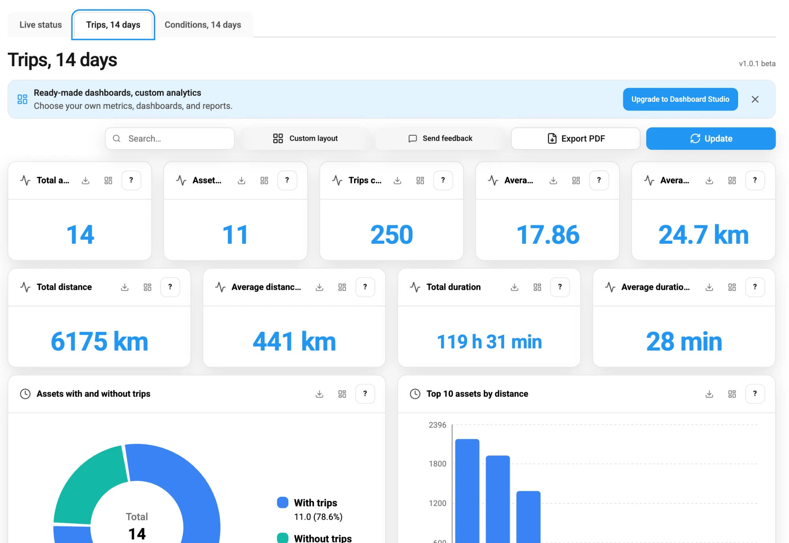

# Trips, 14 days

**Trips, 14 days** shows how your fleet was used in the last 14 days. It shows how many assets made trips, how far and how long they drove, and which assets drove the most. Use it to review vehicle use and to find assets that stand unused. It's the second dashboard in [Dashboards](./).

<figure><figcaption>Trips, 14 days for a fleet of 14 assets</figcaption></figure>

Here's what you can do:

* See the totals and averages of the fleet, in [Fleet totals](#fleet-totals).
* Find the assets that drove, stood, or sped the most, in [Rankings of assets](#rankings-of-assets).
* Look up a single trip, in [Asset trip details](#asset-trip-details).

Every panel counts the trips that started in the last 14 days. **Top 10 assets by idle time** counts the stops that started in that period.

## How Navixy detects a trip

A trip starts when the speed of an asset goes above 3 km/h. It ends when the speed stays at 3 km/h or below for 5 minutes without a break. A shorter halt, such as at a traffic light, stays inside the trip. The time between two trips is a stop, and [Live status](live-status.md#movement-status) shows an asset in a stop as **Parked**.

Navixy also applies these rules:

* A trip shorter than 50 m doesn't count. Navixy treats it as GPS noise, such as a position that drifts while the vehicle is parked.
* When the GPS device sends no position for more than 15 minutes, the trip ends there. The next position starts a new trip or stop. So a drive through a long tunnel can appear as two trips.
* A trip appears on the dashboard only after it ends. A vehicle that is driving now has no trip for the current drive yet.
* Navixy builds trips every 4 hours. A trip is complete when the asset has stood still for 5 minutes and the GPS device kept sending positions during that time. Then the trip appears after the next run, up to about 4 hours later.
* Some GPS devices stop sending when a vehicle parks. Then the trip appears when the device sends again, at the latest about 24 hours after the trip started.
* The distance of a trip comes from the odometer of the vehicle when the GPS device reports the odometer. Otherwise, Navixy adds up the distances between the positions of the trip.

## Fleet totals

The numbers at the top of the dashboard describe the whole fleet:

| Panel | What it shows |
| --- | --- |
| **Total assets** | All assets in your workspace. |
| **Assets with trips** | Assets with at least one trip. |
| **Trips count** | The number of trips. |
| **Average trips per asset** | The number of trips divided by **Total assets**. |
| **Average distance per trip** | The average length of a trip. |
| **Total distance** | The distance of all trips. |
| **Average distance per asset** | **Total distance** divided by **Total assets**. |
| **Total duration** | The time of all trips, in hours and minutes. |
| **Average duration per trip** | The average time of a trip. |

The averages per asset divide by all assets, including the assets without trips. So a fleet with many unused assets shows a low average even if the other assets drive a lot.

**Assets with and without trips** shows the same split as a donut chart: the assets that made at least one trip, compared with the rest of the fleet.

## Rankings of assets

Five bar charts each show the 10 assets with the highest value:

| Panel | What it ranks by |
| --- | --- |
| **Top 10 assets by distance** | The distance of all trips. |
| **Top 10 assets by trips** | The number of trips. |
| **Top 10 assets by speed** | The highest speed on any trip. |
| **Top 10 assets by idle time** | The total time of the stops between trips, in hours. |
| **Top 10 assets by engine hours** | The total time of all trips, in hours. It doesn't measure how long the engine ran. |

**Top 10 assets by idle time** counts every stop, with the engine on or off. It isn't the **Idle** status on Live status, which needs the ignition on. A stop counts only the time when the GPS device kept sending positions. So an asset whose device goes silent while it's parked adds little idle time. **Top 10 assets by engine hours** counts the full time of every trip, including short halts inside a trip. It doesn't measure how long the engine ran.

## Asset trip details

**Asset trip details** lists the trips, one row per trip. It shows up to 1,000 trips.

| Column | What it shows |
| --- | --- |
| **Asset label** | The name of the asset. |
| **Starting time**, **Ending time** | The time of the first position above 3 km/h, and the time of the last position above 3 km/h before the asset stopped. So **Ending time** is when the asset stopped, not 5 minutes later when Navixy confirmed the stop. |
| **Distance**, **Duration** | How far the asset drove and how long the trip took. |
| **Starting latitude**, **Starting longitude**, **Ending latitude**, **Ending longitude** | The positions where the trip started and ended. |
| **GPS points count** | The number of positions that the GPS device sent during the trip. A low number for a long trip means that the device reported rarely. |

To find a trip, sort the table by a column or use the search, as described in [Search, layout, and export](dashboard-tools.md).

## See also

* [Live status](live-status.md): Learn which assets move or stand right now.
* [Conditions, 14 days](conditions.md): Learn which devices report poor GPS accuracy. Poor accuracy affects the distance of a trip when the device reports no odometer.
