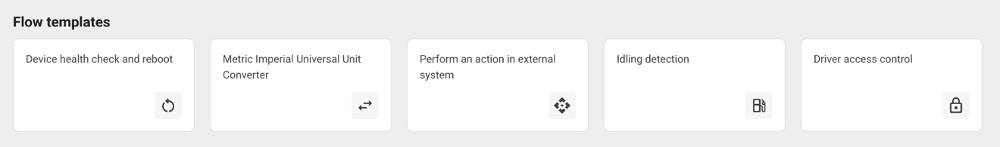

# Flow templates

A template is a prepared flow that you can start from, instead of building a flow node by node. You select a template, choose your own devices, and adjust the parts that are specific to your fleet.

<figure><figcaption>The template gallery</figcaption></figure>

## How to start from a template



### Open the gallery

The **Flow templates** gallery is on the IoT Logic start page, above the **Created flows** table.



### Select a template

Each template in the gallery shows its name. Click the template closest to what you need.

The template opens in the flow editor as a new flow with the template's name, and a **Template** dialog that describes what the template does, how it works, and how to set it up. Click **Start editing** to work on the flow, or **Cancel** to discard it and return to the start page. Nothing is saved until you save the flow, and you can change anything in it first.



### Choose your devices

A template has no devices connected, and its **Data Source** node shows **Show warning details** until you open it. Open the node and select the devices whose data you want to run through it. See [Data Source](../nodes/data-source.md).



### Enter the details of other systems

A template with a **Webhook** node sends requests to an example address. The node shows **Show warning details**, which asks for credentials if the receiving service requires them. Open the node and enter the URL, headers, and body of your own system. See [Webhook](../nodes/webhook.md).

A template with **Device Action** nodes has commands for the device models that the node titles name. Commands reach Teltonika devices only. Check the commands against the documentation of your devices. See [Device Action](../nodes/device-action.md).

If the template has neither node, skip this step.



### Adjust the formulas

A template's formulas are written for a typical sensor. Check that the attribute names in them match what your devices report, and change the thresholds to the thresholds that your operation uses.

Use the attribute button in an expression field to choose from the names that this flow knows about, rather than trusting the names that came with the template.

The section of each template under [The templates](#the-templates) says what to change in it.



### Save the flow

A template opens with **Flow enabled** on, so the first save also switches the flow on. The checks run at that point, so anything left unadjusted is reported then. See [Why flows won't save](../troubleshooting/flow-wont-save.md).



## The templates

The gallery shows these templates, in this order:

| Template | What it does |
| --- | --- |
| [Device health check and reboot](#device-health-check-and-reboot) | Reboots a device that keeps reporting a weak GPS signal |
| [Metric Imperial Universal Unit Converter](#metric-imperial-universal-unit-converter) | Adds temperature, speed, and fuel level values in other units |
| [Perform an action in external system](#perform-an-action-in-external-system) | Sends a request to another system when the speed is above 120 km/h |
| [Idling detection](#idling-detection) | Marks the messages of a vehicle that has idled for longer than 10 minutes |
| [Driver access control](#driver-access-control) | Blocks or unblocks the engine by the driver's hardware key |

In every template, each path ends at the **Send to tracking** node, an **Output Endpoint** node. So every message reaches the Navixy platform with the values that the flow added.

**Webhook** and **Device Action** nodes act on every message that reaches them, not once per event. While a condition stays true, a device that reports every 10 seconds triggers a request or a command every 10 seconds. See [Webhook](../nodes/webhook.md#what-the-node-does) and [Device Action](../nodes/device-action.md#what-the-node-does).

### Device health check and reboot

This template sends a reboot command to a device that keeps reporting a weak GPS signal. The signal counts as weak when the device reports fewer than 4 satellites with the ignition on. The flow sends the command after three such messages in a row, and at most once in 24 hours.

| Node | What it does |
| --- | --- |
| **The device is unhealthy** | Checks `ignition == 1 && satellites < 4` and stores the result as `device_unhealthy`. The then branch leads to **Reboot needed** |
| **Reboot needed** | True when `device_unhealthy` is true on this message and the two messages before it, and no reboot was sent in the last 24 hours. Stores the result as `reboot_watchdog`. The then branch leads to **Save reboot time** |
| **Save reboot time** | Sets `rebooted` to `1`. **Reboot needed** reads when `rebooted` was last set, to count the 24 hours. Leads to both reboot nodes and to **Send to tracking** |
| **Teltonika reboot** | Sends the command `cpureset` |
| **Jimi/Concox reboot** | Sends the command `RESET#` |

The else branches of **The device is unhealthy** and **Reboot needed** lead to **Send to tracking**.

Before you save the flow, check the following:

* Commands reach Teltonika devices only, so **Jimi/Concox reboot** sends nothing. See [Device Action](../nodes/device-action.md#what-the-node-does).
* To change the satellite threshold, edit the condition of **The device is unhealthy**.
* To change the interval between reboots, edit `86400000` in the condition of **Reboot needed**. The value is in milliseconds: 86,400,000 ms is 24 hours.

### Metric Imperial Universal Unit Converter

This template adds temperature, speed, and fuel level values in other units to each message, and keeps the original values.

| Node | What it adds |
| --- | --- |
| **Metric values** | `temperature_c`, `speed_kmh`, and `fuel_l`, converted from degrees Fahrenheit, miles per hour, and US gallons |
| **Imperial values** | `temperature_f`, `speed_mph`, and `fuel_gal`, converted from degrees Celsius, kilometers per hour, and liters |

Both nodes read `temperature`, `speed`, and `fuel_level`. The nodes are connected in a row: the **Data Source** node, **Metric values**, **Imperial values**, and **Send to tracking**.

Before you save the flow, check the following:

* Keep the node that matches your devices' units: **Imperial values** if they report metric units, **Metric values** if they report imperial units. Delete the other node, then connect the two nodes on either side of it.
* Check that your devices report `temperature`, `speed`, and `fuel_level` under these names. To convert another value, add an attribute with the same kind of formula.

### Perform an action in external system

This template sends a request to another system when the speed is above 120 km/h. The request is set up as a Slack message.

| Node | What it does |
| --- | --- |
| **Speed is more than 120** | Checks `speed>120` and stores the result as `speed_limit`. The then branch leads to **Webhook to your system** and to **Send to tracking**. The else branch leads to **Send to tracking** |
| **Webhook to your system** | Sends a request with the header `Content-Type: application/json`. Its body, `{"text": "Speed is {{speed}} "}`, is a Slack message |

The flow sends a request for every message with a speed above 120 km/h, not once each time a vehicle starts speeding.

Before you save the flow, check the following:

* In **Webhook to your system**, replace the URL with your system's address. Replace the headers and the body with the headers and the body that your system expects. See [Webhook](../nodes/webhook.md).
* Replace the condition of **Speed is more than 120** with your own, such as `temperature > 80`.

### Idling detection

This template sets the `alert` attribute to `1` on the messages of a vehicle that has stood still with the ignition on for longer than 10 minutes. On the other messages, `alert` is `0`.

The **Idle condition** node checks that the ignition is on and the speed is 2 or less. The flow stores the time when idling started in `idle_start_time`. The **Idle for 10 min** node checks whether more than 600,000 ms (10 minutes) have passed since then. The **Alert** node sets `alert` to `1`.

Before you save the flow, check the following:

* To change the idling time, edit `600000` in the condition of **Idle for 10 min**. The value is in milliseconds.
* To watch another condition for its duration, such as a door that stays open, replace the condition of **Idle condition** with your own.

### Driver access control

This template checks the driver's hardware key, such as an RFID card or an iButton, and blocks the engine when the key isn't on your list. The vehicle must have a key reader installed and set up.

| Node | What it does |
| --- | --- |
| **Hardware key check** | True when `hardware_key` is one of the listed key IDs and the ignition is on. Stores the result as `hw_key_check` |
| **Unblock the engine on Teltonika** | On the then branch. Sends the command `lvcancanopenengine` |
| **Telegram alert** | On the else branch. Sends the text "Unauthorized movement" to a Telegram chat through a Telegram bot |
| **Block the engine on Teltonika** | On the else branch. Sends the command `lvcancancloseengine` |

Both branches also lead to **Send to tracking**.

The else branch runs for every message that fails the condition. Such a message has a key that isn't on the list, or has the ignition off. So while the ignition is off, each message blocks the engine and sends a Telegram message. While a driver with a listed key drives, each message sends the unblock command.

Before you save the flow, check the following:

* In **Hardware key check**, replace `ALLOWED_HW_KEY_1`, `ALLOWED_HW_KEY_2`, and `ALLOWED_HW_KEY_3` with your key IDs. Add or remove IDs as needed.
* In **Telegram alert**, replace `<YOUR_TOKEN>` in the URL with your bot's token, and `YOUR_CHAT_ID` in the body with your chat ID. To use another messenger, replace the URL, the headers, and the body. See [Webhook](../nodes/webhook.md).
* The engine commands are for Teltonika devices, and commands reach Teltonika devices only. See [Device Action](../nodes/device-action.md#what-the-node-does).

## Templates and uploaded flows

A template and an uploaded flow both give you a flow that you didn't build yourself, and they serve different purposes.

| Aspect | Template | Uploaded flow |
| --- | --- | --- |
| Where it comes from | Provided with the product | A file downloaded from another flow |
| What it contains | A pattern for a common case | A copy of a flow's nodes, connections, and formulas, without its devices |
| Devices | None, you choose them | None, you choose them |

Use **Upload flow** on the start page to copy a flow that you or a colleague already built, in this workspace or another one. See [Downloading and uploading a flow](./#downloading-and-uploading-a-flow).
