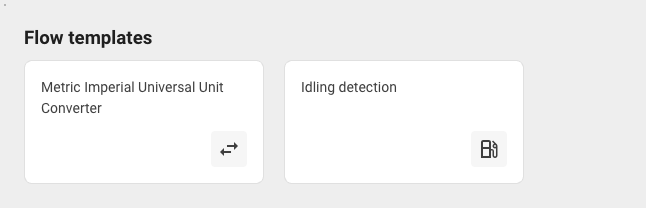

# Flow templates

A template is a prepared flow that you can start from, instead of building a flow node by node. You select a template, choose your own devices, and adjust the parts that are specific to your fleet.

<figure><figcaption>The template gallery</figcaption></figure>

## How to start from a template



### Open the gallery

The **Flow templates** gallery is on the IoT Logic start page, above the **Created flows** table.



### Select a template

Each card shows the template's name. Click the one closest to what you need.

The template opens in the flow editor as a new flow with the template's name, and a **Template** dialog that describes what the template does, how it works, and how to set it up. Click **Start editing** to work on the flow, or **Cancel** to discard it and return to the start page. Nothing is saved until you save the flow, and you can change anything in it first.



### Choose your devices

A template has no devices connected, and its **Data Source** node shows **Show warning details** until you open it. Open the node and select the devices whose data you want to run through it. See [Data Source](../nodes/data-source.md).



### Adjust the formulas

A template's formulas are written for a typical sensor. Check that the attribute names in them match what your devices report, and change the thresholds to the ones that your operation uses.

Use the attribute button in an expression field to choose from the names that this flow knows about, rather than trusting the names that came with the template.



### Save the flow

A template opens with **Flow enabled** on, so the first save also switches the flow on. The checks run at that point, so anything left unadjusted is reported then. See [Why flows won't save](../troubleshooting/flow-wont-save.md).



## The templates

| Template | What it does |
| --- | --- |
| **Metric Imperial Universal Unit Converter** | Adds converted temperature, speed, and fuel level values to each message and keeps the original values. It has two **Initiate Attribute** nodes: one adds metric values and the other adds imperial values. Delete the node that you don't need, then connect the two nodes on either side of it |
| **Idling detection** | Sets the `alert` attribute to `1` when a vehicle stands still with the ignition on for longer than a set time. The default time is 10 minutes, set in the **Idle for 10 min** node |

## Templates and uploaded flows

A template and an uploaded flow both give you a flow that you didn't build yourself, and they serve different purposes.

| Aspect | Template | Uploaded flow |
| --- | --- | --- |
| Where it comes from | Provided with the product | A file downloaded from another flow |
| What it contains | A pattern for a common case | A copy of a flow's nodes, connections, and formulas, without its devices |
| Devices | None, you choose them | None, you choose them |

Use **Upload flow** on the start page to copy a flow that you or a colleague already built, in this workspace or another one. See [Downloading and uploading a flow](./#downloading-and-uploading-a-flow).
