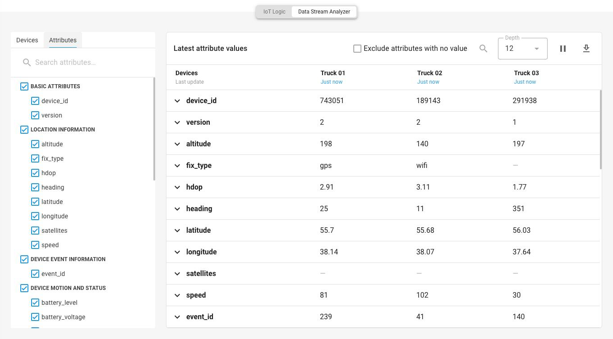
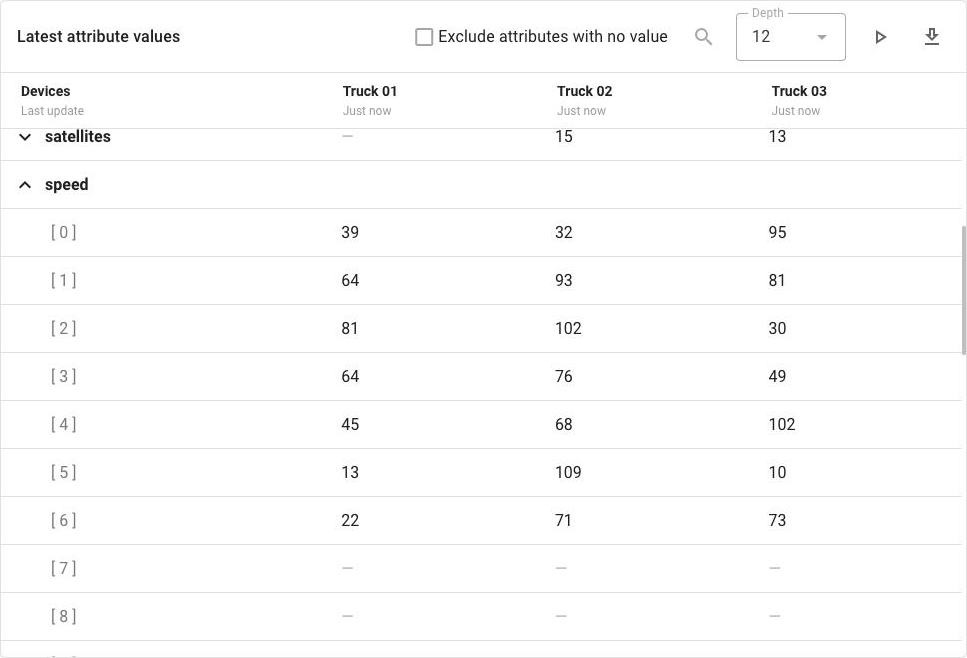

# Flow monitoring

Data Stream Analyzer shows the latest values that arrive from the devices connected to a flow, live. It is where you check that a flow does what you built it to do, and the first place to look when it doesn't.

<figure><figcaption>Values arriving from connected devices</figcaption></figure>


**Access**

Data Stream Analyzer shows only the devices that your role lets you see. Opening it needs a role that lets you view flows. See [Access to flows](flow-management/README.md#access-to-flows).


## How to open Data Stream Analyzer

Data Stream Analyzer opens from the flow editor. Above the canvas, switch from **IoT Logic** to **Data Stream Analyzer**.

The tab is available for a flow that is saved and enabled. While the flow has unsaved changes or is switched off, the tab is unavailable, and its tooltip asks you to save and enable the flow.

Data Stream Analyzer is read-only. Nothing that you select in it changes the flow or what the flow sends on.

## How to choose what to watch

The **Devices** and **Attributes** tabs set what the table shows. Choose devices first, then the attributes to show for them.

### Devices

The **Devices** tab lists the devices that are connected to this flow through its **Data Source** nodes and that you have access to. Select up to 10 devices to watch at a time.

If the list is empty, the flow has no devices yet. Add them in a **Data Source** node. See [Data Source](nodes/data-source.md). Data Stream Analyzer shows one flow at a time, so a device that isn't in any flow can't be watched here.

### Attributes

The **Attributes** tab lists the attributes that the selected devices send, sorted into groups:

| Group | What it contains |
| --- | --- |
| **Basic attributes** | `device_id`, `version`, and `message_time` |
| **Location information** | Coordinates, speed, heading, altitude, and satellite fix quality |
| **Device event information** | The event the device reported |
| **Mobile cells** and **Wi-Fi points** | The networks the device detected |
| **Device motion and status** | Movement, mileage, and battery and board voltage |
| **Input and output status** | The state of the device's inputs and outputs |
| **Sensor data** | Temperature, humidity, fuel level, analog inputs, and counters |
| **Identification data** | Hardware keys and the VIN |
| **Custom data** | Custom attributes the device sends |
| **OBD and CAN**, **BLE**, **UDS**, **Tachograph** | Vehicle bus, Bluetooth sensor, diagnostics, and tachograph data |

A group appears only when a selected device sends something in it. Attributes that belong to no group, including the attributes that your flow calculates, are listed after the groups. All attributes are selected at first. Clear the attributes that you don't need. The table keeps your choice the next time that you open it in this browser.

## Reading the values

The **Latest attribute values** table has one column for each device that you selected and one row for each attribute. Each cell shows the most recent value of that attribute from that device. The table refreshes every 5 seconds, so a new value can take a few seconds to appear.

<figure><figcaption>Earlier values of one attribute</figcaption></figure>

* **Last update**, under each device name, shows how long ago the device's last message arrived.
* Hover over a value to see when it was recorded. **Message time** is when the device recorded it, and **Server time** is when the Navixy platform received it.
* A dash (—) in a cell means the attribute had no value in that message. The dash looks the same whether the message didn't include the attribute, the device sent it empty, or the formula produced no value.

The toolbar above the table controls what the table shows:

| Control | What it does |
| --- | --- |
| **Exclude attributes with no value** | Shows each attribute's own most recent values instead of one value for each recent message. Off by default. See [Attributes with no value](#attributes-with-no-value) |
| **Search values** | Filters the table |
| **Depth** | How many recent values to keep for each attribute, from 1 to 12, and 12 by default. Expand an attribute's row to see them, newest first |
| **Pause updates** / **Resume updates** | Stops the table changing while you read it, then starts it again |
| **Export values** | Downloads what the table shows as a JSON file |

### Attributes with no value

By default, the table follows the device's recent messages: each attribute has one value for each message, and a message where the attribute had no value shows a dash.

**Exclude attributes with no value** changes which values the table shows, not only which rows. Each attribute then shows its own most recent values that aren't empty, and these values can be older than the device's recent messages. A formula that stopped producing a value therefore keeps showing its last value, with the time of that older value. To check whether the latest messages still have the value, turn **Exclude attributes with no value** off.

## How to check a new attribute

After you add an **Initiate Attribute** node and enable the flow, the attribute appears on the next message that the device sends. A flow acts on data that arrives after the flow is enabled, so earlier messages don't have the attribute.



### Select a device that is reporting

On the **Devices** tab, select a device connected to the flow. Check its **Last update** to confirm that the device sends data.



### Add the attribute to the table

On the **Attributes** tab, find the name that you gave the attribute in the **Initiate Attribute** node. Calculated attributes are listed after the groups. Check that the attribute is selected, together with the readings that the formula uses.



### Wait for the next message

The value appears when the device next sends data. A device that reports every few minutes takes a few minutes.



### Check the value against its inputs

The readings that the formula used are in the same column. Work through the calculation by hand once, to confirm that the formula does what you meant, not only that it produces a number. Expand the rows to compare several messages.



## What the values tell you

| What you see | What it usually means |
| --- | --- |
| The attribute has a value | The formula ran on the latest message |
| The attribute isn't in the list | No message has carried it yet. A device attribute is missing when the device doesn't send it. A calculated attribute is missing when the flow didn't create it: the message took a branch without its node, or the formula reads a value that the message doesn't have. Check the attribute name too |
| The attribute has a value on some messages and a dash on others | The formula reads something the device doesn't send every time. See [Missing values](expressions/missing-values.md) |
| The value is present and wrong | The formula runs and the arithmetic isn't what you intended. Check the coefficient and the order of operations |
| **Last update** keeps growing | The device isn't reporting. Check the device itself |

See [Troubleshooting](troubleshooting/README.md) to learn what to do in each case.

## Checking the rest of a flow

Data Stream Analyzer shows values: what the devices sent and what your flow calculated. Two things don't show in the table directly:

* **Which branch a message took.** When the **IF/THEN Logic** node has an **Expression name**, select the attribute with that name, such as `over_limit`. It stores the node's result. `true` means that the message took the then branch. `false`, or no value, means the else branch.
* **Late messages.** A message that arrives after a newer message is left out, so it never reaches the table. See [How flows work](how-flows-work.md).
