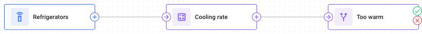

# Nodes

Nodes are the pieces that you build a flow from. Each node does a single job to the messages that pass through it, and you choose which jobs the flow needs.

This page says what each node is for. Follow the links for the settings and the steps.

<figure><figcaption>Nodes connected into a flow on the canvas</figcaption></figure>

The **Nodes** panel shows four node types in three groups, in the order that you usually use them. **Start with** and **End with** are required. **Process** is optional: use it when the flow needs it.

<table><thead><tr><th width="161">Node</th><th width="141">Panel group</th><th>What it does</th></tr></thead><tbody><tr><td><a href="data-source.md">Data Source</a></td><td>Start with</td><td>Chooses the devices whose data runs through this flow. Every message they send enters here.</td></tr><tr><td><a href="initiate-attribute.md">Initiate Attribute</a></td><td>Process</td><td>Works out new values from the ones already in the message, such as liters from a raw sensor count, and adds them to it.</td></tr><tr><td><a href="logic.md">IF/THEN Logic</a></td><td>Process</td><td>Checks one condition for every message and sends the message one of two ways: messages that match go to <strong>then</strong>, and the rest go to <strong>else</strong>.</td></tr><tr><td><a href="output-endpoint.md">Output Endpoint</a></td><td>End with</td><td>Finishes a path and sends the result on to the Navixy platform.</td></tr></tbody></table>

Formulas in an **Initiate Attribute** node and conditions in an **IF/THEN Logic** node work on the values that a device sends. A value that the device left out of a message changes where that message goes. See [Missing values](../expressions/missing-values.md) to learn how a flow handles such a message.

## How nodes connect

Three rules apply to every flow:

- Data enters at a **Data Source** node. The node starts the path, so no connection can lead into it.
- An **Output Endpoint** node finishes a path. Connections can lead into it, but none lead out of it.
- **Initiate Attribute** and **IF/THEN Logic** nodes sit in the middle. Chain as many as the flow needs: a value that an early node calculates is available to a condition later.


**Split a path only with an IF/THEN Logic node.**

When one node connects to two or more paths, all of them are [live](../how-flows-work.md#live-paths) for every message. The flow keeps the work of one path and discards the rest. The flow saves without an error, and nothing reports that the work was lost.

An **IF/THEN Logic** node is safe, because only one of **then** and **else** is live for any message.


## Limits

IoT Logic checks a flow against these limits when you save it. A flow that goes over a limit doesn't save, and IoT Logic marks the node that the limit applies to. The canvas also doesn't let you add a node or a connection beyond the first two limits.

| Limit | Value |
| --- | --- |
| Nodes in one flow | 64 |
| Connections in one flow | 96 |
| Attributes produced by one node | 50 |
| Attributes produced by one flow | 200 |
| Device connections in one flow. A device in two **Data Source** nodes counts twice | 25,000 |

See [Why flows won't save](../troubleshooting/flow-wont-save.md) to learn every check and what each message means.
