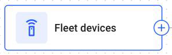
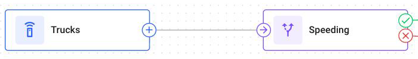

# Data Source

This page describes the **Data Source** node: what it does, where it sits in a flow, and its settings. Read it when you choose which devices a flow processes.

## What the node does



The **Data Source** node is where data enters a flow. You attach devices to it, and from then on every message that those devices send passes through this flow before it reaches the Navixy platform.

It is the only node that can start a flow. A flow with no **Data Source** node can't receive any messages and doesn't save.



<figure><figcaption>The node where devices enter a flow</figcaption></figure>



## Where it sits in a flow

<figure><figcaption>A Data Source node starts the path</figcaption></figure>

One flow can have several **Data Source** nodes, each with its own devices and its own path. A single flow can then process several groups of devices in different ways, and all the rules stay in one flow.

A **Data Source** node can connect to more than one node, but the flow keeps the work of only one of those paths. To process the same devices in two ways, branch with an **IF/THEN Logic** node instead. See [Nodes](README.md) to learn how nodes connect and why only one path's work is kept.


A device may be attached to two **Data Source** nodes in the same flow only if their paths never meet. If they do, the flow doesn't save, and the save error names the node where the paths meet.


## Data Source settings

In the node settings, you choose the devices that send data into the flow.

| Field | What it does |
| --- | --- |
| **Name** | Required. What the node is called on the canvas. Up to 255 characters |
| **Search devices** | Filters the list by device name as you type |
| **All** | Every device in the workspace that your role lets you see, with the total in the tab label |
| **Selected** | Only the devices currently chosen, with the count in the tab label |
| **Select all** | Selects the devices loaded in the list. The list loads 50 devices at a time as you scroll, so scroll to the end first to include every match |
| **Clear selection** | The same button, once every listed device is selected. Removes the devices currently listed, which is the ones matching the search rather than every device in the node |

A flow can have up to 25,000 device connections in total.

A **Data Source** node with no devices saves without an error, and then nothing enters the flow through it. If a flow is switched on and produces nothing, check the devices of its **Data Source** nodes first.


**The device list is saved as a replacement, not as an addition.** What you have selected when you apply the change becomes the node's complete device list. If you clear the selection and choose one device, the node has one device, not one more device than before.

The list shows only the devices that your role lets you see. Devices that you can't see stay attached when you apply the change, and they still count toward the limit of 25,000 device connections in a flow.

Check the **Selected** tab before you apply the change, especially on a node that already has a large fleet.


## How to configure a Data Source node

To configure a Data Source node, follow these steps:



### Name the node

Enter a **Name** that identifies the group of devices, such as `Reefer trucks` or `Depot 2 vans`. The name appears on the canvas, so make it easy to read.



### Choose the devices

Search for the devices that you need and select them. Only the devices that are registered in your workspace appear.

Switch to **Selected** to check the full list before you apply. This list replaces whatever the node had before.



### Apply

Click **Apply changes**, then save the flow.



## Questions and answers

* [Several Data Source nodes in one IoT Logic flow](https://app.gitbook.com/s/iUOsBLCF28U0Cm4ggUHo/products/iot-logic/several-data-source-nodes-in-one-flow)
* [One device in several IoT Logic flows](https://app.gitbook.com/s/iUOsBLCF28U0Cm4ggUHo/products/iot-logic/one-device-in-several-flows)
* [Devices available in IoT Logic](https://app.gitbook.com/s/iUOsBLCF28U0Cm4ggUHo/products/iot-logic/devices-available-in-iot-logic)
* [Deleting devices used in IoT Logic flows](https://app.gitbook.com/s/iUOsBLCF28U0Cm4ggUHo/products/iot-logic/flows-after-device-deletion)
