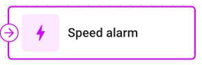
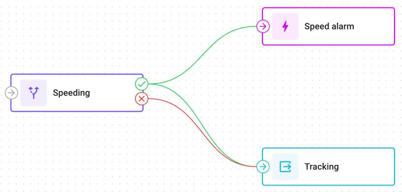
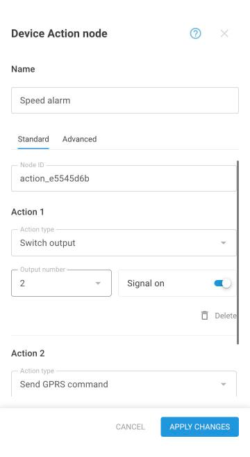
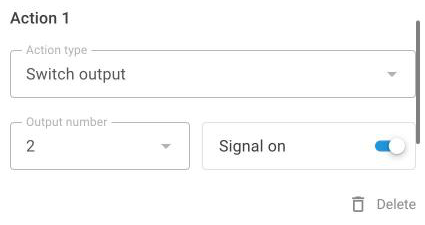
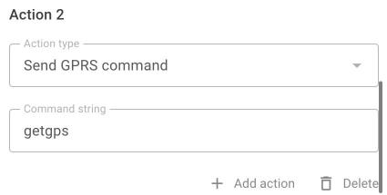
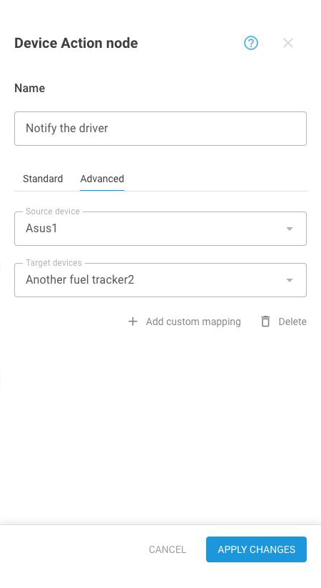

# Device Action

This page describes the **Device Action** node: what it sends, to which devices, and when. Read it when a flow has to act on a device, for example switch a relay when a reading crosses a limit.

## What the node does



The **Device Action** node sends commands to a device when a message reaches the node.

A temperature crosses a limit, and the node switches a relay. A door opens outside working hours, and the node turns on a siren. The trigger is the message itself, so the command goes out as soon as the reading arrives.



<figure><figcaption>The node that sends commands</figcaption></figure>



By default, a command goes to the device that sent the message. On the **Advanced** tab, a custom mapping sends the commands to other devices instead.

The node sends its commands on every message that reaches it, not only when a value changes. While a condition stays true, a device that reports every 10 seconds gets a command every 10 seconds. A message that answers a command doesn't trigger the node.


**Commands reach Teltonika devices only.** Other device models, and devices without an IMEI, receive nothing, and nothing on screen says so. Check the device model before you build a flow around a command.


## Where it sits in a flow

<figure><figcaption>The then branch reaches the Device Action node and an Output Endpoint node</figcaption></figure>

The **Device Action** node ends a path: nothing can follow it. Put an **IF/THEN Logic** node before it, so that the commands go out only for the messages that meet a condition. If no **IF/THEN Logic** node comes before it on the path, the node sends its commands on every message.

A path that ends at a **Device Action** node keeps none of the values that the flow calculated. The message still reaches the Navixy platform, but with only what the device sent. To keep the calculated values for the messages that trigger the command, connect an **Output Endpoint** node to the same branch as the **Device Action** node. An **Output Endpoint** node on the else branch doesn't help a message that took the then branch. See [What happens to a branch without an Output Endpoint node](logic.md#what-happens-to-a-branch-without-an-output-endpoint-node).

## Device Action node settings


{% column width="58%" valign="middle" %}
The settings dialog has two tabs:

* **Standard** has the actions that the node sends.
* **Advanced** has custom mappings, which send the actions to other devices. Optional.


{% column width="42%" %}
<figure><figcaption>The actions of the node</figcaption></figure>



### Standard tab

| Field | What it does |
| --- | --- |
| **Name** | Required. What the node is called on the canvas. Up to 255 characters |
| **Node ID** | The node's identifier, created when you add the node, such as `action_1a9987ad`. You can't change it |
| **Action type** | **Switch output** or **Send GPRS command** |
| **Add action** | Adds another action, up to 10 in one node |
| **Delete** | Removes the action above it |

The dialog opens with one empty action. The node sends its actions in the order of the list, one command for each action. The platform sends a **Switch output** command first, so it can reach the device before an earlier command string that is still waiting.

#### Switch output

Turns a digital output of the device on or off, such as a relay, an immobilizer, or a siren.

| Field | What it does |
| --- | --- |
| **Output number** | The output to switch, 1 to 8. A number that another **Switch output** action of this node uses isn't offered |
| **Signal off** / **Signal on** | The state to set. A new action starts at **Signal off** |

<figure><figcaption>Switch an output on or off</figcaption></figure>

#### Send GPRS command

Sends a text command to the device over GPRS, exactly as you write it.

| Field | What it does |
| --- | --- |
| **Command string** | The command text. Required, up to 512 characters |

<figure><figcaption>Send a command string</figcaption></figure>

The command text depends on the device model. Check the manufacturer's documentation for the exact string, and test it on one device before you use it for a fleet. Use only characters from a standard English keyboard: other characters don't arrive as typed. A command can't include values from the message: the text is sent as written.

### Advanced tab

Without a custom mapping, the actions go to the device that sent the message. A custom mapping changes this for one source device: messages from the source send the actions to each target device instead. The source device receives nothing unless it is also a target. A device without a mapping still receives its own commands.

<figure><figcaption>Send the actions to other devices</figcaption></figure>

| Field | What it does |
| --- | --- |
| **Source device** | The device whose messages trigger the actions. One source can have one custom mapping |
| **Target devices** | The devices that receive the actions instead. At least one, and up to 1,000 across all custom mappings of the node |
| **Add custom mapping** | Adds another source device and its targets |
| **Delete** | Removes the custom mapping above it |

Both lists offer the devices of this flow's **Data Source** nodes. Search them by device name or IMEI.

A custom mapping covers the cases where the sensor and the device that acts aren't the same device. For example, a reading from a vehicle opens a gate controller, or any truck of a group turns on a depot siren.

If you remove a device from the flow, its custom mapping stays until you next open the node's settings. The dialog then shows **Select a source device** for a removed source, and drops a removed target. Fix the mapping, or delete it, and save the flow.

## When a command arrives

The node passes each command to the Navixy platform, which sends it to the device:

* **Switch output** waits up to 3 days for a device that is offline.
* **Send GPRS command** waits up to 1 hour, and is sent once.
* Up to 100 commands can wait for one device. A newer command is then refused and lost.
* A command that is the same as one still waiting isn't added again.
* One message can send up to 100 commands, counted across all flows of the device.

A command is sent at most once: nothing sends a lost command again. The interface doesn't show whether a command arrived. See [A device command doesn't arrive](../troubleshooting/README.md#a-device-command-doesnt-arrive).

## How to configure a Device Action node

To configure the node, follow these steps:



### Name the node

Enter a **Name** that says what the node does, such as `Lock trailer door`.



### Choose the action

On the **Standard** tab, select the **Action type**, then fill in its fields.



### Add more actions

Click **Add action** for each further command.



### Map the devices, if another device acts

If the commands must go to other devices than the one that sent the message, open **Advanced** and click **Add custom mapping**. Otherwise, skip this step.



### Apply, connect, and save

Click **Apply changes**. Connect the node to the then branch of an **IF/THEN Logic** node, and connect an **Output Endpoint** node to the same branch to keep the calculated values. Click **Save flow**: the settings are stored when the flow is saved.



## Questions and answers

* [Device Action commands for offline devices](https://app.gitbook.com/s/iUOsBLCF28U0Cm4ggUHo/products/iot-logic/device-action-commands-for-offline-devices)
* [Several commands in one Device Action node](https://app.gitbook.com/s/iUOsBLCF28U0Cm4ggUHo/products/iot-logic/several-commands-in-one-device-action-node)
* [Message values in Device Action command text](https://app.gitbook.com/s/iUOsBLCF28U0Cm4ggUHo/products/iot-logic/message-values-in-device-action-commands)
* [Nodes after Device Action nodes](https://app.gitbook.com/s/iUOsBLCF28U0Cm4ggUHo/products/iot-logic/nodes-after-device-action)
* [Output Endpoint nodes in command-only flows](https://app.gitbook.com/s/iUOsBLCF28U0Cm4ggUHo/products/iot-logic/output-endpoint-in-command-only-flows)
