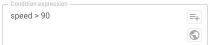
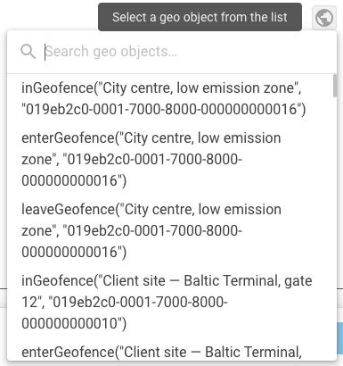

# Geo object functions

A flow can ask where a device is, not only what its sensors report. A condition can test whether the device is inside a named area, and a calculated attribute can record which area it is in.

## What this is for

Two kinds of question become possible once a flow can read your geo objects:

* **A condition that depends on location.** Run a command only when the vehicle is inside the depot. Skip an alert while the asset is in its permitted area.
* **An attribute that records the area.** Store the name of the area the device is in, so that every message has it and nothing has to recalculate it.

Both are written the same way as any other formula. See [Expressions](../expressions/).

## The functions

| Function | What it returns |
| --- | --- |
| `inGeofence(id)` | True when the device is inside that geo object, false when it isn't |
| `geofenceName()` | The name of the geo object the device is in |

Both take an optional index, so you can ask where the device was at an earlier reading rather than at this one:

```
inGeofence(123, 1)
```


**Neither function checks that index.** An index above 11 saves without complaint and then returns nothing on every message. The attribute stays empty for good, with nothing to explain it. Keep it within 0 to 11. See [Earlier values](../expressions/history.md).


The save does check that every geo object ID in a formula exists and that you can read it. A deleted or inaccessible area fails the save rather than failing silently later.

## Choosing a geo object in a formula

The **Condition expression** field in an **IF/THEN Logic** node has a geo object button next to the attribute button. It lists the geo objects in your workspace and inserts the one you pick, so you don't type an ID by hand.

<figure><figcaption>The geo object button in an expression field</figcaption></figure>

<figure><figcaption>Choosing a geo object</figcaption></figure>

If the list is empty, the workspace has no geo objects yet. Create one first, in the Business Data Repository.

## Examples

**Route messages from vehicles inside the depot down their own branch**, in an IF/THEN Logic node:

```
inGeofence(123)
```

**Record which area the device is in**, in an Initiate Attribute node:

```
geofenceName()
```

**Detect that a device has left an area since its previous reading**, in an IF/THEN Logic node:

```
inGeofence(123, 1) && !inGeofence(123)
```

## Things to know

**A geo object is read at the moment the message is processed.** The answer is about where the device was when it sent that message, not where it is now.

**A message with no position returns nothing.** A device that reports a sensor reading without a location gives these functions nothing to work with. The result is no value rather than false. In an **IF/THEN Logic** node that sends the message to **else**. In an **Initiate Attribute** node the attribute is left out. See [Missing values](../expressions/missing-values.md).
