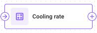
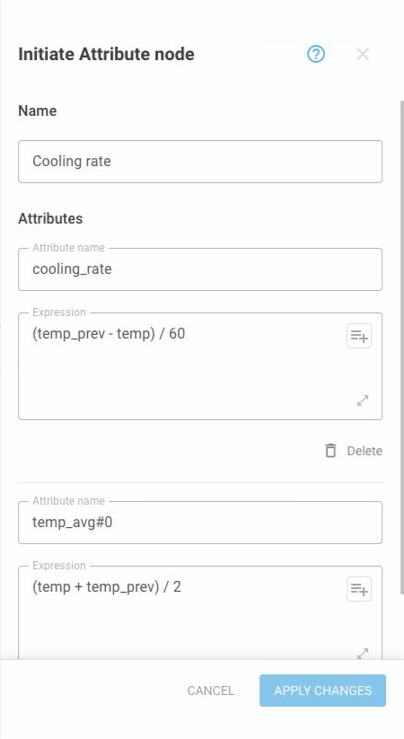

# Initiate Attribute

This page describes the **Initiate Attribute** node: what it calculates, how to name its attributes, and how to write their formulas. Read it when a flow needs a value that the device doesn't send.

## What the node does



The **Initiate Attribute** node calculates new values from the values already in the message and adds them to the message.

A sensor reports a raw count, and the business needs liters. A temperature arrives in Celsius, and the reports are in Fahrenheit. A status word stores six flags in one number. Each of these cases needs one attribute and one formula.



<figure><figcaption>One point in, one point out</figcaption></figure>



The node calculates each attribute as soon as the message reaches the node. From then on, the message contains the new value: later nodes can use it, an **IF/THEN Logic** node can branch on it, and it arrives at the Navixy platform with the device's own readings.

## Where it sits in a flow

<figure><figcaption>Calculated values pass on to the next node</figcaption></figure>

The node has one connection in and one connection out, so it can sit anywhere in the middle of a flow. When you chain two of these nodes, one attribute can use another: the first node calculates a percentage, and the second node compares that percentage with the previous percentage.

## Initiate Attribute node settings


{% column width="58%" valign="middle" %}
One node has a list of attributes, each with a name and a formula. Add as many attributes as the flow needs, up to 50 in one node. The node calculates the attributes in the order of the list, so each attribute can read the ones above it.

If you group related attributes into one node, the canvas stays easy to read. Split attributes across nodes only when they need to be on different branches.


{% column width="42%" %}
<figure><figcaption>Each attribute has a name and a formula</figcaption></figure>



| Field | What it does |
| --- | --- |
| **Name** | Required. What the node is called on the canvas |
| **Attribute name** | Required. The name of the calculated value. Up to 48 characters |
| **Expression** | Required. How the value is calculated. Up to 960 characters |
| **Add attribute** | Adds another name and formula to this node |

### Attribute names

An attribute name uses lowercase Latin letters and digits separated by underscores, such as `fuel_level_percent` or `temp_fahrenheit`.

The name has to be unique for the devices that it is produced on. The flow doesn't save if two of its nodes that the same message passes through produce the name. The **then** and **else** branches of one **IF/THEN Logic** node can each produce it, because a message follows only one of them. The flow also doesn't save if another flow produces the same name on a device that this flow also covers. Two flows that cover different fleets may use the same name. See [Attribute names](../expressions/attributes.md) to learn the full rule.

Choose a name that says what the value is, not which node made it. The name is what appears in Data Stream Analyzer, in Tracking, and in every formula that reads the value afterwards.

### Expressions

The formula reads the values in the message and returns the new one. Writing `temperature` gives you what the device just reported. Writing `value('temperature', 1, 'valid')` gives you the temperature it reported before that.

```
temperature * 1.8 + 32
```

```
math:round(fuel_raw * 0.1)
```

Type the names of the device's readings exactly as the device sends them, as shown in [Flow monitoring](../monitoring.md). The attribute button in the field inserts the names of the attributes that this flow calculates. A name that matches nothing returns nothing, and the attribute is left out.

See [Expressions](../expressions/) to learn the operators, the functions, and how to read earlier values.

## How to configure an Initiate Attribute node

To configure an Initiate Attribute node, follow these steps:



### Name the node

Enter a **Name** that says what the node calculates, such as `Fuel conversions`. The name appears on the canvas.



### Name the attribute

Enter an **Attribute name**. The value has this name everywhere afterwards, so make the name descriptive and unique.



### Write the formula

Enter the **Expression**. Use the attribute button to insert the names of attributes that the flow calculates.



### Add more attributes

Click **Add attribute** for each additional value that this node calculates, up to 50.



### Apply

Click **Apply changes**, then save the flow.



## When you change or delete an attribute

The node calculates each message once, when the message passes through it, and Navixy stores the result. A change to an attribute, including deleting it, applies to the messages that arrive after you save the flow. Values that the node already calculated for earlier messages stay as they were: Navixy doesn't recalculate or remove them.

This matters for a formula that reads its own earlier values with `value()`. Right after the change, those earlier values are still results of the old formula. The new formula combines old and new results until newer values replace the old ones.

## Limits

| Limit | Value |
| --- | --- |
| Attribute name | 48 characters |
| Expression | 960 characters |
| Attributes in one node | 50 |
| Attributes in one flow | 200 |

## Questions and answers

* [Attributes that read other attributes in one Initiate Attribute node](https://app.gitbook.com/s/iUOsBLCF28U0Cm4ggUHo/products/iot-logic/attributes-that-read-attributes-in-same-node)
* [Same attribute name in two IoT Logic flows](https://app.gitbook.com/s/iUOsBLCF28U0Cm4ggUHo/products/iot-logic/same-attribute-name-in-two-flows)
* [Calculated values and original readings](https://app.gitbook.com/s/iUOsBLCF28U0Cm4ggUHo/products/iot-logic/calculated-values-and-original-readings)
* [IoT Logic formulas that can't be calculated](https://app.gitbook.com/s/iUOsBLCF28U0Cm4ggUHo/products/iot-logic/formulas-that-cant-be-calculated)
