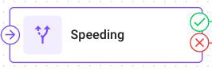
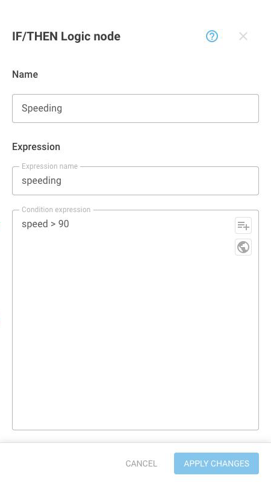

# IF/THEN Logic

This page describes the **IF/THEN Logic** node: how it splits a flow, how to write its condition, and what happens on each branch. Read it when some messages need different handling from the rest.

## What the node does



The **IF/THEN Logic** node checks one condition for every message and sends the message one of two ways.

Messages that match the condition leave through the then branch: the upper outgoing point, marked with a check-mark icon. Everything else leaves through the else branch: the lower outgoing point, marked with a cross icon. Both branches are real paths, and the flow continues on each of them.



<figure><figcaption>The upper point is then, the lower point is else</figcaption></figure>



The node has three uses:

* Calculate only when it applies. Put an **Initiate Attribute** node on the then branch, and its values appear only on the messages that match. For example, in a fleet where only some trucks have a fuel probe, the flow can calculate liters, a percentage, and the change since the last message for those trucks. The messages from the other trucks stay unchanged.
* Mark the matching messages. When you enter an **Expression name**, the node stores its answer, true or false, under that name on every message where the condition gives an answer. Data Stream Analyzer and Tracking show it like any other attribute.
* Send a command only when it applies. Put a **[Device Action](device-action.md)** node on the then branch, and the command is sent only for the messages that match. For example, a vehicle over the speed limit gets a command, and the other vehicles get nothing.

Both branches end at an **Output Endpoint** node, and they can share one **Output Endpoint** node. See [Formula examples](../expressions/examples.md#calculating-a-value-only-for-some-messages) to learn how the complete fuel probe flow is built.

## Where it sits in a flow

The node has one connection in and two connections out. Put it after the **Initiate Attribute** nodes whose values the condition reads, so that the values exist when the node checks the condition.


Two branches that are both [live](../how-flows-work.md#live-paths) must not meet again at the same node. If they do, the flow doesn't save, and the save error marks the node where the branches meet. Give each branch its own path onward.


## IF/THEN Logic node settings


{% column width="58%" valign="middle" %}
The node has one condition. The optional **Expression name** is the name of its result, and the **Condition expression** is the condition itself.


{% column width="42%" %}
<figure><figcaption>A condition and the name that stores its result</figcaption></figure>



| Field | What it does |
| --- | --- |
| **Name** | Required. What the node is called on the canvas |
| **Expression name** | Optional. The node stores the condition's result under this name, true or false, which later nodes can read. The field is empty on a new node. When you leave it empty, the node only sends each message to one of its branches and stores no result. The value is an attribute, so the name follows the [attribute naming rules](../expressions/attributes.md) and has to be unique for the devices it reaches. Up to 64 characters |
| **Condition expression** | Required. The condition. It must return true or false. Up to 480 characters |

**Apply changes** doesn't accept a node with no condition, and the **Condition expression** field shows an error.

## Writing the condition

A condition returns true or false. It can contain one test or several tests joined together. Parentheses group the tests:

```
!driver_identified && (vibration_active || speed > 3)
```

### Logical operators

| Operator | What it does | Example |
| --- | --- | --- |
| `&&`, `and` | True when both sides are true | `temperature > 15 && humidity > 80` |
| <code>&#124;&#124;</code>, `or` | True when at least one side is true | `temperature < 10 or humidity > 80` |
| `!`, `not` | The opposite of the condition | `!driver_identified` |

### Comparison operators

| Operator | What it does | Example |
| --- | --- | --- |
| `==` | True when the two sides are equal | `door_state_2 == 0` |
| `!=` | True when they aren't equal | `avl_io_221 != null` |
| `<`, `<=` | True when the left side is smaller, or smaller or equal | `humidity <= 80` |
| `>`, `>=` | True when the left side is larger, or larger or equal | `speed > 60` |
| `=~` | True when the left side is one of the values on the right. With text on both sides, the right side is a regular expression | `lock_state =~ ['locked', 'unlocked']` |
| `!~` | True when the left side is none of the values on the right | `driver_name !~ ['John', 'Steve']` |
| `=^` | True when the text starts with the text on the right | `driver_id =^ 'cc6f8216'` |
| `!^` | True when the text doesn't start with the text on the right | `driver_id !^ 'cc6f8216'` |
| `=$` | True when the text ends with the text on the right | `engine_hours =$ '1000'` |
| `!$` | True when the text doesn't end with the text on the right | `driver_id !$ '8b38851c3c68'` |

### Reading earlier values

A condition can compare the value that just arrived with an earlier value, as in this example:

```
value('fuel_level', 0) < value('fuel_level', 1) - 40
```

See [Earlier values](../expressions/history.md) to learn how to read earlier values.


**A missing value doesn't always send the message down the else branch.** It depends on the operator: `>` and `<` produce nothing, so the message goes to the else branch and the node stores no result, but `!=` and `!~` give a real answer of true, so the message goes to the then branch. A condition like `speed != 60` fires on every message from a device that reports no speed at all.

Before you write a condition that could read a missing value, see [Missing values](../expressions/missing-values.md).


## What happens to a branch without an Output Endpoint node

A branch that doesn't reach an **Output Endpoint** node still runs: its nodes calculate their values, and a **Device Action** node on it sends its commands. But the branch adds nothing to the message.

For a message that takes such a branch, the flow discards everything that it calculated, including attributes calculated before the **IF/THEN Logic** node and the node's own stored result. The message still reaches the Navixy platform, because delivery to the platform doesn't depend on the flow. But the message arrives without any of the values that this flow calculated.


A **Device Action** node finishes its path, so a branch that ends there loses the flow's calculated values. To keep them for the messages that trigger the command, connect an **Output Endpoint** node to the same branch as the **Device Action** node. For example, connect the then branch to both nodes. An **Output Endpoint** node on the else branch doesn't help, because a message that takes the then branch never reaches it.

Here it's safe to connect one node to two nodes. Both paths are [live](../how-flows-work.md#live-paths), but the **Device Action** node adds no values, so the flow loses none of its calculated values.


## How to configure an IF/THEN Logic node

To configure an IF/THEN Logic node, follow these steps:



### Name the node

Enter a **Name** that states the condition, such as `Over speed limit`. The name appears on the canvas. A good name lets you understand the branch without opening the node.



### Write the condition

Enter the **Condition expression**. Use the attribute button in the field to insert attribute names from the flow instead of entering them.



### Apply and connect both branches

Click **Apply changes**, then connect the then and else branches on the canvas to the nodes that handle each case. The then branch starts at the upper outgoing point, marked with a check-mark icon. The else branch starts at the lower one, marked with a cross icon.



## Questions and answers

* [Messages on IF/THEN Logic branches](https://app.gitbook.com/s/iUOsBLCF28U0Cm4ggUHo/products/iot-logic/messages-on-if-then-logic-branches)
* [Chained conditions in IoT Logic](https://app.gitbook.com/s/iUOsBLCF28U0Cm4ggUHo/products/iot-logic/chained-conditions)
* [Current time in IF/THEN Logic conditions](https://app.gitbook.com/s/iUOsBLCF28U0Cm4ggUHo/products/iot-logic/current-time-in-conditions)
* [IoT Logic branches without Output Endpoint nodes](https://app.gitbook.com/s/iUOsBLCF28U0Cm4ggUHo/products/iot-logic/branches-without-output-endpoint)
