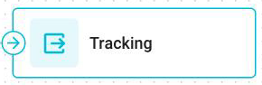
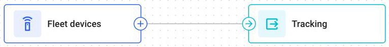

# Output Endpoint

This page describes the **Output Endpoint** node, which ends every path of a flow. Read it to see how a path reaches the Navixy platform.

## What the node does



The **Output Endpoint** node is where a path finishes and the result leaves IoT Logic.

The message that arrives at this node is the message that the device sent, plus every value that the flow calculated on the path. The node sends this message to the Navixy platform.



<figure><figcaption>The node that ends a path</figcaption></figure>



Every flow needs at least one **Output Endpoint** node. A flow with no **Output Endpoint** node has nowhere to deliver its result.

## Where it sits in a flow

<figure><figcaption>The shortest flow: devices straight to the platform</figcaption></figure>

Several paths can lead into one **Output Endpoint** node if no two of them are [live](../how-flows-work.md#live-paths) for the same message. For example, the **then** and **else** branches of one **IF/THEN Logic** node can share an **Output Endpoint** node.

## How to configure an Output Endpoint node

The node sends the result to the Navixy platform, where the rest of your Location Intelligence tools read it. **Mode** has one option, **Default endpoint**, which is already selected. Beyond the name, there is nothing to set. To configure the node, follow these steps:



### Name the node

Enter a **Name** that says where the data goes, such as `To platform`.



### Apply

Click **Apply changes**, then save the flow.



## Questions and answers

* [Two branches into one Output Endpoint node](https://app.gitbook.com/s/iUOsBLCF28U0Cm4ggUHo/products/iot-logic/two-branches-into-one-output-endpoint)
* [Format of messages that IoT Logic flows send](https://app.gitbook.com/s/iUOsBLCF28U0Cm4ggUHo/products/iot-logic/format-of-messages-at-destination)
* [IoT Logic branches without Output Endpoint nodes](https://app.gitbook.com/s/iUOsBLCF28U0Cm4ggUHo/products/iot-logic/branches-without-output-endpoint)
