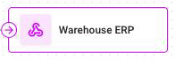
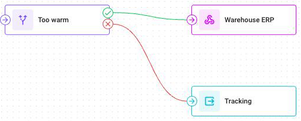
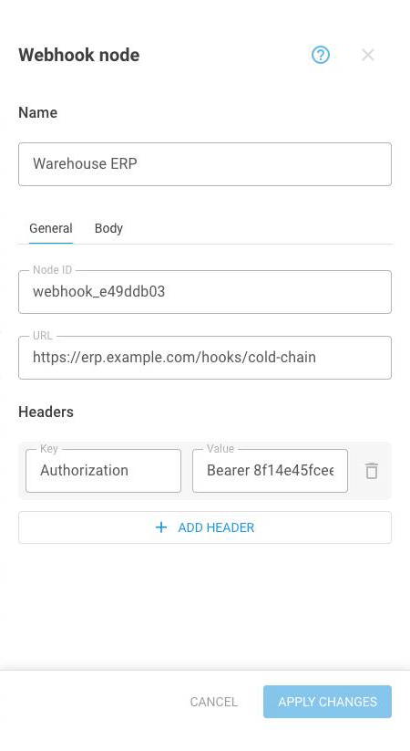

# Webhook

## What the node does



The **Webhook** node calls another system the moment data arrives, sending it whatever you choose from the message.

The Webhook node is what connects a flow to everything outside Navixy: a messaging channel, a ticketing service, an ERP, an automation tool, or your own application. Anything that accepts an HTTP request can be the destination.



<figure><figcaption></figcaption></figure>



The node sends its request and doesn't wait for an answer. It fires once for every message that reaches it.


**Webhook** is a node that finishes a path. It sends its request and the path ends there, so no connection can follow it.


## Where it sits in a flow

<figure><figcaption></figcaption></figure>

Connect it to the **then** branch of an **IF/THEN Logic** node so the call happens only when the condition is met. If it is connected to any other node, it fires on every message. That number of calls is usually more than the receiving system wants.

Because the node ends the path, put an **Output Endpoint** node in parallel. Without one, every attribute that this flow calculated for the triggering message is discarded. The message still reaches the Navixy platform, but unenriched. See [IF/THEN Logic](logic.md).

## Webhook settings

The node's settings open in two tabs: **General** for where the request goes, and **Body** for what it carries.

<figure><figcaption></figcaption></figure>

### General tab

| Field | What it does |
| --- | --- |
| **Name** | Required. What the node is called on the canvas |
| **Node ID** | The node's identifier, which you can't change |
| **URL** | Required. Where the request goes. Must start with `http://` or `https://`, up to 255 characters |
| **Headers** | Key and value pairs sent with the request. A key and a value are both required, up to 255 characters each. Up to 10 headers |
| **Add header** | Adds another key and value. Unavailable once the node has 10 headers |

Headers are where authentication goes. Most services expect a token in one, and the exact name and format come from that service's own documentation.

### Body tab

| Field | What it does |
| --- | --- |
| **Body** | The content of the request, up to 4,000 characters. Optional |

The body is usually JSON, and mixes fixed text with values taken from the message. To insert a value, write its attribute name in double braces:

```json
{"device": "{{device_id}}", "speed": "{{speed}}", "alert": "High temperature"}
```

Click the attribute button in the **Body** field to choose from the attributes that this flow knows about, rather than typing a name from memory.

Match the shape that the receiving system expects. Most services reject a request whose body isn't the structure that they document. The node doesn't read the response, so a rejection is invisible from inside the flow.

## How to configure a Webhook node



### Name the node

Enter a **Name** that says where the call goes, such as `Notify dispatch channel`.



### Enter the URL

On the **General** tab, enter the **URL** that the receiving system gave you. It must start with `http://` or `https://`.



### Add the headers

Add whatever the receiving system requires, usually an authentication token and a content type.



### Build the body

Switch to the **Body** tab and write the content. Use the attribute button to insert values from the message.



### Apply and connect it to a condition

Click **Apply changes**, then connect the node to the **then** branch of an **IF/THEN Logic** node.



## Limits

| Limit | Value |
| --- | --- |
| URL | 255 characters |
| Header key | 255 characters |
| Header value | 255 characters |
| Headers per node | 10 |
| Body | 4,000 characters |
