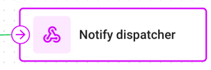
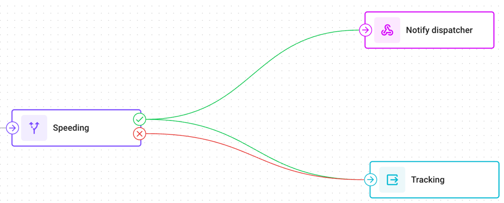
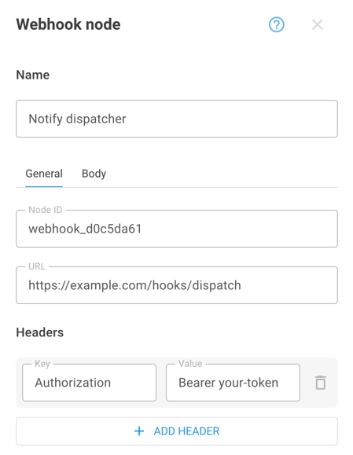
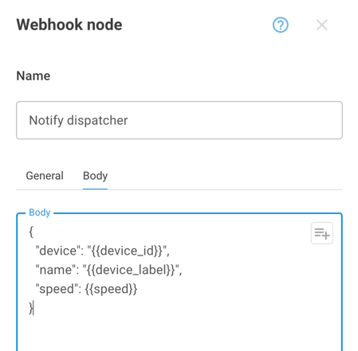

# Webhook

This page describes the **Webhook** node: what it sends, where, and when. Read it when a flow has to tell another system about a reading. For example, the flow posts an alert to a messaging channel when a temperature crosses a limit.

## What the node does



The **Webhook** node sends an HTTP request to a system outside Navixy when a message reaches the node.

The destination can be any system that accepts HTTP requests, such as these:

* A messaging service, such as Slack or Telegram
* A ticketing service
* An ERP or CRM system
* An automation tool, such as Zapier or Make
* Your own application

You write the request body, and the node fills it with values from the message.



<figure><figcaption>The node that calls other systems</figcaption></figure>



The node sends one request for every message that reaches it, not only when a value changes. While a condition stays true, a device that reports every 10 seconds triggers a request every 10 seconds. A message that answers a command triggers the node too.

The node doesn't wait for a response and doesn't read it. Nothing in the flow shows whether the receiving system accepted the request.

## Where it sits in a flow

<figure><figcaption>The then branch reaches the Webhook node and an Output Endpoint node</figcaption></figure>

The **Webhook** node ends a path: nothing can follow it. Put an **IF/THEN Logic** node before it, so that the requests go out only for the messages that meet a condition. If no **IF/THEN Logic** node comes before it on the path, the node sends a request for every message.

A path that ends at a **Webhook** node keeps none of the values that the flow calculated. The message still reaches the Navixy platform, but with only what the device sent. To keep the calculated values for the messages that trigger the request, connect an **Output Endpoint** node to the same branch as the **Webhook** node. See [What happens to a branch without an Output Endpoint node](logic.md#what-happens-to-a-branch-without-an-output-endpoint-node).

The then and else branches of one **IF/THEN Logic** node can both lead to the same **Webhook** node, because a message follows only one of them. Two paths that a message follows at the same time can't lead to the same **Webhook** node. A flow with such paths doesn't save.

## Webhook node settings


{% column width="58%" valign="middle" %}
The settings dialog has two tabs:

* **General** has the address of the request and its headers.
* **Body** has the content of the request.


{% column width="42%" %}
<figure><figcaption>The address and headers of the request</figcaption></figure>



### General tab

| Field | What it does |
| --- | --- |
| **Name** | Required. What the node is called on the canvas. Up to 255 characters |
| **Node ID** | The node's identifier, created when you add the node, such as `webhook_6c48d789`. You can't change it |
| **URL** | Required. The address that the request goes to. Starts with `http://` or `https://`, up to 255 characters |
| **Headers** | The headers of the request, as **Key** and **Value** pairs. Optional, up to 10 |
| **Add header** | Adds another header. Unavailable once the node has 10 headers |
| **Delete header** | Removes the header in its row |

The **URL** can't point to `localhost` or to a private network address, such as `192.168.1.10`. The only value from the message that the **URL** can contain is `{{device_id}}`, the device's ID.

Headers are where authentication goes. Most services expect a token in a header, such as `Authorization`, and their own documentation gives the exact name and format. A header needs both a **Key** and a **Value**, up to 255 characters each:

* **Key** is the header name, without spaces, such as `Authorization` or `X-Api-Key`.
* **Value** is fixed text. The only value from the message that it can contain is `{{device_id}}`.

The request is sent as JSON. Without a `Content-Type` header, the node sends `Content-Type: application/json`. A `Content-Type` header of your own can name only a JSON type, such as `application/json` or `application/vnd.api+json`.

Navixy sets these headers itself, so a node can't have them: `Host`, `Content-Length`, `Transfer-Encoding`, `Connection`, `Keep-Alive`, `Proxy-Connection`, `TE`, `Trailer`, `Upgrade`, `Expect`, and `X-Navixy-Webhook`. When you add one and click **Apply changes**, its **Key** field shows **This header is set automatically**.


**Header values are stored as you enter them.** Anyone who can open the flow can read them, including a token. Use a token that grants only what the request needs.


### Body tab

<figure><figcaption>The content of the request</figcaption></figure>

| Field | What it does |
| --- | --- |
| **Body** | The content of the request, up to 4,000 characters. Optional: without it, the request is sent with an empty body |

The body is usually JSON, in the structure that the receiving system documents. It mixes fixed text with values from the message. To insert a value, write its name in double braces:

```json
{"device": "{{device_id}}", "name": "{{device_label}}", "temperature": {{temperature}}}
```

For a message from the device `Truck 12` with a temperature of 9.5, the node sends this body:

```json
{"device": "019dbec6-d380-8000-801f-44455643e216", "name": "Truck 12", "temperature": 9.5}
```

Click the attribute button in the **Body** field to choose a name from the list, rather than typing it from memory. The list has these names:

| Name | Value |
| --- | --- |
| `{{device_id}}` | The ID of the device that sent the message |
| `{{device_label}}` | The name of the device |
| `{{device_imei}}` | The IMEI of the device. For a device with several IMEIs, the one added first |
| `` | The value of an attribute that the device sends or that this flow calculates. For an attribute with a channel, include the channel number, such as `{{lls_level_0}}` |

The node uses the values that the message has when it reaches the node: what the device sent, and the attributes that the flow calculated earlier on the same path. An attribute that the flow calculates only on another path is missing.

The node inserts each value as text, without quotation marks:

* **Put quotation marks around a text value** in the body yourself, as in `"name": "{{device_label}}"`.
* **A number, `true`, or `false` can go without quotation marks**, as in `"temperature": {{temperature}}`.
* **A missing value becomes empty text.** With `"temperature": {{temperature}}`, a message without `temperature` gives a body that isn't valid JSON. Put an **IF/THEN Logic** node that checks the value before the **Webhook** node.
* **A name that isn't an attribute name is sent as written.** Attribute names are lowercase, so `{{Speed}}` or `{{location.latitude}}` reaches the receiving system unchanged.
* **Times are written in ISO 8601**, such as `2026-10-29T10:15:30Z`. Put them in quotation marks.

The node doesn't check that the body is valid JSON, and the flow saves with a body that the receiving system can't read. Test the node with one device before you use it for a fleet.

## When a request is sent

The node sends each request after Navixy stores the message's values. Requests go out in parallel, so the receiving system can get them in a different order than the messages arrived.

* **A request that doesn't finish within 10 seconds is canceled.**
* **A request is sent at most once.** Nothing sends a failed request again, including one that the receiving system rejects or doesn't answer.
* **A redirect isn't followed.** Enter the final address of the receiving system.
* **A request isn't sent** when its body is larger than 64 KB after the values are inserted, or when the host name in the **URL** leads to a private network address.

Each request has the header `X-Navixy-Webhook`, whose value is the ID of the flow. The receiving system can use it to tell which flow sent the request.

The interface doesn't show whether a request arrived. Check the logs of the receiving system. See [A webhook call doesn't arrive](../troubleshooting/README.md#a-webhook-call-doesnt-arrive).

## How to configure a Webhook node

Two flow templates already have a Webhook node: [Perform an action in external system](../flow-management/templates.md#perform-an-action-in-external-system), set up for Slack, and [Driver access control](../flow-management/templates.md#driver-access-control), set up for Telegram.

To configure the node, follow these steps:



### Name the node

Enter a **Name** that says where the request goes, such as `Notify dispatch channel`.



### Enter the URL

On the **General** tab, enter the **URL** that the receiving system gave you.



### Add the headers

Click **Add header** for each header that the receiving system requires, usually an authentication token. Otherwise, skip this step.



### Write the body

Open the **Body** tab and write the content in the structure that the receiving system expects. Use the attribute button to insert values from the message.



### Apply, connect, and save

Click **Apply changes**. Connect the node to the then branch of an **IF/THEN Logic** node. To keep the calculated values, connect an **Output Endpoint** node to the same branch. Click **Save flow**: the settings are stored when the flow is saved.

If the flow doesn't save, see [A Webhook node isn't valid](../troubleshooting/flow-wont-save.md#a-webhook-node-isnt-valid).



## Limits

| Limit | Value |
| --- | --- |
| **Webhook** nodes in one flow | 10 |
| Headers in one node | 10 |
| URL | 255 characters |
| Header key | 255 characters |
| Header value | 255 characters |
| Body, as you write it | 4,000 characters |
| Body, after the values are inserted | 64 KB |
| Time for one request | 10 seconds |

The limits on how many requests Navixy sends at the same time are in the [Navixy GraphQL API documentation](https://app.gitbook.com/s/eaPUYn5ATRhY1fALtOkq/products/iot-logic/node-types#how-navixy-sends-the-request).

## Questions and answers

* [How often Webhook nodes fire](https://app.gitbook.com/s/iUOsBLCF28U0Cm4ggUHo/products/iot-logic/how-often-webhook-nodes-fire)
* [Webhook responses in IoT Logic flows](https://app.gitbook.com/s/iUOsBLCF28U0Cm4ggUHo/products/iot-logic/webhook-responses)
* [Webhook calls to unavailable systems](https://app.gitbook.com/s/iUOsBLCF28U0Cm4ggUHo/products/iot-logic/webhook-calls-to-unavailable-systems)
* [Two branches into one Webhook node](https://app.gitbook.com/s/iUOsBLCF28U0Cm4ggUHo/products/iot-logic/two-branches-into-one-webhook)
* [Device commands through Webhook nodes](https://app.gitbook.com/s/iUOsBLCF28U0Cm4ggUHo/products/iot-logic/device-commands-through-webhook)
