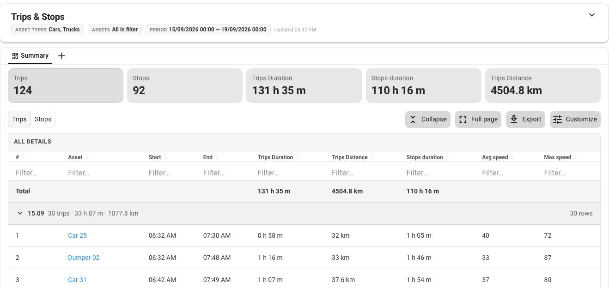

# Reports

Reports answers the questions that a fleet manager asks about a whole period. How far did each van drive last week, where did it stop, and how warm did the refrigerated trailer get? For the assets and the period that you choose, it shows how your fleet worked over time, from the totals to one asset, trip, or sensor. [Tracking](../tracking/) shows where your assets are now, and Reports shows what they did.

<figure><figcaption>
A Trips &#x26; Stops report: totals for the period, and one row for each trip
</figcaption></figure>

## What you can do with Reports

**See how your fleet moved, from the totals to a single trip.** At the end of a week or a month, the [Trips & Stops](trips-and-stops.md) report lists every trip of the assets that you choose. For each trip, it shows when and where the trip started and ended, the distance, the duration, and the average and maximum speed. It also shows how long each asset stood still between trips. For one asset, events such as **Ignition on** and **Geofence entrance** appear between the trips. Click a trip to see its track on the map and the geo objects that it passed through.

**Check what the sensors reported.** When a load arrives too warm or a tank runs low, the [Sensor readings](sensor-readings.md) report shows the readings of every sensor on the GPS devices of your assets over a period. Sensors measure values such as fuel level, temperature, or battery voltage. For each sensor, the report shows the lowest, the highest, the average, the first, and the last reading. Its chart shows how the readings changed. On the chart, you can see when a value rose or fell and zoom in on that part of the period.

**Repeat a report and export it.** For a review that you run every week, set up a report once. Choose the columns of a report. In Trips & Stops, you can also sort and filter the table. Save a report with its assets, period, and columns, open it again later, and export it to an Excel file or a PDF. See [Manage reports](manage-reports.md) to learn how to choose the columns, save a report, open it again, and export it.


**Navigation**

Reports is a product of Location Intelligence. To open it, click **Reports** on the sidebar.


## Who it is for

Reports is for the people who manage a fleet and are responsible for it:

* A fleet manager or an operations manager reviews how far the vehicles drove and where they stopped.
* A dispatcher checks the trips and stops of a shift.
* A maintenance manager checks what the sensors of vehicles and equipment reported.
* An analyst finds the assets and trips behind a total.

A report gives each of them a record of what happened over a period, in one table, so they don't have to check each vehicle on the map.

Reports has a set of ready report types. To build your own reports and dashboards from the same kind of data, use [IoT Query Premium](https://app.gitbook.com/o/YVLWhgAwCZPoU5vlRsCs/s/75iUkTidqKcVcd2J49aB/), which is coming soon. Its AI assistant builds a dashboard from a request in plain language.

## Core concepts

* **Report type:** What a report answers. Reports has two report types: [Trips & Stops](trips-and-stops.md) and [Sensor readings](sensor-readings.md). Inside Reports, you choose a report type in the Reports menu, which lists the report types that your role gives access to.
* **Report:** A report type generated for the assets and the period that you choose.
* **Saved report:** A report that keeps its assets, period, and columns, so that you can open it again.
* **Trip:** A movement of an asset from the moment it starts to move until it stands still for at least 5 minutes.
* **Stop:** A period of at least 5 minutes when the asset stands still and its GPS device keeps sending positions.

## Where report data comes from

A report is about your assets, not about GPS devices. Reports combines three things:

* **What the GPS devices send**: Positions, speed, and sensor values.
* **Your assets in** [**Business Data Repository**](../bdr/): A report shows the name of the vehicle, person, or container that a device is assigned to.
* **Your geo objects**: When a trip starts or ends inside a [geo object](../bdr/geo-objects/), such as a depot or a customer site, the report shows the name of the geo object.

A report shows data up to the moment when you generate it. [How report data is prepared](how-report-data-works.md) explains when data appears, how far back it goes, and which time zone a report uses.

## Before you start

Check the following before you generate your first report:

* **You have access to Reports.** Reports is in the menu when your workspace includes Reports and one of your roles includes it. If it isn't in the menu, ask the people who set up your workspace. See [Access to Reports](./#access-to-reports).
* **Your assets have GPS devices.** An asset without an assigned GPS device isn't included in any report. Assign the device before you need the data. Trips that a device recorded before it was assigned to the asset never appear in the reports of this asset. See [Manage assets](../bdr/assets/manage-assets.md).
* **Your sites are geo objects.** If you want the names of your depots and customer sites in the Trips & Stops report, create geo objects for them. See [Create geo object](../bdr/geo-objects/create-geo-object.md).

## Access to Reports

Your role decides which report types you can use. Reports has no access settings of its own.

A role gives access to each report type separately. It can let you do one or both of these:

| Access | What it allows |
| --- | --- |
| See the report type | The report type is in the Reports menu, and you can open it |
| Generate the report | You can generate a report of this type |

To generate a report, you need both. A report type that you can't see isn't in the Reports menu, so you can't generate it either.

A report can include every asset of the workspace, also an asset that your role doesn't let you see in **Assets**.

If you need a report type that isn't in your Reports menu, ask the people who set up your workspace. To learn more, see [Access and roles](../access-and-roles.md).

## Where to start

Start with [Manage reports](manage-reports.md). It takes you from opening Reports to your first report for the assets and the period that you choose. To learn what each column means, read [Trips & Stops](trips-and-stops.md). If a report is empty or a trip is missing, see [Troubleshooting reports](troubleshooting.md).

## Section contents

* [Manage reports](manage-reports.md): Generate a report, save it, open it again, and export it.
* [How report data is prepared](how-report-data-works.md): Learn when new data appears in a report, how far back reports go, and which time zone a report uses.
* [Trips & Stops](trips-and-stops.md): Learn how trips and stops are detected and what each column of the report shows.
* [Sensor readings](sensor-readings.md): Learn which values the report includes and how the lowest, highest, and average values are calculated.
* [Troubleshooting reports](troubleshooting.md): Find out why a report is empty, a trip is missing, or you can't open a report.
