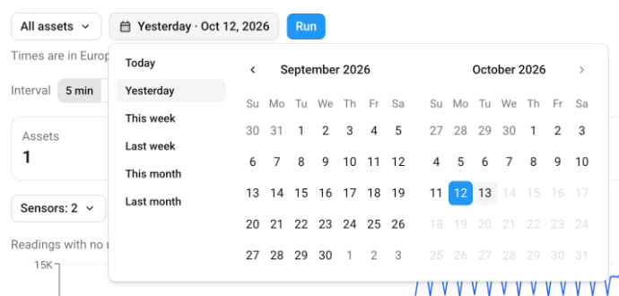

# Manage reports


**Access**

The Reports menu lists the report types that your role lets you see, and the report types with a lock. To run a report, your role must also let you run that report type. See [Access to Reports](README.md#access-to-reports).


## Open a report

Reports shows one report type at a time. You choose it in the Reports menu.

To open a report, follow these steps:

1. Click **Reports** on the sidebar.
2. In the Reports menu, click **Trips and stops** or **Sensor readings**.

**Trips and stops** opens for **All assets** and **Yesterday** and runs immediately. **Sensor readings** opens for **Yesterday** with no assets and asks you to choose them. Choose the assets, then click **Run**. See [Run a report](#run-a-report).

To make the Reports menu narrow, click **Collapse menu**. The menu then shows only icons. To show the names again, click **Expand menu**.

## Run a report

A report covers the assets and the period that you choose at the top of the report. Two buttons there show the current choice, such as **All assets** and **Yesterday**.

To run a report, follow these steps:

1. Click the button that shows the assets, such as **All assets**.
2. Choose **All assets**, or choose the assets one by one. To find an asset, search by its ID.
3. Click the button that shows the period, such as **Yesterday**, then choose the period. See [Choose the period](#choose-the-period).
4. Click **Run**.

You can choose at most 200 assets one by one. To include more than 200 assets, choose **All assets**.

Changes to the assets or the period apply only when you click **Run**. To undo the changes that you haven't run yet, click **Reset**.

The report doesn't update by itself. To run it again with the same assets and period, click **Run**.

In **Sensor readings**, when you change the **Interval**, the report runs again. See [Interval](sensor-readings.md#interval).

## Choose the period

A report covers whole days, from midnight at the start of the first day to midnight at the end of the last day.

<figure><figcaption>
The period menu: choose a preset, or a range of days in the calendar
</figcaption></figure>

To choose the period, follow these steps:

1. Click the button that shows the period, such as **Yesterday**.
2. Do one of the following:
   * Click a preset.
   * In the calendar, click the first day of the range, then the last day.
3. Click **Run**.

Each preset covers these days:

| Preset | Days |
| --- | --- |
| **Today** | Today |
| **Yesterday** | Yesterday |
| **This week** | The first day of this week to today |
| **Last week** | The whole previous week |
| **This month** | The first day of this month to today |
| **Last month** | The whole previous month |

Your browser's language sets the first day of the week, such as Sunday or Monday. When the language sets no first day, the week starts on Monday.

A range in the calendar is at most 31 days long and ends today at the latest.

A report's dates and times are in your computer's time zone. The report names this time zone, for example "Times are in Europe/Berlin." See [Which time zone a report uses](how-report-data-works.md#which-time-zone-a-report-uses).

## Share a report by its link

A report's page address keeps the assets, the dates, the open tabs, and the filters. It also keeps the interval of **Sensor readings**, and the trip panel, stop panel, or reading panel that is open. A link to the page or a bookmark opens the same report.

To share a report, follow these steps:

1. Run the report with the assets and the period that you need.
2. Copy the page address from the address bar of your browser.
3. Send the address, or save it as a bookmark.

The address keeps the dates, not the preset. For example, if you bookmark a report for **Last week**, the bookmark shows that same week when you open it a month later. To see the most recent week, choose **Last week** again and click **Run**.

When another person opens the link, Reports uses that person's own access. To see the same report, that person needs access to the report type in the same workspace.

## Show and hide columns

Each report table has its own columns menu. Some columns always show: **Asset** in the **By asset** table, **Day** in the **By day** table, and **Sensor** in **Sensor readings**.

To show or hide columns, follow these steps:

1. Click <picture><source srcset="../.gitbook/assets/icons/reports-view_column-dark.svg" media="(prefers-color-scheme: dark)"></picture> next to the table.
2. Click a column to show or hide it.

To show every column again, click **Show every column**. While a column is hidden, <picture><source srcset="../.gitbook/assets/icons/reports-view_column-dark.svg" media="(prefers-color-scheme: dark)"></picture> has a dot.

Reports keeps your choice in this browser, for your account. The choice applies to the same table on every tab. For example, the **By day** table shows the same columns on the **Days** tab and on the tab of each asset.

## Download a table

You can download each table of a report as a CSV file or an Excel file.

To download a table, follow these steps:

1. Click <picture><source srcset="../.gitbook/assets/icons/reports-download-dark.svg" media="(prefers-color-scheme: dark)"></picture> next to the table.
2. Click **CSV** or **Excel (XLSX)**.

In **Sensor readings**, the menu offers two files. **By sensor** is the table itself. **Readings by interval** has one row for each interval of each sensor. Click **CSV** or **Excel (XLSX)** under the file that you need. Hidden columns don't change the **Readings by interval** file.

The file contains the table as it shows on screen. Hidden columns are left out. The sort, the filters, the tab, and the choice of **All**, **Trips**, or **Stops** in the log also apply to the file. The file adds a few columns that the screen doesn't show:

* The file of the **Trip and stop log** starts with **Asset** and **Day**. In place of **Position**, it has **Start latitude**, **Start longitude**, **End latitude**, and **End longitude**.
* On the tab of an asset, the file of the **By day** table starts with **Asset**.

The column headings name the unit and the time zone, for example **Distance (km)** and **Start (Europe/Berlin)**. Durations are in decimal hours: 1 hour 15 minutes is 1.25. Excel shows two decimals, and the CSV file has up to six, such as 2.083333 for 2 hours 5 minutes.

The file name has the table and the first and last day of the period, for example `trips-and-stops-log-2026-10-01-2026-10-07.xlsx`. For a period of one day, the name has one date.

If the file isn't saved, the menu shows "The file could not be written. Try again, or reload the page."

## Report types with a lock

Besides **Trips and stops** and **Sensor readings**, the Reports menu shows other report types and **Ask** with <picture><source srcset="../.gitbook/assets/icons/reports-lock-dark.svg" media="(prefers-color-scheme: dark)"></picture>. Click one of them to see what it reports.

These report types are offered as paid options. Contact Navixy to add them to your workspace.

<a href="https://navixy.com/en/contact?utm_source=navixy-docs&utm_campaign=reports-paid-options" class="button primary">Contact Navixy</a>
