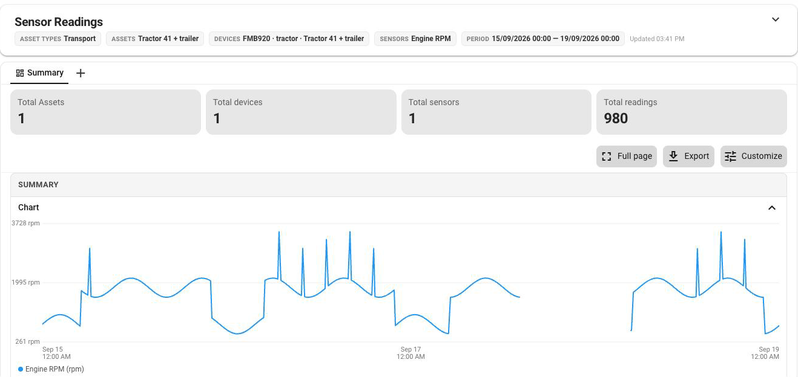

# Sensor readings

**Sensor readings** shows the values that the GPS devices of your assets sent over a period. The values include fuel level, temperature, battery voltage, and engine speed. Use it to check how a value changed, to find the highest temperature in a refrigerated trailer, or to see when a device stopped sending data.

This page describes what the report shows and how its values are calculated. To generate the report, see [Manage reports](manage-reports.md).


**Access**

**Sensor readings** is in your Reports menu when your role gives access to it. See [Access to Reports](README.md#access-to-reports).


## What the report shows

<figure><figcaption>The Sensor readings report with its summary tiles and chart</figcaption></figure>

Here's what you can do in the report:

* Choose the asset types, the assets, the GPS devices, the sensors, and the period, and click **Generate**.
* Read the totals in the tiles at the top: **Total Assets**, **Total devices**, **Total sensors**, and **Total readings**.
* Compare the lowest, highest, average, first, and last values of each sensor over the period.
* On the chart, see how a value changed and zoom in on part of the period.
* Open a tab for one asset, one GPS device, or one sensor.
* Click a row to open its details: the values and a timeline that shows when the device sent data.
* Choose the columns in **Customize**.

The fields for asset types, assets, GPS devices, and sensors depend on each other. Each field becomes available when the field before it has a value. When you select an asset, Reports also selects its GPS devices.

## Which values the report includes

The report includes every numeric value that a GPS device sends. The report shows each value under its sensor label, the readable name that a sensor has in your workspace, such as "Fuel level". A value that has no label appears under the name that the GPS device uses, such as `lls_level_0` or `temperature_2`. The report also includes the battery level, the battery voltage, the board voltage, and the odometer. Values that are only 0 or 1 are included too, except digital inputs and outputs.

The report doesn't include the following:

* GPS values: speed, satellites, and altitude
* Digital inputs and outputs, such as a door sensor connected to an input
* Text values and fault codes

Sensor values don't depend on the position. The report includes the values of every message, also a message without a position or with a position that trips don't use. That's why the report can have values for a period in which [Trips & Stops](trips-and-stops.md) has no trip.

Values appear as the GPS device sends them. Reports doesn't convert or calibrate them, so a fuel sensor that sends a raw number shows that number, not liters. The unit is the unit that the device reports. When a GPS device reports no unit, the battery level is in %, the battery voltage and the board voltage are in mV, and the odometer is in meters. The unit is part of what makes a row, so one GPS device can show the same value in two rows. For example, this happens when the unit changes after a firmware update.

## How readings are grouped into 5-minute steps

Navixy groups the values of each sensor into steps of 5 minutes. For each step, Navixy keeps six figures: the lowest value, the highest value, the first value, the last value, the sum of all values, and the number of readings. A report calculates its values from these steps, not from every message that a GPS device sends.

A reading at 10:07 belongs to the step that starts at 10:05. A short peak and a value that stayed high for the whole 5 minutes give the same highest value.

## How the values for a period are calculated

The table shows one row for each sensor of each GPS device. The values of a row cover the whole period:

| Column | How it's calculated |
| --- | --- |
| **Min** | The lowest value in the period |
| **Max** | The highest value in the period |
| **Avg** | The sum of all readings in the period divided by the number of readings, so a step with more readings counts more |
| **First** | The first value in the period |
| **Last** | The last value in the period |

For a sensor that counts up, such as fuel used or distance, the change over the period is **Last** minus **First**.

For a value that is only 0 or 1, such as an on or off state, **Avg** shows a dash. **Min**, **Max**, **First**, and **Last** show 0 or 1.

Each row shows the unit of its sensor. The **Total** row shows a unit only when all rows have the same unit.

The **Total** row at the top calculates the same values over all rows of the tab, even when the rows are different sensors.

## Table columns

These columns are shown by default: **Asset**, **Device**, **Sensor**, **Avg**, **Min**, **Max**, **First**, and **Last**. You can also add **Asset type**, **Sensor type**, and the counts **Assets**, **Devices**, and **Sensors**. To change the columns and their order, open **Customize**.

**Sensor type** shows Custom for every sensor, so it doesn't tell sensors apart. To identify a sensor, use the **Sensor** column.

Click the name of an asset, a GPS device, or a sensor in a row to open a tab for it. An asset tab or a GPS device tab shows the same table with the readings of that asset or GPS device only.

## Sensor tab

A sensor tab shows how one sensor changed over the period, with one row for each time step, the newest first. Choose the length of the step in **Interval**: 5 min, 10 min, 30 min, or 1 hour. For a period longer than 7 days, the shortest step is 10 minutes. For a period longer than 14 days, it is 30 minutes.

A period when this sensor had no readings appears as a row that starts with "No data". The GPS device may have been off, or it may have sent messages without this value.

## Chart

The chart above the table shows each sensor as a line. A break in a line is a period without data. Navixy doesn't fill such a period with an estimated value.

You can do the following on the chart:

* Drag across the chart to zoom in on part of the period. Double-click to reset the zoom.
* Click a sensor in the legend to show or hide its line.
* Point to the chart to see the value of each sensor at that time.

When the sensors on the chart have different units, each line has its own scale.

## Sensor details

Click a row to open its details. The details show the following sections:

* **Map**: The GPS track of the asset over the period. Point to the state timeline to see where the asset was at that time.
* **Metrics**: The values of the row, the number of readings, and **Coverage** (the share of the period when the GPS device sent data).
* **State timeline**: The periods when the GPS device sent data (**Transmitting**), the periods when it sent no data (**No data**), and how the value changed.

To print the details, click **Export PDF**.

## See also

* [How report data is prepared](how-report-data-works.md): Learn when a reading appears in a report and how long readings are kept.
* [Manage reports](manage-reports.md): Generate the report, save it, and export it.
* [Troubleshooting reports](troubleshooting.md): Find out why a sensor has an unfamiliar name or a report is empty.
