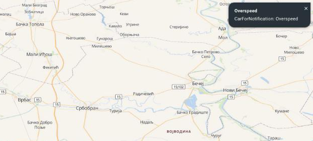

# Notification rules

Notification rules tells you when one of your assets does something that you need to know about immediately. Did a van go faster than 90 km/h? Did a truck leave the depot outside working hours? [Tracking](../tracking/) shows where your assets are now, and a notification rule tells you the moment that an asset does what the rule describes. Notification rules is one interface for 2 Navixy products, Rules and Notifications. See [Rules and Notifications products](#rules-and-notifications-products) to learn what each product does.

<figure><figcaption>
A notification on the Tracking screen: the rule's name, then the asset's name and the notification text
</figcaption></figure>

## What you can do with Notification rules

**Learn when an asset goes too fast, enters an area, or moves outside working hours.** A rule has up to 16 equations. Each equation checks the speed or another value, the position against a geo object, or the time against a schedule. You join the equations with **and** or **or** and choose the assets that the rule covers. See the [Notification rules page](notification-rules.md) to learn what a rule can check.

**See each notification while you work.** When a rule's equations become true for an asset, every user who can see the asset gets a notification. It appears on the screen that the user has open: **Tracking**, **Assets**, **Geo objects**, **Schedules**, **Device management**, **IoT Logic**, or **Notification rules**. Reports and Dashboards don't show notifications, and a notification sent while none of these screens is open doesn't appear later. The notification shows the rule's name, the asset's name, and the rule's notification text. On the **Tracking** screen, click a notification that has a position to move the map there.

**Get one notification for each event.** A rule sends one notification when its equations become true for an asset. The rule sends nothing more until the equations become false and then true again. See [How rules work](how-rules-work.md) to learn when a rule sends a notification.


**Navigation**

To open your rules, click **Notification rules** on the sidebar.


## Who it is for

Notification rules is for the people who have to act when something happens to an asset:

* A dispatcher learns that a vehicle leaves a geo object or drives too fast.
* A fleet manager sets the rules for speed, working hours, and the places where the vehicles go.
* An operations supervisor learns when an asset is in use outside its schedule.

Each of them gets a notification at the moment when an event happens. They don't have to watch every asset on the map.

## Core concepts

* **Notification rule**: A rule that tells you when something happens to your assets, such as a vehicle that goes over 90 km/h or leaves a depot. Navixy sends a notification when the rule's equations become true for an asset.
* **Equation**: One check in a rule, such as a speed over 90 km/h, a position inside a geo object, or a time within a schedule.
* **Covered assets**: The assets that a rule checks. A rule with no assets selected covers every asset in the workspace, including the assets that you add later.
* **Notification**: A box with the rule's name, the asset's name, and the rule's notification text. When the rule has no notification text, the box shows the rule's name in its place. A notification stays for 60 seconds or until you close it. While the pointer is on the box, the box stays, and the 60 seconds start again when the pointer leaves the box.

## Rules and Notifications products

Rules checks your assets and sends a notification when a rule's equations become true. Notifications shows each notification to the users who can see the asset.

To learn about an event, you need both products: a rule finds the event, and a notification tells you about it. So Location Intelligence shows the 2 products in one interface.

[Your account administrator](../who-manages-your-workspace.md) enables each product separately [in Navixy Console](https://app.gitbook.com/s/9BfYVQ80Aby5RbZ9vQVj/organization/manage-workspaces#enable-or-disable-a-product), so a workspace can have one product without the other.

| Product | Rules | Notifications |
| --- | --- | --- |
| What it does | Stores your rules and checks every message from the GPS devices of the covered assets. When a rule's equations become true for an asset, Rules sends a notification to Notifications. | Receives each notification and shows it to the users who can see the asset that the notification is about. |
| What you see in Location Intelligence | **Notification rules** on the sidebar, with the rule list and the rule editor. | A box with the notification, on the **Tracking**, **Assets**, **Geo objects**, **Schedules**, **Device management**, **IoT Logic**, and **Notification rules** screens. Reports and Dashboards don't show notifications. |
| When your workspace doesn't have it | **Notification rules** disappears from the sidebar. The workspace's rules keep running and sending notifications, but nobody can change or turn off these rules. The rules no longer stop you from deleting the assets, geo objects, and schedules that they use. | No notification appears. The rules still run. |

Each task needs a product in your workspace and a permission in your role:

| Task | Product | Permission in your role |
| --- | --- | --- |
| See the rules on the **Notification rules** page and open them | Rules | See rules |
| Create, edit, turn on or off, or delete a rule | Rules | Create rules, Edit rules, or Delete rules, and also See rules |
| See notifications on your screens | Notifications | See the asset in **Assets** |
| Get a notification when a rule's equations become true | Rules and Notifications | See the asset in **Assets**. Someone with the permission to create rules has to create the rule. |

See [Access to Notification rules](#access-to-notification-rules) to learn what each permission allows.

## Before you start

Check the following before you create your first rule:

* **Your workspace has the Rules and Notifications products.** If it doesn't, ask [your account administrator](../who-manages-your-workspace.md). See [Rules and Notifications products](#rules-and-notifications-products) to learn what each product does, and [Access to Notification rules](#access-to-notification-rules) to learn which permissions you also need.
* **Your assets have GPS devices.** A rule checks only the GPS devices that are assigned to its assets. See [Manage assets](../bdr/assets/manage-assets.md#assign-a-device-to-an-asset) to learn how to assign a GPS device.
* **You have the geo objects and schedules that your rules need.** A rule can use only a geo object that is one area. See [Create geo object](../bdr/geo-objects/create-geo-object.md) and [Set up schedule](../bdr/schedules/set-up-schedule.md) to learn how to create them.

## Access to Notification rules

Your workspace's products and your role decide what you can do. See [Rules and Notifications products](#rules-and-notifications-products) to learn which product each task needs.

In a role, access to rules belongs to the Rules product. Your role decides whether you can see, create, edit, and delete rules.

A role gives access to all the workspace's rules or to none of them. It can give you these permissions:

| Access | What it allows |
| --- | --- |
| See rules | The rules are on the **Notification rules** page, and you can open them |
| Create rules | You can create a rule |
| Edit rules | You can edit a rule and turn it on or off |
| Delete rules | You can delete a rule |

To create, edit, or delete a rule, you also need the permission to see rules.

Without the permission to see rules, the **Notification rules** page says that you don't have access.

A role has no separate permission for notifications. You get a notification about an asset only when your role lets you see that asset in **Assets**. A user whose role gives no access to assets gets no notifications.

If you need more access rights, ask your account administrator. See [Access and roles](../access-and-roles.md) to learn how roles give access to the products.

## Where to start

Start with the [Notification rules page](notification-rules.md) to learn what a rule can check and how the rule editor works. To learn when a rule sends a notification, read [How rules work](how-rules-work.md).

## Section contents

* [How rules work](how-rules-work.md): Learn which data a rule checks, how equations combine, and when Navixy sends a notification.
* [Notification rules page](notification-rules.md): Learn which equations, operators, and covered assets a rule can have, and what its limits are.
