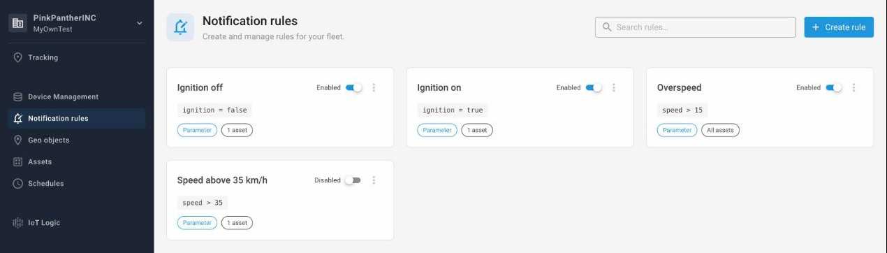

# Notification rules page

A notification rule sends a notification when its equations become true for one of your assets. An equation is one check in a rule, such as a speed over 90 km/h or a position inside a geo object. For example, a rule can tell you when a vehicle goes faster than 90 km/h inside a depot during working hours.

This page describes the **Notification rules** page and the rule editor. To learn how Navixy checks a rule and when it sends a notification, see [How rules work](how-rules-work.md).


**Access**

**Notification rules** is on the sidebar only when your workspace has the Rules product. Your role decides whether you see rules on this page and whether you can create, edit, or delete them. A role gives access to all the workspace's rules or to none of them. See [Access to Notification rules](README.md#access-to-notification-rules) to learn which products and permissions you need.


## Rule list

**Notification rules** is where you search, create, edit, and delete your workspace's rules and turn them on or off. To open it, click **Notification rules** on the sidebar.

<figure> 15. Under the equation are two labels: Parameter, and the number of assets or All assets. The search box and the Create rule button are at the top of the page."><figcaption>
The Notification rules page, with one entry for each rule
</figcaption></figure>

Here's what you can do:

* Create a rule: Click **Create rule** to open the rule editor.
* Edit a rule: Click the rule's entry, or select **Edit** in the entry's <picture><source srcset="../.gitbook/assets/icons/more_vert-dark.svg" media="(prefers-color-scheme: dark)"></picture> menu.
* Turn on or turn off a rule: Click the switch in the rule's entry. A rule that is off sends no notifications.
* Delete a rule: Select **Delete** in the entry's <picture><source srcset="../.gitbook/assets/icons/more_vert-dark.svg" media="(prefers-color-scheme: dark)"></picture> menu. You can't restore a deleted rule.

Each rule entry shows the rule's name, its status, and its equations, such as `speed > 15` or inside a geo object. The entry also shows the types of equation that the rule uses and its covered assets: **All assets** or the number of assets. When your role doesn't let you see a geo object or a schedule that an equation uses, the entry shows that item as unavailable.

When you turn on a rule, Navixy checks the whole rule again. The check finds changes since the rule was saved, such as a geo object that is no longer one area. If the check fails, the rule stays off, and an error message names the rule.

## Assets, geo objects, and schedules that a rule uses

You can't delete an asset, a geo object, or a schedule in Business Data Repository while a rule uses that item. You can delete the item after you delete the rule or remove the item from the rule. A rule that is off also blocks the deletion. A rule that covers all assets doesn't block the deletion of an asset.

## Rule editor

In the rule editor, you name a rule, write its notification text, add its equations, and choose the assets that the rule covers. The editor opens as a page. Its title is **Create rule** for a new rule. For an existing rule, the title is the rule's name.

| Element | Description |
|---|---|
| **Name** | Required. Up to 255 characters. Every notification from the rule shows the name. |
| **Status** | A new rule starts as **Enabled**, so the rule starts to send notifications when you save it. |
| **Notification text (optional)** | Up to 1,000 characters. Navixy sends the text exactly as you write it. The text can't include values such as the speed. The notification shows the rule's name and the asset's name next to the text. When the field is empty, the notification shows the rule's name in its place. |
| **Equations** | From 1 to 16 equations. See [Equations](#equations). |
| **Covered assets** | See [Covered assets](#covered-assets). |

When you save a new rule as **Enabled**, Navixy creates the rule and then turns it on. If Navixy can't turn on the rule, Navixy saves the rule as **Disabled**, and the editor marks the fields to fix.

When you click **Save rule** and someone else saved the rule after you opened it, Navixy asks whether to reload the rule. **Reload rule** shows the other person's version and discards your changes. **Keep editing** keeps your changes, but when you save them, Navixy asks again, because the rule has a newer version.

When you leave the editor with unsaved changes, the editor asks you to confirm that you want to discard them.

## Equations

In **Equations**, you add the rule's equations and choose how to join them. Each equation has a **Type**: **Parameter**, **Geo object**, or **Schedule**. Each equation after the first has an **and** or **or** switch that joins the equation to the equations before it. The switch is set to **and** by default. To learn how the order of equations changes the result, see [How equations combine](how-rules-work.md#how-equations-combine).

**Create equation** adds an equation at the end. It's unavailable when the rule has 16 equations. You can't delete a rule's only equation.

When an equation uses a geo object or a schedule that your role doesn't let you see, the equation shows that item as unavailable. You can delete such an equation, but you can't edit it.

### Parameter equations

A parameter equation compares a value in the GPS device's message with the value that you enter.

| Element | Description |
|---|---|
| **Parameter** | The parameter to compare. The list shows each parameter that the GPS devices of the covered assets reported, with its type and unit, such as `speed · number · km/h`. The parameter that you select decides which operators you can select. |
| **Value** | For **in range** and **out of range**, the equation has **Min** and **Max** instead. **Max** can't be less than **Min**. |
| **Unit** | For a duration only: **Seconds**, **Minutes**, **Hours**, or **Days**. It starts on **Hours**. |

Each parameter type has its own operators and its own way to enter the value:

| Parameter type | Operators | Value |
|---|---|---|
| Number | **=**, **≠**, **>**, **≥**, **<**, **≤**, **in range**, **out of range** | A number |
| Date and time | The same operators as for a number | A date and a time |
| Duration | The same operators as for a number | A number, and a unit in **Unit** |
| Yes or no | **=**, **≠** | Yes or no, from a list |
| Text | **=**, **≠** | Text that has to match exactly |

To learn how Navixy compares values and what happens when a message doesn't contain the parameter, see [Parameter equations](how-rules-work.md#parameter-equations).

### Geo object equations

A geo object equation checks the GPS device's position against a geo object.

| Element | Description |
|---|---|
| **Condition** | **Inside**, **Outside**, **Enters**, or **Exits** |
| **Geo object** | **Select** opens the **Select geo object** dialog, which lists the workspace's geo objects. A rule can use only a geo object that is one area. |

To learn what each condition means and which geo objects a rule can use, see [Geo object equations](how-rules-work.md#geo-object-equations).

### Schedule equations

A schedule equation checks when the GPS device recorded the message.

| Element | Description |
|---|---|
| **Condition** | **Within** or **Outside** the schedule's time slots |
| **Schedule** | One of the workspace's [schedules](../bdr/schedules/README.md) |

To learn how the schedule's time zone and status affect the result, see [Schedule equations](how-rules-work.md#schedule-equations).

## Covered assets

In **Covered assets**, you choose the assets that the rule checks. When you select no assets, the section shows **All assets**. The rule then covers every asset in the workspace, including the assets that you add later. When you remove the last asset with <picture><source srcset="../.gitbook/assets/icons/cancel-dark.svg" media="(prefers-color-scheme: dark)"></picture>, the rule covers all assets again. When the list is too long to show, the list ends with the number of assets that it doesn't show, such as **5 more**.

**Change** opens the **Select assets for this rule** dialog, which has these counts and options:

* **Available** counts the assets that you haven't selected, and **Total** counts all assets.
* **Select all** selects every asset that matches the search text. A rule can cover up to 25,000 assets. When more assets match, **Select all** is unavailable until you narrow the search.

When no assets are selected, the dialog says that the rule will cover all assets.

A rule can also cover assets that your role doesn't let you see. The editor doesn't show these assets, and they stay covered when you save the rule.

## Rule limits

| Limit | Value |
|---|---|
| Equations in a rule | 16 |
| Assets that a rule covers | 25,000, or all assets |
| Name | 255 characters |
| Notification text | 1,000 characters |

## See also

* [How rules work](how-rules-work.md): Learn which data a rule checks and when Navixy sends a notification.
* [Schedules](../bdr/schedules/README.md): Learn how schedules and their time slots work.
