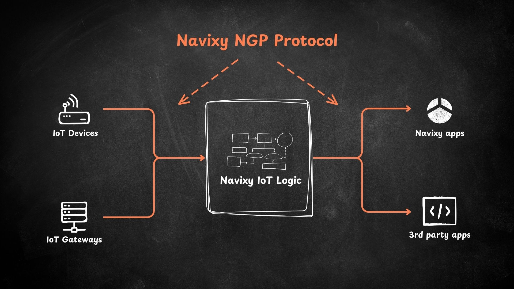

# Protocol overview

Navixy Generic Protocol (NGP) is an open protocol for sending telematics data to Navixy: positions, sensor readings, device states, and events. GPS device and IoT device manufacturers can use NGP free of charge, and so can developers who forward data to Navixy from their own systems.

In NGP 4.0, a sender encodes the data with [Protocol Buffers](https://protobuf.dev/) (protobuf). A sender is your device, hub, or server that sends NGP data. The sender sends the data over TCP to `gateway.iot.<REGION>.navixy.com`, port `30006`, where `<REGION>` is `eu` or `us`. [Regional hosts](protocol-specification/transport-layer.md#regional-hosts) lists the hosts.

This section is for developers who build a sender. It assumes that you know TCP sockets and can generate code from a `.proto` file. To send your first data, start with [Getting started](getting-started.md).

<figure><figcaption>
Devices send data to Navixy over NGP, and other apps read the data from Navixy.
</figcaption></figure>

## Who sends NGP data

Any program that can open a TCP connection can send NGP data. Typical senders are the following:

* GPS devices and IoT sensors with firmware that implements NGP
* Your own hubs or servers that collect several devices' data and forward it to Navixy
* Your own servers that convert another telematics system's data into NGP

Use NGP when Navixy doesn't decode your device's own protocol. GPS devices whose protocol Navixy decodes send data in their own protocol, not in NGP.

## Key concepts

The NGP pages use the following terms:

| Term | Definition |
| --- | --- |
| Sender | Your device, hub, or server that sends NGP data to Navixy. |
| Location Intelligence | The Navixy web app where you manage devices and assets. |
| IoT Logic | The Location Intelligence product that processes all device data. |
| Flow | A set of connected processing steps in IoT Logic. |
| NGP device | A device activated in Location Intelligence with the vendor **Navixy** and the model **NGP device**. Navixy saves NGP data only for such devices. |
| Device identifier | The text that identifies a device in NGP data, up to 64 characters. It's a different value from the device's name, which the **Devices** list shows. You enter it when you activate the device, and every packet for the device has it in `device_id`. |
| Reading | One value that a device reports, such as a temperature or a speed. |
| Packet | A device's data at one moment: the device identifier, a time, an optional position, an optional event, and attributes. The message type is `Navixy3Packet`. |
| Attribute | A named reading in a packet, such as `battery_level` or `temperature_1`. Its value is a boolean, an integer, a decimal number, or text. |
| Attribute name | The name under which Navixy saves an attribute's value, without the channel. You usually send the attribute name and the channel together in the attribute's `name` field: `temperature_2` has the attribute name `temperature` and the channel 2. |
| Channel | A number that distinguishes sensors of the same kind, such as 2 for the second temperature sensor. |
| Value field | The attribute field that has the value: `bool_value`, `int_value`, `double_value`, or `string_value`. |
| Packet field | A field of `Navixy3Packet`, such as `speed` or `time_ms`. |
| Frame | The unit that a sender and Navixy exchange over TCP: a 4-byte length, then a protobuf message. |
| Batch | The packets that you send in one frame, with a sequence number. The message type is `Navixy3Batch`. |
| Sequence number | A number that you give each batch. Navixy returns it in the acknowledgment, so you can see which batch an acknowledgment is for. |
| Acknowledgment | Navixy's reply to a batch. It confirms that Navixy decoded the batch and saved the packets that passed all checks. It doesn't show which packets failed. The message type is `Navixy3Ack`. |
| Receive time | The moment when Navixy receives a packet. Navixy uses it in place of a missing or out-of-range time: see [Which time Navixy uses](protocol-specification/how-navixy-saves-packets.md#which-time-navixy-uses). |
| Data gateway | The Navixy service that receives device data. Each region has its own data gateway host. |

## How a sender works with Navixy

Before a sender sends data, you activate the device in Location Intelligence with the **NGP device** model: see [Enter the details of an NGP device](https://app.gitbook.com/s/6RLA9o0EecKpLxHiaeR4/products/device-management/activate-device#enter-the-details-of-an-ngp-device). Then the sender works with Navixy in the following order:

1. Open a TCP connection to your region's data gateway, port `30006`.
2. Encode the device's readings as packets in a batch.
3. Send the batch as one frame.
4. Read the acknowledgment.
5. Send the next batch.

If the connection closes before the acknowledgment arrives, connect again and send the same batch. If it closes again, see [How to handle a missing acknowledgment](protocol-specification/transport-layer.md#how-to-handle-a-missing-acknowledgment).

The sender sends no credentials. Navixy reads `device_id` in each packet and saves the packet for the device with this identifier. So use device identifiers that other people can't guess: see [Device identifiers instead of credentials](protocol-specification/transport-layer.md#device-identifiers-instead-of-credentials). NGP sends data in one direction only: Navixy doesn't send commands to a device over NGP.

## Protocol versions

The Navixy platform that these pages describe accepts only NGP 4.0. The `navixy3.proto` file on the [Message structure and attributes](protocol-specification/message-structure-and-attributes.md#message-definition) page defines its messages. The file and message names start with `navixy3` for a historical reason: Navixy first designed this format to move data from the previous Navixy platform. The names don't change the data that you send.

The earlier versions, NGP 1.0 to 1.2, send JSON over HTTP, HTTPS, or MQTT to Navixy 3, the previous generation of the Navixy platform. NGP has no versions 2 or 3. The [NGP documentation for Navixy 3](https://app.gitbook.com/s/tx3J5BxnWyPV0nP2xr0z/technologies/navixy-generic-protocol) describes the earlier versions. If your sender already sends NGP 1.2, see [Migration from NGP 1.2](migration-from-ngp-1-2.md) to learn how to convert its messages.

## Section contents

The section has the following guides:

* [Getting started](getting-started.md): Send a first packet in Python and check that Navixy saved it.
* [See NGP data](see-ngp-data.md): See the positions and readings that a device sends.
* [Migration from NGP 1.2](migration-from-ngp-1-2.md): Convert NGP 1.2 JSON messages into NGP 4.0 packets.

The [Protocol specification](protocol-specification/README.md) gives the rules that a sender follows, in the order that data moves:

* [Transport layer](protocol-specification/transport-layer.md): Look up the hosts, the frame format, the replies, and the connection limits.
* [Message structure and attributes](protocol-specification/message-structure-and-attributes.md): Look up the message definition, every packet field, the attribute names, and event IDs.
* [Data types and encoding standards](protocol-specification/data-types-and-encoding-standards.md): Look up how NGP encodes numbers, times, and text, and how to leave out a packet field.
* [How Navixy saves packets](protocol-specification/how-navixy-saves-packets.md): Learn which packets Navixy saves, which time it uses, and in which order.

## Developer resources

The following resources help you build a sender:

* [navixy3.proto](protocol-specification/message-structure-and-attributes.md#message-definition): Copy the message definition to generate code for your language.
* [Getting started](getting-started.md#write-the-script): Run a complete Python sender.
* [NGP documentation for Navixy 3](https://app.gitbook.com/s/tx3J5BxnWyPV0nP2xr0z/technologies/navixy-generic-protocol): Read about the JSON versions, NGP 1.0 to 1.2.
* [Contact Navixy](https://www.navixy.com/en/contact?utm_source=navixy-docs&utm_campaign=ngp-overview): Ask about an NGP integration.
