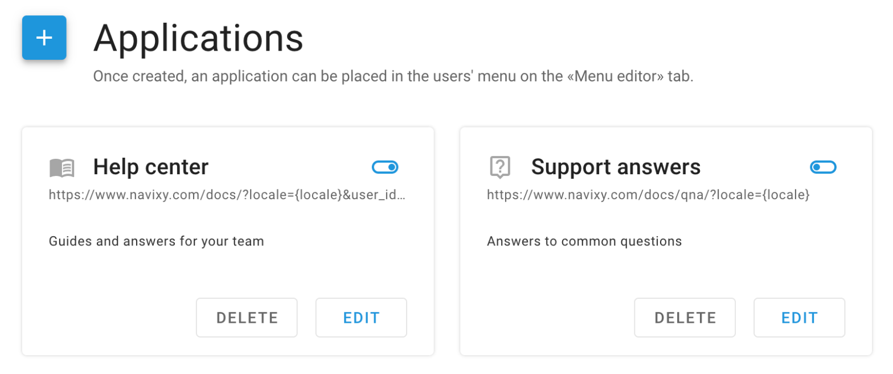
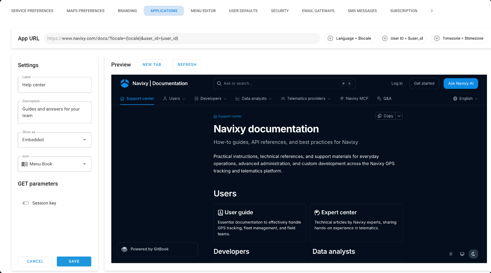
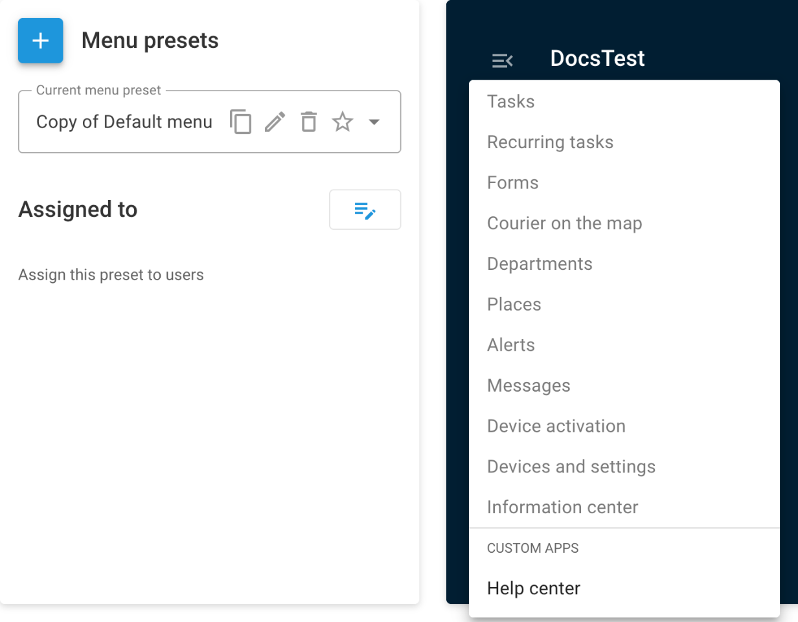

# Applications

You can add your own web applications to your users' side menu. Your users then open them without leaving the Navixy platform. For example, you can give your users your support portal, a form to book vehicle service, or a reporting tool that you host.

You create the applications on the **Applications** tab of **Settings**. You then place them in the menu on the [Menu editor](custom-menu-editor.md) tab. There you also choose which users see each application.

<figure><figcaption>
Applications tab with one application turned on and one turned off
</figcaption></figure>

Users see an application only after you add it to a menu preset. Until you do, the application doesn't appear in any menu. A menu preset is a menu layout that you assign to users in **Menu editor**.

## Before you start

* If you don't see the **Applications** tab, contact Navixy to check which features your account has. The tab appears under the same condition as the **Menu editor** tab.
* To work with applications, you need the Admin role in the Admin Panel. The Employee role can't change platform settings. See [Access](../access.md) to learn more about the roles.
* To preview an application while you set it up, specify a demo user in **Service preferences**. See [Demo user account](service-preferences/demo-user-account.md) to learn how to create a demo user account.

## Create an application

Applications use the same editor as the User applications that your users create. To learn more about each setting, see [Creating new User applications](https://app.gitbook.com/s/446mKak1zDrGv70ahuYZ/guide/account/user-applications/creating-new-user-applications) in the User guide.

1. Go to **Settings → Applications**.
2. Click the plus button next to the **Applications** title.
3. In the **App URL** field, enter the address of your application.

   If you leave out `http://` or `https://`, the editor adds `https://`.
4. To pass information about the user to the application, click **Language**, **User ID**, or **Timezone**.

   Each button adds a parameter to the address. The platform fills in the parameter value when a user opens the application.
5. Enter the **Label** and the **Description**.
6. Select an **Icon**.
7. In **Show as**, select **Embedded** or **A new tab**.

   Some web applications don't allow other sites to show them inside a page, in an iframe. Such an application can't open inside the platform. If the preview stays empty, select **A new tab**.
8. To let the application work with the Navixy API as the user who opened it, turn on **Session key**.

   The application then gets the session of that user, with that user's access rights. Your applications have no API key option, unlike User applications: an API key belongs to one user account, and your applications open in many accounts.
9. Click **Refresh** to preview the application.

   The preview opens the application as the demo user from **Service preferences**, with your users' default time zone. If you didn't specify a demo user, or the demo login doesn't match any of your users, the preview isn't available.
10. Click **Save**.

<figure><figcaption>
Application editor with the preview of an embedded application
</figcaption></figure>

The application appears in the list on the **Applications** tab. A new application is turned on. To show it to your users, add it to a menu preset, as described in [Add an application to the menu](#add-an-application-to-the-menu).

## Add an application to the menu

An application can be a menu item of its own or a tab inside a menu item. It can appear only once in each preset.

To add an application to a menu preset, you need the rights to add and modify users as well.

1. Go to **Settings → Menu editor**.
2. In **Current menu preset**, select the preset that you want to add the application to.

   You can change only the presets that you created. To start from the **Default menu preset** that Navixy provides, duplicate it first.
3. Choose where the application appears:
   * For a menu item of its own, click **Add item** in a menu group in the **Visual editor** section.
   * For a tab of a menu item, select that menu item, then click **Add item** in the **Item selector** section.
4. Under **Custom apps**, select your application.
5. Optional: Rename the application in the menu, or drag it to another place.
6. Click **Save**.
7. If the preset isn't assigned to anyone yet, assign it:
   * To show the application to some of your users, assign the preset to them under **Assigned to**.
   * To show the application to every user who has no preset of their own, click the star icon to make the preset the default, and confirm.

<figure><figcaption>
Custom apps group in the Add item list
</figcaption></figure>

The list under **Custom apps** shows only the applications that are turned on. You can't select an application that is already in the preset. To learn more about presets, see [Menu editor](custom-menu-editor.md).

## Turn an application on or off

Each application in the list has a switch that turns it on or off for all users at once. When you turn off an application, it disappears from every user's menu, but it stays in your presets. When you turn it on again, it comes back to the same place in the menu.

## Edit an application

To change an application, click **Edit** on it in the list, change the settings, and click **Save**. The change applies at once to all users who have the application in their menu.

The name in the menu is the one exception. A menu preset stores the name that the application had when you added it to the preset. A new **Label** doesn't rename existing menu items. To change the name in the menu, rename the item in **Menu editor**.

## Delete an application


A deleted application can't be restored. If you create the application again later, add it to your menu presets again as well.


To delete an application, click **Delete** on it in the list and confirm. Navixy removes the application from all your menu presets, so it disappears from every user's menu.

## What your users see

* The application opens inside the Navixy platform or in a new browser tab, depending on the **Show as** setting.
* The menu item has the name that the application had when you added it to the preset, or the name that you gave it in **Menu editor**.
* Users can't edit, hide, or delete an application that you added.
* Your applications appear where you place them in **Menu editor**. Users keep the [User applications](https://app.gitbook.com/s/446mKak1zDrGv70ahuYZ/guide/account/user-applications) that they created themselves. Those always appear at the end of the side menu, after a separator.
* If the preset of your [demo user account](service-preferences/demo-user-account.md) has your applications, visitors to the demo account see them too. They don't see the User applications created in the demo account.

## Limits

* You can create up to 30 applications.
* Each application needs a unique label, up to 24 characters.
* The description can have up to 100 characters.
* The address can have up to 1,000 characters. It must start with `http://` or `https://` and include a domain name, such as `example.com`.

## Manage applications with the Admin Panel API

To manage applications from your own code, see [Application](https://app.gitbook.com/s/6dtcPLayxXVB2qaaiuIL/panel-api/resources/dealer/application) in the Admin Panel API documentation.
