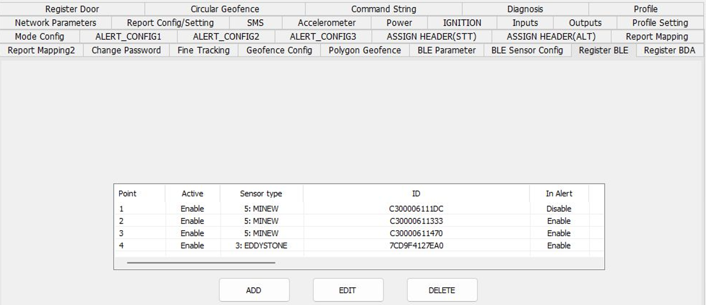
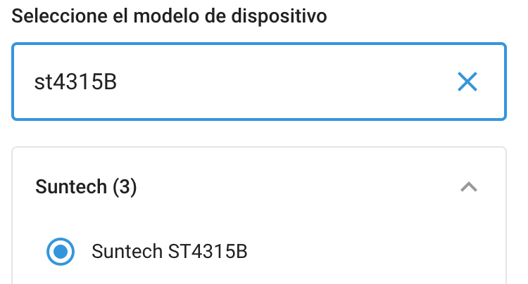
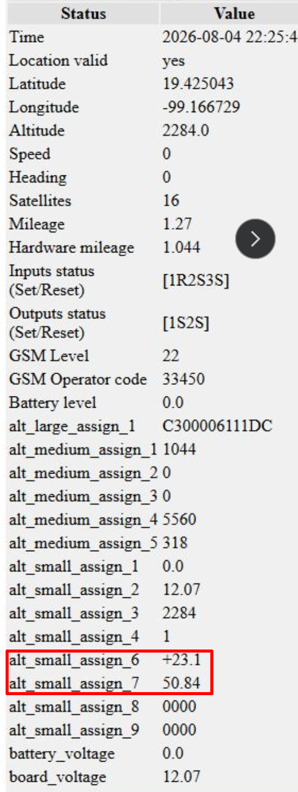
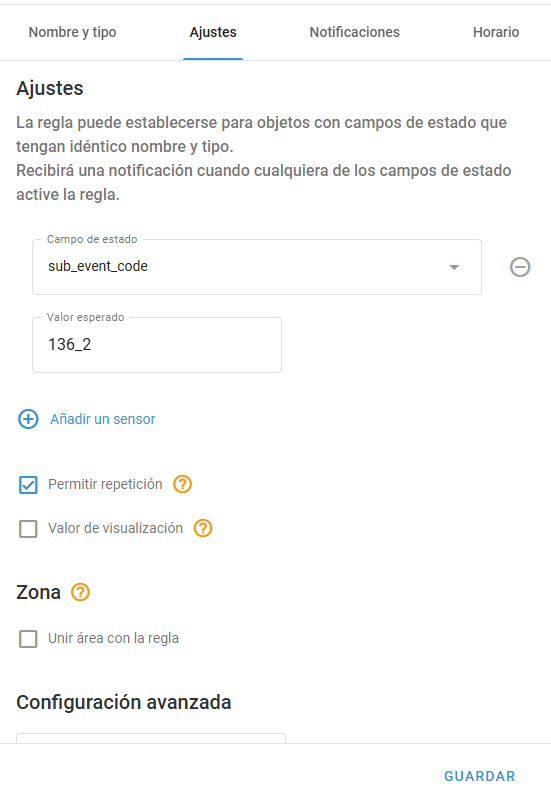

# Configuring BLE sensors on Suntech devices

Bluetooth Low Energy (BLE) sensors let you monitor temperature, humidity, door state, and panic events without extra wiring. A Suntech GPS device with a BLE gateway scans those sensors and sends the values to Navixy inside its normal status and alert reports.

This article covers BLE sensors: how to prepare Minew beacons, how to pair them in SyncTrak, and how to show the data in Navixy. For ignition and digital inputs, see [Mapping the ignition motion input for Suntech devices in Navixy](../gps-devices/input-control/mapping-the-ignition-motion-input-for-suntech-devices-on-navixy.md).

Compatible Suntech families (BLE gateway required):

* ST4300 series, for example ST4315B, ST4345LB
* ST4900 series, for example ST4932, ST4955LCBW, ST4915LCBF
* ST8000 series, for example SD8000U, ST8230

Confirm BLE support and the matching Navixy model for your exact device before you start. The parameter examples below come from an ST4315B. Slot numbers can differ on other models if Report Mapping uses a different field order.

## How to prepare the sensors in the Minew apps

The device only reads what each sensor already broadcasts. Configure the sensor first. Write down the MAC address of every sensor. You need it in SyncTrak.

Install BeaconSET+ for the wristband and the temperature and humidity sensor. Install MSensor for the door sensor. Enable Bluetooth, open the app, and select the sensor by MAC address.

### Sensor setup via mobile apps

#### Minew B10 wristband (panic button): Use BeaconSET+ app (default PIN: minew123 or 000000)

* Slot 1 iBeacon: Base params OFF.
* Trigger Params: ON. Enable tap types (single, double, triple).
* Trigger type: Enable single, double, and triple tap if the app offers them.
* Advertising time after the trigger: 10 seconds. With 1 second, the button often stops before the device scans, and the panic event is lost.
* Interval & Power: 900 ms, 0 dBm.

The device reports panic as event 136. The subtype follows the number of clicks:

* One click: Packet 136;1 (Navixy sub\_event\_code: 136\_1)
* Two clicks: Packet 136;2 (Navixy sub\_event\_code: 136\_2)
* Three clicks: Packet 136;3 (Navixy sub\_event\_code: 136\_3)

#### Minew temperature & humidity sensor: Use BeaconSET+ (default PIN: minew123)

* Slot 1 iBeacon: Base params OFF (iBeacon alone carries no telemetry).
* Telemetry Slot (SLOT4 TLM / HT): Base params ON.
* Interval & Power: 900–1000 ms, 0 dBm.

#### Minew S4 door sensor: Use MSensor (default PIN: minewtech1234567)

* Operating Mode: Regular mode (Don't use Energy-saving mode, or door events are delayed/dropped).
* Interval & Power: 900–1000 ms, 0 dBm.


A BLE sensor accepts one connection at a time. While the phone app stays connected, the device can't read that sensor. Close BeaconSET+ or MSensor, or move out of range, after you save the parameters.


### How to pair the sensors in SyncTrak

After the sensors start broadcasting, open the SyncTrak desktop tool to configure the BLE scanning rules of the device.

#### BLE Parameter tab

* BLE SCAN (4021): Enable.
* Sensor RPT BLE scan time (4011): 20 seconds.
* Continuous scan (4037): Enable. Keep Continuous scan enabled when you use a panic button or a door sensor. If you disable it, the BLE receiver sleeps between scan windows. A press or a door change in that window is dropped. Temperature and humidity can still update.
* BDA RPT BLE scan time (4012): Set lower than Fine Tracking time. If the scan lasts longer than the report interval, the device aborts the scan to send the report on time. The BLE report then shows scan status 0 and sensor count 0.

#### Register BLE tab

* Add the wristband and the climate sensor here. Sensor type: 5: MINEW. Click ADD, enter the MAC address, and save.
* The registration order matters. The first sensor is dedicated BLE 1, the second is dedicated BLE 2. Report fields such as `DED_BLE1_TEMP` follow that order. Keep the order stable.
* Set In alert to Enable only when you use the high and low thresholds of that sensor. Don't register the door sensor only on this tab.

#### Register Door tab

* Register the door sensor here. Sensor type: 4: MINEW DOOR. Enable door sensor for that point.
* The firmware keeps door peripherals in a separate list. A door sensor that exists only under Register BLE sends no door state. The same MAC can appear on both tabs without harm, but Register Door is the entry that works.

#### BLE Sensor Config tab

* Set BLE sensor report (2610) to Stt/Alt scan enable so BLE values attach to standard reports.

<figure><figcaption>
SyncTrak BLE Parameter and Register tabs configured for continuous scanning and sensor pairing.
</figcaption></figure>

#### Enable BLE alerts in SyncTrak

On the alert configuration tabs, enable the events you use in Navixy:

* 119: Dedicated BLE sensor in range
* 120: Dedicated BLE sensor out of range
* 121 / 122: Dedicated BLE temperature high / low
* 124 / 125: Dedicated BLE humidity high / low
* 135: Dedicated BLE door state
* 136: Dedicated BLE panic state

#### Report Mapping tab

Navixy doesn't read the raw BDA BLE report. Select the BLE fields in Report Mapping so they travel inside STT and ALT.

Select at least:

* Temperature and humidity of the dedicated climate sensor (for example `DED_BLE1_TEMP` and `DED_BLE1_HUM`, or `DED_BLE2_*` if that sensor is point 2).
* Large ID of the dedicated BLE sensor if you want the MAC in the Navixy platform.

Note the position of each field in the **S_ASSIGN** column, listed in the **Small Table** box on the right of the screen. The first field in that column arrives as `stt_small_assign_1`, the second as `stt_small_assign_2`, and so on.

On one ST4315B lab object with several **S_ASSIGN** fields selected (voltage, altitude, then BLE measurements), temperature arrived as `stt_small_assign_6` and humidity as `stt_small_assign_7`. If you select fewer fields, or a different order, the slot numbers change. Always confirm the slot in Air Console. Once the sensors are mapped, see [Monitor sensor values](monitor-sensor-values.md) for how the readings appear in Navixy.

## How data reaches Navixy and platform setup

Register the GPS device in Navixy using the matching device model.

<figure><figcaption>
How the ST4315 appears in Navixy. Other ST4300, ST4900, and ST8000 units use their own model names.
</figcaption></figure>

### How the device communicates

The device transmits three main packet types:

* STT is the periodic status report. It carries mapped BLE measurements on every Fine Tracking interval.
* ALT is the alert report. The device sends it when panic, door, or threshold events occur. Mapped BLE fields are included on that packet too.
* BDA is a separate BLE dump. Navixy doesn't process it. Keep the fields in Report Mapping.

### How to show the BLE data in Navixy

1. In Navixy, register the device under the device model.
2. Go to Devices > Sensors and buttons.
3. Open Air Console to inspect incoming parameters:
   * Input Bitmask: Read right-to-left. Bit 0 = Ignition, Bit 1 = Input 1, Bit 2 = Input 2. (00000001 = Ignition ON; 00000011 = Ignition ON + Input 1 grounded, using motion ignition).
   * Output Bitmask: Bit 0 = Output 1, Bit 1 = Output 2 (00000011 = both active).
4. Create [Measuring Sensors](manage-sensors.md): Map `stt_small_assign_6` to Temperature (°C) and `stt_small_assign_7` to Custom / Humidity (%).

<figure><figcaption>
Navixy Air Console showing incoming stt_small_assign telemetry parameters and hardware states.
</figcaption></figure>

### How to create rules and alerts for BLE events in Navixy

Navixy processes hardware events via `event_code` and `sub_event_code`. For the alert rule types that consume them, see [Inputs and outputs](https://app.gitbook.com/s/446mKak1zDrGv70ahuYZ/guide/events-and-notifications/inputs-and-outputs).

#### Panic events (`event_code` 136)

* 136\_1: Single click
* 136\_2: Double click
* 136\_3: Triple click

**Cooldown limit:** The device firmware enforces a 60-second cooldown per click type. A second single click within 60 seconds is dropped, but a double click can still trigger immediately.

#### Door state (`event_code` 135)

* 135\_0: Door closed (135;0;6,MAC)
* 135\_1: Door opened (135;1;6,MAC)


The `6` in the payload is the length of the MAC address in bytes. It isn't the sensor type you set in SyncTrak.


#### Sensor range alerts

* 119: Dedicated BLE sensor in range
* 120: Dedicated BLE sensor out of range
* 121 / 122: BLE temperature high / low
* 124 / 125: BLE humidity high / low

**Rule setup tip:** Trigger on `event_code` when any press or door activity must generate the alert. Trigger on `sub_event_code`, for example `135_1` or `136_3`, when filtering for specific states.

<figure><figcaption>
Navixy alert rule configuration window using event_code and sub_event_code.
</figcaption></figure>

## Verification and troubleshooting

1. Panic or door events never arrive? Ensure Continuous scan (4037) is enabled in the BLE Parameter tab.
2. BLE telemetry empty or zero? Verify Parameter 4012 scan time is shorter than the Fine Tracking report time. Ensure mobile setup apps are fully closed.
3. Door state missing? Confirm the door sensor MAC is registered under the Register Door tab, not Register BLE.

## See also

* [Manage sensors](manage-sensors.md): add sensors and fix missing readings, wrong units, and measurement gaps
* [Monitor sensor values](monitor-sensor-values.md): build multi-conditional sensor alerts for cold chain and equipment monitoring
* [Mapping the ignition motion input for Suntech devices in Navixy](../gps-devices/input-control/mapping-the-ignition-motion-input-for-suntech-devices-on-navixy.md): how Suntech physical inputs map to Navixy input channels
* [Configuring Suntech ST4410G master-slave in Navixy](configuring-suntech-st4410g-master-slave-on-navixy.md): master-slave redundancy, distance monitoring, and alert integration
