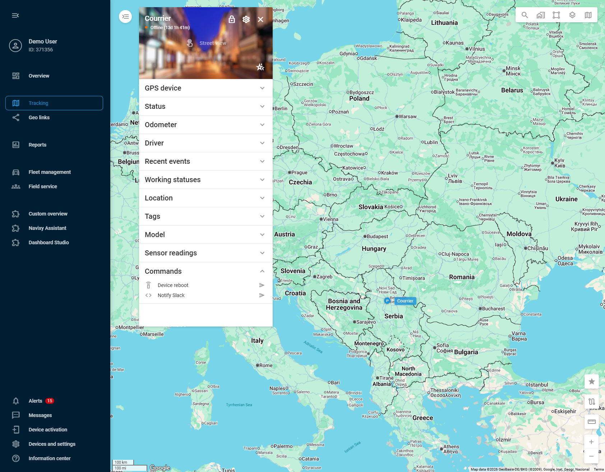
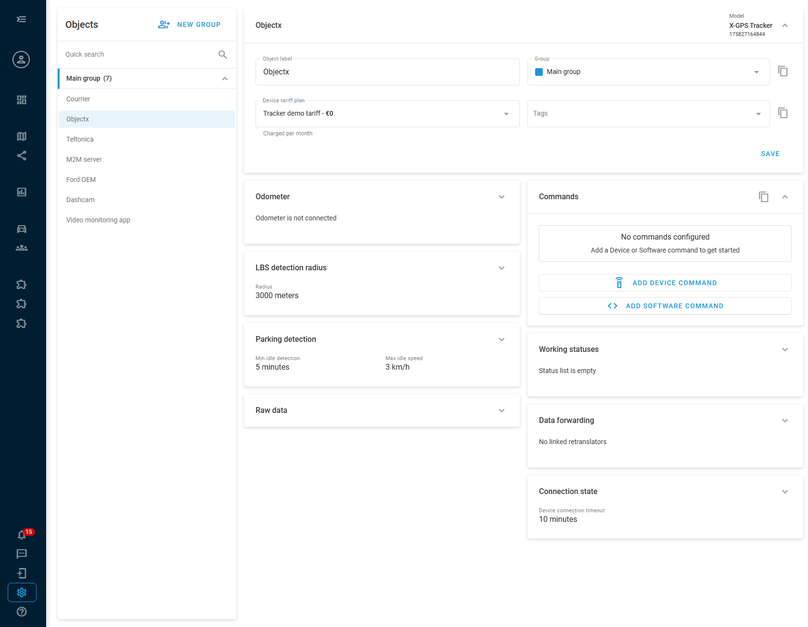
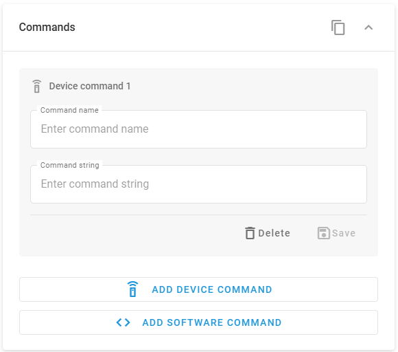
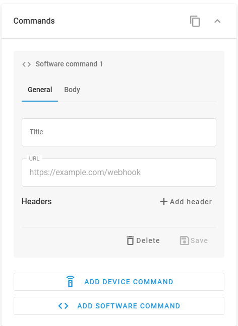
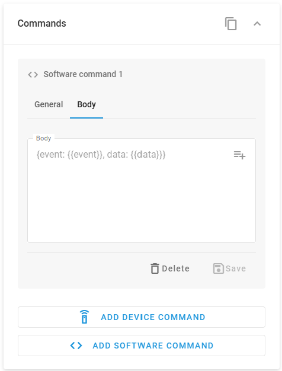

# Commands

A command is an action that you save on a device and then send with one click. For example, you can restart a GPS device that stopped sending data, immobilize a vehicle, or post the vehicle's location to your team chat. You set up commands for each device in the **Devices and settings** module. You then send them from the device's [Object widget](../../tracking/objects-list/object-widget.md) in the Tracking module, or from the [X-GPS Mobile](../../x-gps-mobile-apps/x-gps-mobile/) app.

## What you can do with commands

Here are typical tasks that a saved command does with one click. The second column names the kind of command that does the task. A device command goes to the GPS device. A software command sends a request to another service, such as a team chat. [Device commands and software commands](#device-commands-and-software-commands) describes both.

| Task | Kind of command | What happens |
| --- | --- | --- |
| Restart a device that stopped sending data | Device command | The device receives its restart command and restarts. |
| Immobilize a vehicle | Device command | The device switches on the output that is wired to the vehicle's immobilizer. See [Vehicle immobilization](#vehicle-immobilization). |
| Unlock a door or switch on an alarm | Device command | The device switches the output that controls the lock or the alarm. |
| Change a device setting to a new value each time | Device command | You enter the value when you send the command, and the device applies it. See [Ask for a value each time you send a command](#ask-for-a-value-each-time-you-send-a-command). |
| Post the vehicle's location and speed to a team chat | Software command | Navixy sends the message to the chat. See [Send location and speed to Slack](#send-location-and-speed-to-slack). |
| Send the vehicle's location to your CRM or dispatch system | Software command | Navixy sends the device's current location to the system's address. |

## Device commands and software commands

Navixy has two kinds of commands. They differ in where the action goes:

* **Device command**: Navixy sends an instruction to the GPS device, and the device performs it. The device can restart, switch an output on or off, or change one of its settings. The instruction is a text called a command string. Each device model has its own command strings, which its manufacturer lists in the model's documentation.
* **Software command**: Navixy sends a request to another service, such as a team chat, a CRM, or your own server. Nothing goes to the GPS device. The request can include the device's current data, such as its location and speed.

Each device has its own list of commands. A command appears only on the devices where you add it or [copy it to](#copy-commands-to-other-devices). This also applies to a software command: it sends nothing to the device, but it sends that device's own data, such as its current location. If someone added a software command to one device only, only that device shows it.

## Vehicle immobilization

To immobilize a vehicle with a command, the vehicle needs an immobilizer or an immobilization relay connected to one of the GPS device's outputs. The command switches that output. The command string comes from the device manufacturer's documentation.

What the vehicle does then depends on the immobilizer and on how it is installed, and both differ from one vehicle and device to another. For example, with a common installation, the vehicle keeps moving, but after it stops and the ignition is off, it can't start again. To release the vehicle, you can add a separate command that switches the output back. Decide how to set up immobilization and release for your vehicles, tasks, and situations.


A command that switches an output can be unsafe for a vehicle in some situations, for example while the vehicle is moving. Send such commands with extra caution, and check the vehicle's situation first. Navixy doesn't check the vehicle's speed or ignition before it sends a command. Some GPS devices have their own safety logic, which is described in [Outputs control](https://app.gitbook.com/s/IgDb43gtyXcm1Av4h1np/faq-and-troubleshooting/gps-devices/outputs-control).


## When to use IoT Logic instead

Commands are for manual actions: you decide when to send a command, and you send it for one device at a time. To send commands automatically, for example when a sensor value crosses a limit, or to send the same command to many devices, use [IoT Logic](../../account/iot-logic/). Its **Device action** and **Webhook** nodes do the same jobs as device commands and software commands, inside an automated flow.

Automate commands that switch outputs, such as immobilization, with extra caution. An automated flow sends the command when its conditions are met, and nobody checks the vehicle's situation at that moment.

## Send a command

You send a command from the device's [Object widget](../../tracking/objects-list/object-widget.md) in the Tracking module. Its **Commands** block lists the device's commands. A remote control icon marks a device command, and an angle-brackets icon marks a software command.

Navixy sends a command as soon as you click its send button, with no confirmation. The one exception is a command that [asks for a value](#ask-for-a-value-each-time-you-send-a-command): it opens a field for the value first. Before you send a command that switches an output, such as immobilization, check that it's safe for the vehicle in its current situation. See [Vehicle immobilization](#vehicle-immobilization).

To send a command, follow these steps:

1. In the Tracking module, open the device's Object widget.
2. Expand the **Commands** block.
3. Click the send button next to the command.
4. If the command asks for a value, enter up to 500 characters and click **Send**.

<figure><figcaption><p>Commands in the Object widget</p></figcaption></figure>

<!-- SCREENSHOT: Value input dialog shown when sending a command that contains the <> placeholder, with the value field and the Send button. -->

The X-GPS Mobile app shows the same commands. See [Asset information](../../x-gps-mobile-apps/x-gps-mobile/assets-list/asset-information.md#gps-device) to learn where the app lists them. You can't add or change commands in the app.

## Command results

After you send a command from the Object widget, Navixy shows a notification with the result:

* For a device command, the notification says whether Navixy sent the command. A successful result means that the command left Navixy. It doesn't confirm that the device performed it.
* For a software command, the notification shows the command name and the receiving service's response. The response has a status code, a number that shows whether the service accepted the request, for example `200` when it did. It also has the text that the service returned.

<!-- SCREENSHOT: Notification toast for a device command showing the success/fail result. -->

<!-- SCREENSHOT: Notification toast for a software command showing the command name and the raw HTTP response (status and body). -->

Each sent command also appears in the [Recent events](../../tracking/objects-list/object-widget.md#data-blocks) block of the Object widget. Expand the entry to see the result. If the command asked for a value, the entry title shows the value that you entered next to the command name, for example `Update status <online>`.

<figure><figcaption><p>A sent command in Recent events</p></figcaption></figure>

## Set up commands for a device

To open a device's commands, follow these steps:

1. Go to **Devices and settings** on the sidebar.
2. Select the device.
3. Expand the **Commands** block.

<figure><figcaption><p>The Commands block of a device without commands</p></figcaption></figure>

A device can have up to 10 commands, device commands and software commands together. When a device has 10 commands, **Add device command** and **Add software command** are unavailable. To remove a command, click **Delete** in its form.

### Add a device command

A device command needs the command string for your device model, which you find in the model's documentation.


Command strings are different for each device model. A wrong command string can change the device's settings or its behavior in a way you didn't plan. Check the string in your model's documentation before you save the command.


To add a device command, follow these steps:

1. Click **Add device command**.
2. Enter a **Command name**, for example `Device reboot`.
3. Enter the **Command string**, for example `cpureset`.
4. Click **Save**.

<figure><figcaption><p>A device command</p></figcaption></figure>

### Ask for a value each time you send a command

A command can ask you for a value when you send it, instead of always sending the same text. To make a device command ask for a value, add the `<>` placeholder to the **Command string** where the value goes, for example `relay,<>`. A software command can ask for a value too: see [Add a software command](#add-a-software-command).

A command can have only one `<>` placeholder. If you add a second one, the field shows an error and Navixy doesn't save the command. To read a short summary of the `<>` syntax in the product, click the help icon in the **Commands** block.

<!-- SCREENSHOT: Commands block help icon and the "How command values work" dialog explaining the <> placeholder syntax. -->

### Copy commands to other devices

To give several devices the same commands, set them up on one device and copy them:

1. In the **Commands** block, click the copy icon. Its tooltip is **Apply these settings to other objects**.
2. Select the devices.
3. Click **Apply**.

Navixy adds the device's saved commands to each selected device. The commands that a selected device already has stay as they are.

### Add a software command

A software command connects Navixy to another service, such as a team chat, a CRM, or your own server. It sends an HTTP POST request with a JSON body to an address that you choose. The address can belong to any service that accepts such requests, such as Slack, a webhook receiver, or a REST API. To add a software command, follow these steps:

1. Click **Add software command**.
2. On the **General** tab, enter a **Title** and the **URL** that receives the request.
3. If the receiving service needs HTTP headers, click **Add header** and enter each header's key and value.
4. On the **Body** tab, enter the JSON body in the format that the receiving service expects.
5. Click **Save**.


{% column width="58.333333333333336%" %}
The **URL** is the receiving service's full address, for example `https://hooks.slack.com/services/...`.

For a service that uses token authentication, add the `Authorization` header with the value `Bearer your_token`. A service that takes an API key in the URL needs no header.


{% column width="41.666666666666664%" %}
<figure><figcaption><p>The General tab of a software command</p></figcaption></figure>




{% column width="58.333333333333336%" %}
To add the device's current data to the body, use attribute placeholders in the `{{attribute_name}}` format. Click  next to the field and select an attribute. Navixy inserts its placeholder where the cursor is. When you send the command, Navixy replaces each attribute placeholder with the attribute's current value.


{% column width="41.666666666666664%" %}
<figure><figcaption><p>The Body tab of a software command</p></figcaption></figure>



The attribute list shows only the attributes that the device sends to Navixy, so it differs from one device to another. Select attributes from the list to avoid typing errors in their names.

To make a software command [ask for a value](#ask-for-a-value-each-time-you-send-a-command) when you send it, add the `<>` placeholder to the **Body**, for example `{"value": "<>"}`.

### Send location and speed to Slack

A software command can post the device's location and speed to a Slack channel through a Slack incoming webhook. Slack expects a JSON body with a `text` field. This body sends the device ID, the speed, and the coordinates:


```json
{
  "text": "Device {{device_id}}: speed {{speed}} km/h at {{latitude}}, {{longitude}}"
}
```


To set up the command, follow these steps:

1. In Slack, set up an incoming webhook and copy its URL. The [Slack incoming webhooks guide](https://docs.slack.dev/messaging/sending-messages-using-incoming-webhooks/) describes how.
2. In the device's **Commands** block, click **Add software command**.
3. On the **General** tab, enter `Notify Slack` as the **Title**.
4. In **URL**, paste the webhook URL, for example `https://hooks.slack.com/services/T00000000/B00000000/XXXXXXXXXXXX`.
5. On the **Body** tab, enter the JSON body.
6. Click **Save**.

When you send the command, Navixy replaces the four attribute placeholders with the device's current values. The message appears in the Slack channel that the webhook belongs to.
