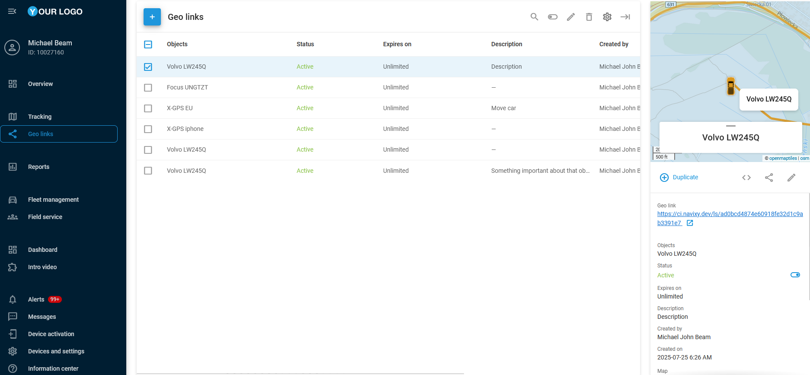

# Geo links

A geo link is a web link that shows the live location of your vehicles or other assets on a map. For example, you can show a customer where their delivery is, or let a partner follow a shipment on its way. The person who opens the link needs no Navixy account and no app: the map opens in a web browser. You can send the link by email, SMS, WhatsApp, Telegram, or any other app, or [embed the map in a website](embedding-geo-links.md).

One link can show several vehicles or assets. For each one, you choose its label and attributes, such as the speed, the address, or sensor readings. For the whole link, you choose the map type, such as Google Maps or OpenStreetMap. The map can also show your [places](../tracking/map-tools/places-pois.md) (points of interest, POI), your [geofences](../tracking/map-tools/geofences.md) (areas that you draw on the map), and the recent route.

You also choose when the link works. By default, a link works as soon as you create it and never expires. You can set it to start later, or give it a limited lifetime, so that it stops working, for example when a delivery is over. You can switch off a link at any time. The people who have it then can't see the location until you switch it on again.


Here is an example of a generated geo link URL: `https://tracking.example/ls/#ecdd8c083d52a396ecdd8c083d52a396`


## Geo links in X-GPS Mobile

You can also create and manage geo links in the X-GPS Mobile app. The app and the web platform show the same list of geo links. See [Geo links in X-GPS Mobile](../x-gps-mobile-apps/x-gps-mobile/geo-links-in-x-gps-mobile.md).

## Section contents

The pages in this section show how to create, update, share, and embed geo links:

* [Creating geo links](creating-geo-links.md)
* [Updating and sharing geo links](updating-and-sharing-geo-links.md)
* [Embedding geo links](embedding-geo-links.md)
